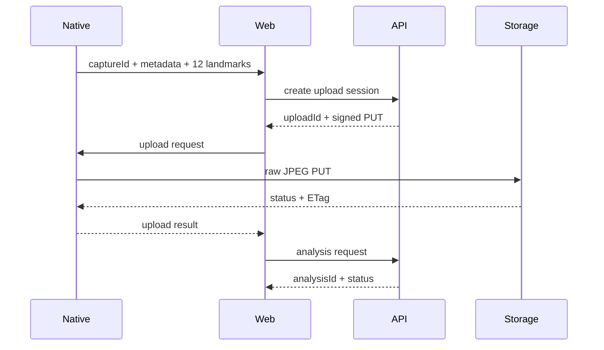

### 문서 목적

Native에서 생성한 JPEG와 고정 순서 landmark를 Web이 upload\-session 및 asynchronous analysis request로 변환하는 contract를 정의한다\. Endpoint와 server response는 OpenAPI 확정 전 proposal이며 현재 runtime은 Mock adapter를 사용한다\.

### 현재 구현 상태

- Native camera result schema와 Web mirror schema 구현
- image metadata와 SHA\-256 생성
- Web request builder 구현
- Native Presigned PUT method 구현
- Mock upload\-session/analysis adapter 구현
- 실제 HTTP adapter, object storage E2E와 result polling은 미구현

현재 ` BodyAnalysisApi.mode === 'mock' `이므로 runtime에서는 native PUT를 생략한다\. ` http ` adapter로 교체되면 동일 orchestration에서 upload 단계가 활성화된다\.

### 1\. Native capture result

```json
{
  "captureId": "capture_<uuid>",
  "image": {
    "contentType": "image/jpeg",
    "sizeBytes": 1432532,
    "checksumSha256": "<base64-sha256>",
    "widthPx": 1536,
    "heightPx": 2048,
    "orientation": "up",
    "mirrored": false
  },
  "previewDataUrl": "data:image/jpeg;base64,<preview>",
  "landmarks": [
    {
      "id": "leftShoulder",
      "x": 0.312341,
      "y": 0.241532,
      "confidence": 0.932151,
      "source": "detected"
    }
  ]
}
```

` captureId `는 Native temporary file registry의 key다\. Server authorization이나 object ownership 판단에 사용하지 않는다\.

### 2\. Upload\-session request

#### Proposal endpoint

```text
POST /api/v1/image-analyses/upload-sessions
Authorization: Bearer <access-token>
Idempotency-Key: <uuid>
```

#### Request

```json
{
  "schemaVersion": 1,
  "clientCaptureId": "capture_<uuid>",
  "file": {
    "contentType": "image/jpeg",
    "sizeBytes": 1432532,
    "checksum": {
      "algorithm": "SHA256",
      "value": "<base64-sha256>"
    },
    "widthPx": 1536,
    "heightPx": 2048,
    "orientation": "up",
    "mirrored": false
  }
}
```

#### Response proposal

```json
{
  "uploadId": "upload_<id>",
  "status": "AWAITING_UPLOAD",
  "upload": {
    "method": "PUT",
    "url": "https://<object-storage>/<signed-path>",
    "expiresAt": "<iso-8601>",
    "headers": {
      "Content-Type": "image/jpeg",
      "x-amz-checksum-sha256": "<base64-sha256>"
    }
  }
}
```

Server가 object key를 생성하고 authenticated principal과 ` uploadId `를 연결해야 한다\.

### 3\. Native binary upload

Web은 signed URL과 headers를 Native에 전달한다\.

```json
{
  "captureId": "capture_<uuid>",
  "uploadId": "upload_<id>",
  "method": "PUT",
  "url": "https://<object-storage>/<signed-path>",
  "headers": {
    "Content-Type": "image/jpeg",
    "x-amz-checksum-sha256": "<base64-sha256>"
  }
}
```

Native는 registry에서 ` captureId ` file을 찾고 raw JPEG를 PUT한다\. Response는 bridge handler가 ` uploadId `를 결합해 Web에 반환한다\.

```json
{
  "captureId": "capture_<uuid>",
  "uploadId": "upload_<id>",
  "statusCode": 200,
  "etag": "<etag>"
}
```

Client의 status와 ETag만으로 object validity를 확정하지 않는다\. Server가 object existence, size, MIME type과 checksum을 다시 검증해야 한다\.

### 4\. Analysis request

#### Proposal endpoint

```text
POST /api/v1/image-analyses
Authorization: Bearer <access-token>
Idempotency-Key: <uuid>
```

#### Request

```json
{
  "schemaVersion": 1,
  "uploadId": "upload_<id>",
  "measurements": {
    "heightMm": 1640,
    "shoulderWidthMm": 385,
    "waistWidthMm": null,
    "hipWidthMm": 420
  },
  "landmarkSet": {
    "version": 1,
    "coordinateSpace": "normalized-upright-image",
    "points": [
      {
        "id": "leftShoulder",
        "x": 0.312341,
        "y": 0.241532,
        "detectorConfidence": 0.932151,
        "source": "detected"
      }
    ]
  }
}
```

Input measurement string은 request builder에서 cm → mm integer로 변환한다\. ` heightMm `은 required이고 나머지 current schema field는 nullable이다\.

### 5\. Landmark contract

정확히 12개이며 배열 순서를 schema에서 검증한다\.

<div class="notion-table-wrap">
<table>
<thead><tr><th scope="col">순서</th><th scope="col">ID</th></tr></thead>
<tbody><tr><td>1</td><td><code>leftShoulder</code></td></tr><tr><td>2</td><td><code>rightShoulder</code></td></tr><tr><td>3</td><td><code>leftElbow</code></td></tr><tr><td>4</td><td><code>rightElbow</code></td></tr><tr><td>5</td><td><code>leftWaist</code></td></tr><tr><td>6</td><td><code>rightWaist</code></td></tr><tr><td>7</td><td><code>leftHip</code></td></tr><tr><td>8</td><td><code>rightHip</code></td></tr><tr><td>9</td><td><code>leftWrist</code></td></tr><tr><td>10</td><td><code>rightWrist</code></td></tr><tr><td>11</td><td><code>leftAnkle</code></td></tr><tr><td>12</td><td><code>rightAnkle</code></td></tr></tbody>
</table>
</div>

` x `, ` y `, ` confidence `는 ` 0..1 ` 범위다\. ` source `는 ` detected `, ` adjusted `, ` derived ` 중 하나다\.

Pixel conversion:

```text
pixelX = round(x × (widthPx - 1))
pixelY = round(y × (heightPx - 1))
```

좌표는 orientation이 ` up `으로 정규화된 최종 JPEG 기준이다\. ` mirrored `가 true이면 좌표도 저장 image와 같은 horizontal orientation을 사용한다\.

### 6\. Analysis response

```json
{
  "analysisId": "analysis_<id>",
  "status": "PROCESSING",
  "createdAt": "<iso-8601>"
}
```

Current client schema는 ` QUEUED `, ` PROCESSING `, ` COMPLETED `를 허용한다\. Client state에는 request orchestration failure를 표현하는 ` FAILED `가 별도로 존재한다\.

### 7\. Server로 전달하지 않는 값

<div class="notion-table-wrap">
<table>
<thead><tr><th scope="col">값</th><th scope="col">이유</th></tr></thead>
<tbody><tr><td><code>previewDataUrl</code></td><td>Web preview 전용 축소 data</td></tr><tr><td><code>file://</code> path</td><td>Native process-local path이며 bridge 외부 노출 불필요</td></tr><tr><td>Original image Base64</td><td>Large JSON request를 피하고 binary PUT 사용</td></tr></tbody>
</table>
</div>

### 8\. Validation

Client:

- ` captureId ` prefix
- JPEG MIME literal
- positive integer size/dimensions
- checksum non\-empty
- exact 12 landmark order
- finite normalized coordinates
- upload response HTTP 2xx

Server proposal:

- authenticated principal과 ` uploadId ` ownership
- object existence, size, MIME, checksum
- duplicate submission
- upload expiration
- measurement range
- exact unique landmark set
- retention and deletion policy

### 9\. 전체 sequence


