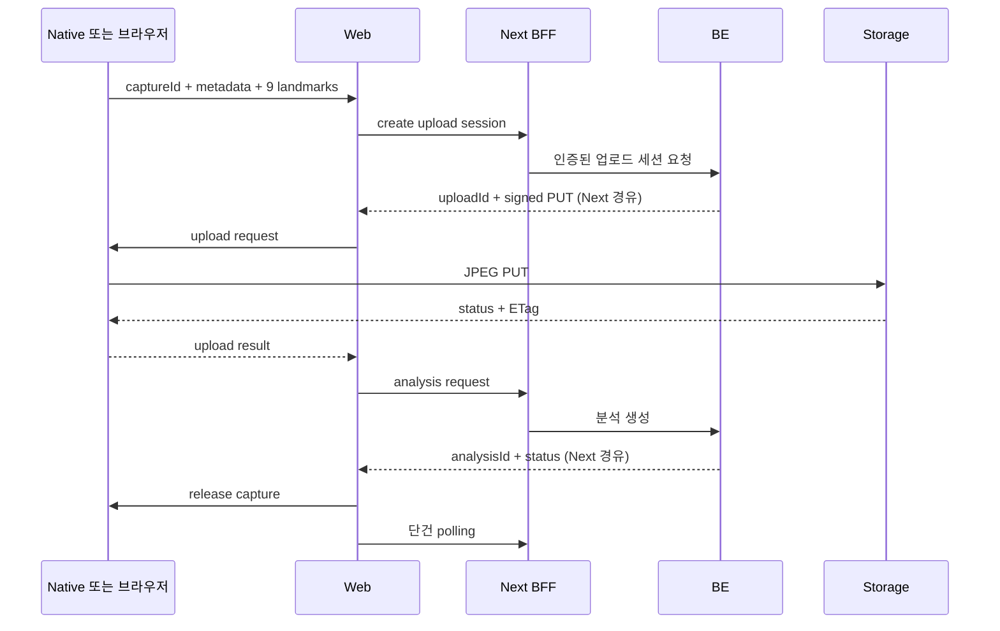

### 문서 목적

Native 또는 브라우저에서 만든 JPEG와 9점 landmark를 실제 업로드 세션·비동기 분석 API로 변환하는 계약을 설명한다\. 과거 image\-analyses proposal과 mock adapter 설명을 현재 source 기준으로 갱신했다\.

### 현재 구현 상태

실제 HTTP 연동과 바이너리 PUT, 분석 생성·목록·단건 polling이 구현되어 있다\. browser → Next 보호 route → BE를 거치며 토큰은 HttpOnly cookie에 둔다\. ` BodyAnalysisApi.mode ` 기반 mock 경로는 현재 코드에 없다\.

정본은 ` packages/shared/src/pose.ts `, ` body-analysis.schema.ts `, ` body-analysis.utils.ts `, Next의 ` api/protected/body-analysis/[[...segments]]/route.ts `다\. BE 내부 구현 자체는 이 FE 저장소만으로 검증하지 않는다\.

### 1\. Native capture result

` poseCameraResultSchema `는 ` capture_ ` 접두 ID, JPEG 메타데이터, 선택 previewDataUrl, 정확한 순서의 9점 배열을 검증한다\.

```typescript
{
  captureId: 'capture_<uuid>',
  image: {
    contentType: 'image/jpeg', sizeBytes: 1432532,
    checksumSha256: '<base64-sha256>', widthPx: 1536, heightPx: 2048,
    orientation: 'up', mirrored: false
  },
  landmarks: [/* 5절의 9점 전체; 각 점은 id, x, y, confidence, source */]
}
```

captureId는 native 파일 또는 브라우저 메모리 조회 키이며 서버 인증 키가 아니다\. 브라우저는 ` capture_web-<uuid> `를 쓴다\.

### 2\. Upload\-session request

브라우저 ` POST /api/protected/body-analysis/uploads ` → BE ` POST /api/v1/body-analysis-uploads `\.

```typescript
{
  schemaVersion: 1,
  clientCaptureId: 'capture_<uuid>',
  file: {
    contentType: 'image/jpeg', sizeBytes: 1432532,
    checksum: { algorithm: 'SHA256', value: '<base64-sha256>' },
    widthPx: 1536, heightPx: 2048, orientation: 'up', mirrored: false
  }
}
```

응답은 비어 있지 않은 uploadId·status와 upload의 method PUT, url, expiresAt, 문자열 headers를 검증한다\. 헤더는 응답 그대로 PUT에 전달한다\. 예전 제안의 ` Idempotency-Key `를 현재 클라이언트가 전송한다고 해석하면 안 된다\.

### 3\. Native binary upload

Web은 signed URL과 headers를 Native에 전달한다\.

```json
{
  "captureId": "capture_<uuid>",
  "uploadId": "upload_<id>",
  "method": "PUT",
  "url": "https://<object-storage>/<signed-path>",
  "headers": {
    "Content-Type": "image/jpeg",
    "x-amz-checksum-sha256": "<base64-sha256>"
  }
}
```

Native는 registry에서 ` captureId ` file을 찾고 raw JPEG를 PUT한다\. Response는 bridge handler가 ` uploadId `를 결합해 Web에 반환한다\.

```json
{
  "captureId": "capture_<uuid>",
  "uploadId": "upload_<id>",
  "statusCode": 200,
  "etag": "<etag>"
}
```

Client의 status와 ETag만으로 object validity를 확정하지 않는다\. Server가 object existence, size, MIME type과 checksum을 다시 검증해야 한다\.

### 4\. Analysis request

브라우저 ` POST /api/protected/body-analysis ` → BE ` POST /api/v1/body-analysis `\.

```typescript
{
  schemaVersion: 1,
  uploadId: '<server-upload-id>',
  measurements: { heightMm: 1640, weightKg: 55.25 },
  landmarkSet: {
    version: 1,
    coordinateSpace: 'normalized-upright-image',
    points: [/* 9점 전체: id, x, y, detectorConfidence, source */]
  }
}
```

키는 cm 문자열을 mm 정수로 바꾸며 500~3000mm다\. 몸무게는 선택값 10~500kg·소수 둘째 자리까지다\. shoulderWidthMm·waistWidthMm·hipWidthMm은 현재 제출 계약에 없다\. initialized 점은 촬영 리뷰 계약에는 있지만 서버 제출에서는 거부한다\.

### 5\. Landmark contract

정확히 9개이며 배열 순서까지 schema에서 검증한다\.

<div class="notion-table-wrap">
<table>
<thead><tr><th scope="col">순서</th><th scope="col">ID</th></tr></thead>
<tbody><tr><td>1</td><td>headTop</td></tr><tr><td>2</td><td>leftShoulder</td></tr><tr><td>3</td><td>rightShoulder</td></tr><tr><td>4</td><td>leftWaist</td></tr><tr><td>5</td><td>rightWaist</td></tr><tr><td>6</td><td>leftHip</td></tr><tr><td>7</td><td>rightHip</td></tr><tr><td>8</td><td>leftAnkle</td></tr><tr><td>9</td><td>rightAnkle</td></tr></tbody>
</table>
</div>

x·y·confidence는 0~1이다\. 좌표는 방향을 up으로 반영한 최종 이미지 기준이다\. 제출 source는 detected/adjusted/derived이며 initialized는 허용하지 않는다\. 감지·파생 비율은 native PoseCameraPolicy와 브라우저 pose\-landmarks\.utils를 대조한다\.

### 6\. Analysis response

분석 생성 응답은 analysisId, status, createdAt을 검증한다\. 서버 상태는 ` running | succeeded | failed `다\. QUEUED·PROCESSING·COMPLETED는 현재 FE 응답 enum이 아니다\.

단건은 startedAt/completedAt, resultSchemaVersion, aiModelVersion, result, failure, personalization, representative를 선택·nullable 값으로 받는다\. result와 personalization은 unknown으로 받은 뒤 화면이 사용하는 필드를 별도로 검증한다\. timezone 없는 서버 시각은 UTC로 정규화한다\.

단건 GET은 running일 때 2초 간격으로 관측 시작부터 3분까지 자동 조회하고, succeeded/failed에서 중단한다\.

### 7\. Server로 전달하지 않는 값

<div class="notion-table-wrap">
<table>
<thead><tr><th scope="col">값</th><th scope="col">이유</th></tr></thead>
<tbody><tr><td><code>previewDataUrl</code></td><td>Web preview 전용 축소 data</td></tr><tr><td><code>file://</code> path</td><td>Native process-local path이며 bridge 외부 노출 불필요</td></tr><tr><td>Original image Base64</td><td>Large JSON request를 피하고 binary PUT 사용</td></tr></tbody>
</table>
</div>

### 8\. Validation

<div class="notion-table-wrap">
<table>
<thead><tr><th scope="col">경계</th><th scope="col">현재 FE 검증</th></tr></thead>
<tbody><tr><td>촬영 결과</td><td>capture_ 접두, JPEG/up, 양수 크기·해상도, 9점 ID·순서·정규화 좌표</td></tr><tr><td>업로드 요청</td><td>최대 15MiB, JPEG/JPG/PNG/WebP/HEIC/HEIF, 44자 base64 SHA-256</td></tr><tr><td>분석 요청</td><td>버전 1, 키 500~3000mm, 선택 몸무게 범위, initialized 금지</td></tr><tr><td>PUT</td><td>method PUT, 응답 2xx, uploadId/captureId 상관관계, 60초 대기 제한</td></tr><tr><td>조회 ID</td><td>1~128자, . 및 .. 거부, 경로 인코딩</td></tr></tbody>
</table>
</div>

최소 해상도·세로 비율·최소 용량 하한은 없다\. FE 자기신고 메타데이터만으로 서버 object 검증이 보장되는 것은 아니다\. 보존·동의·삭제 범위와 실패 object 정리는 별도 정책이다\.

### 9\. 전체 sequence



대표 지정은 POST 보호 route → BE PUT, 삭제는 DELETE, 비로그인 공유는 서버 페이지가 BE 공개 GET을 직접 소비한다\. 자세한 화면·실패 복구 흐름은 체형 분석 비동기 흐름 설계를 본다\.

### 최신 구현과 관련 문서

2026\-11\-11, FE commit ` 645a584 ` 기준으로 코드·계약을 대조했다\. 이번 갱신에서 실기기·저장소 PUT를 재실행하지 않았다\.

[체형 분석 비동기 흐름 설계](<https://app.notion.com/p/4150d0f75cd681878d65e741f18e2b83>)

[WebView 앱의 네이티브 포즈 카메라 설계](<https://app.notion.com/p/4150d0f75cd68154a2f0da3ae8aa9fcd>)

[Next\.js API route를 BFF로 둔 인증 설계](<https://app.notion.com/p/4150d0f75cd68132974dfd5fed689c7d>)
