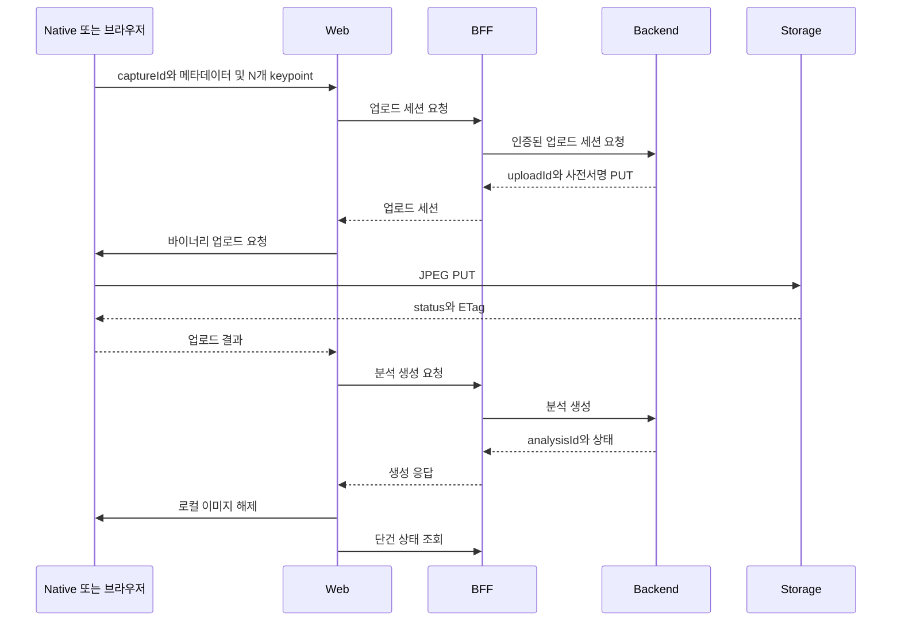

이미지 바이너리, 검출 좌표, 사용자 입력값을 함께 분석하는 API는 파일 전송과 분석 생성을 분리하면 계약을 명확히 할 수 있다\. 이 글에서는 네이티브와 브라우저가 같은 payload를 만드는 방법과 각 경계에서 검증해야 하는 값을 다룬다\.

화면 이동과 재시도 정책은 관련 글로 분리하고, 여기서는 캡처 결과·업로드 세션·분석 요청·응답의 데이터 계약에 집중한다\. 경로와 수치는 설명용 예시이며 실제 허용 범위는 서버와 합의해야 한다\.

### 캡처 결과: 파일 조회 키와 이미지 메타데이터

캡처 결과는 로컬 이미지 조회 키, JPEG 메타데이터, 선택적 미리보기, N개의 keypoint를 포함한다\.

```typescript
const capture = {
  captureId: 'capture-example',
  image: {
    contentType: 'image/jpeg',
    sizeBytes: 1432532,
    checksumSha256: '<base64-sha256>',
    widthPx: 1536,
    heightPx: 2048,
    orientation: 'up',
    mirrored: false,
  },
  points: [
    { id: 'pointA', x: 0.3, y: 0.2, confidence: 0.9, source: 'detected' },
    { id: 'pointB', x: 0.7, y: 0.8, confidence: 0.8, source: 'adjusted' },
  ],
};
```

2개의 점은 배열 형식을 설명하기 위한 가상 예시다\. 실제 계약은 필요한 N개 점의 ID와 순서를 정하고 schema로 검사한다\.

` captureId `는 네이티브 임시 파일이나 브라우저 메모리를 조회하는 키다\. 서버 인증이나 리소스 소유권을 증명하는 값으로 사용하지 않는다\.

### 업로드 세션 요청과 응답

Web은 예시 경로 ` POST /api/analyses/uploads `를 통해 BFF에 업로드 세션을 요청한다\. BFF는 인증 정보를 붙여 서버로 전달한다\.

```typescript
const uploadRequest = {
  schemaVersion: 1,
  clientCaptureId: capture.captureId,
  file: {
    ...capture.image,
    checksum: {
      algorithm: 'SHA256',
      value: capture.image.checksumSha256,
    },
  },
};
```

위 코드는 payload 구성 관계를 보여주는 예시다\. 실제 전송 builder는 서버 schema에 정의한 필드만 선택해야 한다\.

응답에서는 비어 있지 않은 ` uploadId `·상태와 업로드의 ` method: 'PUT' `, URL, ` expiresAt `, 문자열 headers를 검증한다\. 서버가 발급한 headers는 바이너리 PUT에 그대로 전달한다\.

업로드 세션을 분리했다고 해서 제출 멱등성이 생기지는 않는다\. ` Idempotency-Key `를 사용하려면 서버의 지원·유효 범위·재사용 정책까지 계약으로 정해야 한다\.

### 네이티브 바이너리 PUT

Web은 사전서명 URL과 headers를 네이티브에 전달한다\.

```json
{
  "captureId": "capture-example",
  "uploadId": "upload-example",
  "method": "PUT",
  "url": "https://storage.example.com/uploads/example?signature=example",
  "headers": {
    "Content-Type": "image/jpeg",
    "x-amz-checksum-sha256": "<base64-sha256>"
  }
}
```

네이티브는 registry에서 파일을 찾고 raw JPEG를 전송한다\. 브리지 handler는 요청의 ` uploadId `를 결과와 결합해 반환한다\.

```json
{
  "captureId": "capture-example",
  "uploadId": "upload-example",
  "statusCode": 200,
  "etag": "<etag>"
}
```

클라이언트의 2xx와 ETag만으로 저장된 객체의 유효성을 확정하지 않는다\. 서버는 객체 존재 여부, 크기, MIME type, checksum을 다시 검사해야 한다\.

### 분석 요청과 좌표 계약

업로드가 끝나면 ` POST /api/analyses `로 분석을 생성한다\. 요청은 업로드 ID, 입력값, keypoint 집합을 결합한다\.

```typescript
const analysisRequest = {
  schemaVersion: 1,
  uploadId: 'upload-example',
  inputs: { value: 100 },
  keypointSet: {
    version: 1,
    coordinateSpace: 'normalized-upright-image',
    points: capture.points.map(({ confidence, ...point }) => ({
      ...point,
      detectorConfidence: confidence,
    })),
  },
};
```

` inputs.value `와 버전 1은 가상 계약 예시다\. 도메인별 단위·범위·소수 정밀도를 정의하고, 화면 입력값을 전송 단위로 바꾸는 과정을 builder에 모은다\. 클라이언트에서 계산할 수 있는 값이라도 서버 계약에 없는 필드는 추가하지 않는다\.

<div class="notion-table-wrap">
<table>
<thead><tr><th scope="col">항목</th><th scope="col">계약</th></tr></thead>
<tbody><tr><td>점 개수·ID·순서</td><td>N개 전체와 순서를 schema로 검증</td></tr><tr><td>x·y</td><td>최종 이미지 기준 0~1 정규화 좌표</td></tr><tr><td>confidence</td><td>0~1</td></tr><tr><td>이미지 방향</td><td>방향 보정을 적용한 최종 이미지 기준</td></tr><tr><td>source</td><td><code>detected</code>·<code>adjusted</code>·<code>derived</code></td></tr><tr><td>초기화용 점</td><td>리뷰 화면에는 존재할 수 있지만 분석 제출에서는 거부</td></tr></tbody>
</table>
</div>

네이티브와 브라우저가 서로 다른 검출기를 사용하더라도 최종 좌표 공간과 ID 계약은 같아야 한다\. 검출·파생 정책을 비교할 때도 최종 payload를 기준으로 확인한다\.

### 분석 응답

생성 응답은 ` analysisId `, ` status `, ` createdAt `을 검증한다\. 이 예시의 공개 상태는 ` running `, ` succeeded `, ` failed ` 세 가지다\. 서버 내부 대기·처리 enum을 클라이언트가 임의로 추가하지 않는다\.

단건 응답은 시작·완료 시각, 결과 schema 버전, 모델 버전, 결과·실패 정보, 표시용 설명, 대표 여부 등을 계약에 따라 선택·nullable 값으로 받을 수 있다\. 결과와 설명은 ` unknown `으로 받은 뒤 화면이 읽는 필드를 별도로 검증한다\.

서버 시각에 timezone이 없다면 해석 규칙을 계약으로 정한다\. UTC 정규화를 선택했다면 모든 소비 경계에서 일관되게 적용한다\.

상태 조회의 예시는 ` running `일 때 2초 간격, 관측 시작 후 3분 한도다\. 구체적인 중단·수동 재확인은 별도의 polling 설계에서 다룬다\.

### 서버로 전달하지 않는 데이터

<div class="notion-table-wrap">
<table>
<thead><tr><th scope="col">값</th><th scope="col">이유</th></tr></thead>
<tbody><tr><td>previewDataUrl</td><td>화면 미리보기용 축소 데이터</td></tr><tr><td>네이티브 파일 경로</td><td>프로세스 내부 경로이며 서버가 사용할 수 없음</td></tr><tr><td>원본 이미지 Base64</td><td>큰 JSON 대신 바이너리 PUT 사용</td></tr></tbody>
</table>
</div>

로컬 파일 경로와 사전서명 URL, 이미지·민감한 입력값이 로그나 화면 주소에 남지 않게 한다\.

### 경계별 검증

<div class="notion-table-wrap">
<table>
<thead><tr><th scope="col">경계</th><th scope="col">확인할 사항</th></tr></thead>
<tbody><tr><td>캡처 결과</td><td>조회 키 형식, JPEG·방향, 양수 크기·해상도, N개 점의 ID·순서·좌표</td></tr><tr><td>업로드 요청</td><td>허용 형식, 최대 크기, base64 SHA-256</td></tr><tr><td>분석 요청</td><td>지원 버전, 입력 범위·정밀도, 초기화용 점 거부</td></tr><tr><td>PUT 응답</td><td>2xx, uploadId·captureId 상관관계, 대기 제한</td></tr><tr><td>조회 ID</td><td>길이, <code>.</code>·<code>..</code> 거부, 경로 인코딩</td></tr></tbody>
</table>
</div>

예시로 최대 15MiB, SHA\-256 base64 44자, 브리지 대기 60초, 조회 ID 1~128자를 사용할 수 있다\. 수치 자체보다 모든 경계가 같은 계약을 쓰는지가 중요하다\.

최소 해상도·비율·용량은 필요성이 확정된 경우 서버의 실제 이미지 검사와 함께 도입한다\. 보존·동의·삭제 범위와 실패 객체 정리도 별도 정책으로 정의한다\.

### 전체 요청 순서



### 정리

- 파일 조회 키와 인증·소유권을 구분한다\.
- 바이너리와 분석 JSON을 분리하고 업로드 ID로 연결한다\.
- 좌표 공간·점 순서·입력 단위·버전을 공통 계약으로 검증한다\.
- 업로드 성공 응답과 서버의 객체 검증을 구분한다\.
- 화면 흐름·재시도·보존 정책은 payload 계약과 함께 확인한다\.

### 관련 글

- 이미지 업로드 세션과 비동기 분석 polling 설계
- 네이티브 이미지 업로드와 Web 오케스트레이션
- 모바일 이미지 업로드 클라이언트 구현 체크리스트
- 사전서명 업로드 URL과 객체 저장소 공개 주소 설계
