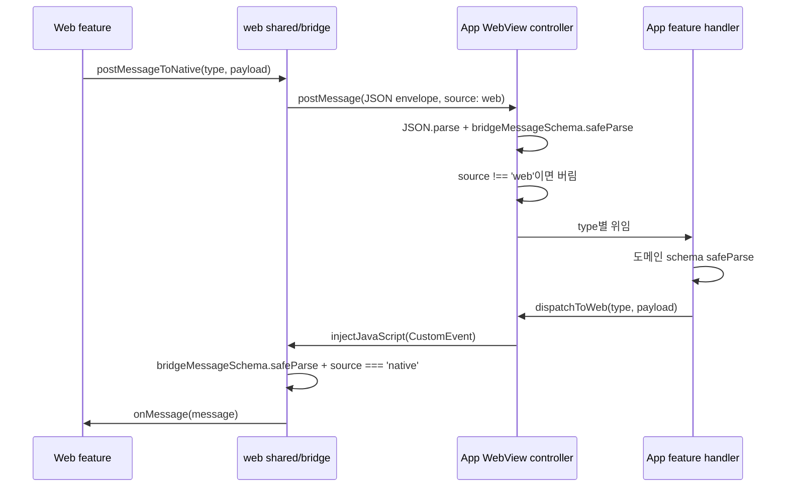

> 표기: 프로젝트 고유 접두사는 ` {prefix} `, 패키지 scope는 ` @scope `로 바꿔 적었다\.

### 문서 목적

React Native WebView shell과 Next\.js 콘텐츠 사이의 브리지 계약을 어떻게 정의하고 검증하는지 정리한다\. 메시지 envelope, 계약 패키지의 소유 방식, App의 단일 라우팅 지점, Web의 전송·구독 primitive, 운영 메시지\(` WEB_READY `·` WEB_STACK_STATE `·` NATIVE_BACK_PRESS `\), 외부 URL 정책, WebView 설정, 구버전 App을 감지하는 ack 패턴을 다룬다\.

아키텍처 전략 글에서 브리지 수신 순서를 짧게 다뤘다\. 이 글은 그 순서가 실제 코드에서 어디에 어떻게 구현됐는지, 그리고 저장소 harness가 무엇을 강제하는지를 더 깊게 기록한다\.

### 1\. 전체 구조

브리지는 양방향이지만 전송 수단이 다르다\. web → native는 ` window.ReactNativeWebView.postMessage(JSON 문자열) `로 App ` onMessage `에 닿고, native → web은 ` injectJavaScript `가 발행하는 ` {prefix}:native-message ` CustomEvent로 Web 구독부에 닿는다\.



### 2\. Envelope

모든 메시지는 같은 envelope로 감싼다\. 정의는 ` packages/shared/src/bridge.ts ` 하나뿐이다\.

```typescript
export const BRIDGE_EVENT_NAME = '{prefix}:native-message';
export const NATIVE_BACK_PRESS = 'native:back-press';

export const bridgeMessageSchema = z.object({
  type: z.string(),
  payload: z.unknown().optional(),
  source: z.enum(['native', 'web']),
  timestamp: z.string(),
});
```

envelope schema는 ` payload `를 ` unknown `으로 둔다\. envelope 단계에서는 &quot;브리지 메시지 모양인가&quot;만 확인하고, payload의 의미 검증은 type을 아는 도메인 handler가 다시 한다\. 그래서 수신 경계마다 ` safeParse `가 두 번 일어난다\.

` source `는 메시지를 보낸 런타임이다\. 양쪽 수신부는 상대 런타임에서 온 메시지만 받는다\. App은 ` source !== 'web' `, Web은 ` source !== 'native' `이면 버린다\.

### 3\. 계약 패키지 ` packages/shared `

#### 단일 소유자

브리지 token 문자열과 payload Zod schema는 ` packages/shared `만 소유한다\. App과 Web은 같은 schema를 import해 각자 수신 경계에서 검증한다\. 같은 문자열을 두 workspace에 따로 적지 않는다\.

도메인별 파일을 subpath export로 연다\.

```json
"exports": {
  ".": "./src/index.ts",
  "./bridge": "./src/bridge.ts",
  "./auth": "./src/auth.ts",
  "./safe-area": "./src/safe-area.ts",
  "./webview": "./src/webview.ts"
  // cutout, location, pose 동일
}
```

소비 쪽은 ` @scope/shared/safe-area `처럼 필요한 도메인만 import한다\. 패키지는 빌드 산출물 없이 TypeScript 원본을 그대로 export하고, 런타임 의존성은 ` zod ` 하나다\.

#### README가 계약 인덱스

` packages/shared/README.md `는 모든 token × payload schema × 발신 위치 × 처리 위치를 표로 가진다\. 도메인 동작 설명은 각 feature README가 갖고, 이 README는 인덱스 역할만 한다\. 계약 기준은 항상 코드이며, token을 추가·변경하는 변경은 이 표를 함께 고친다\.

#### harness가 강제하는 것

문서와 코드가 어긋나지 않도록 ` scripts/check-repository-harness.mjs `가 두 가지를 검사한다\.

` findContractIndexErrors `는 ` packages/shared/src/*.ts `\(index 제외\)에서 ` export const UPPER_CASE = '문자열' ` 형태의 token을 모두 뽑고, README에 백틱으로 감싼 같은 이름이 없으면 실패한다\. 새 token을 만들고 인덱스를 빠뜨리면 검사가 잡는다\.

```javascript
const stringTokens = [...source.matchAll(
  /export const ([A-Z][A-Z0-9_]*)\s*=\s*['"][^'"]+['"]/g
)].map((match) => match[1]);

if (!contractIndex.includes(`\`${token}\``)) {
  errors.push(`packages/shared/README.md must index bridge token ${token}`);
}
```

` findTrustBoundaryErrors `는 ` TRUST_BOUNDARY_CONTRACTS ` 목록의 파일마다 정해진 검증 호출 문자열\(marker\)이 소스에 있는지 확인한다\. 파일이 없거나 marker가 빠지면 실패한다\.

<div class="notion-table-wrap">
<table>
<thead><tr><th scope="col">파일</th><th scope="col">marker</th></tr></thead>
<tbody><tr><td><code>app/src/features/webview/lib/bridge.ts</code></td><td><code>bridgeMessageSchema.safeParse</code></td></tr><tr><td><code>app/src/features/webview/hooks/use-webview-controller.ts</code></td><td><code>stackStatePayloadSchema.safeParse</code>, <code>webReadyPayloadSchema.safeParse</code></td></tr><tr><td><code>app/src/features/cutout-test/api/cutout.request.ts</code></td><td><code>cutoutRequestSchema.safeParse</code></td></tr><tr><td><code>app/src/features/cutout-test/api/inpaint.request.ts</code></td><td><code>inpaintRequestSchema.safeParse</code>, <code>inpaintModelRequestSchema.safeParse</code></td></tr><tr><td><code>app/src/features/cutout-test/api/media.request.ts</code></td><td><code>cutoutMediaRequestSchema.safeParse</code></td></tr><tr><td><code>web/src/shared/bridge/lib/post-message.ts</code></td><td><code>bridgeMessageSchema.safeParse</code></td></tr></tbody>
</table>
</div>

목록에는 브리지 외의 신뢰 경계\(App의 저장값 복원, Web API route body, Web 세션 복원\)도 함께 들어 있다\. 문자열 포함 여부만 보는 단순한 검사지만, 리팩토링 중에 검증 호출이 통째로 빠지는 회귀는 막는다\.

### 4\. App: 단일 라우팅 지점

#### Envelope 파싱

` app/src/features/webview/lib/bridge.ts `가 envelope 생성과 파싱을 맡는다\. ` parseWebBridgeMessage `는 ` JSON.parse ` 후 ` bridgeMessageSchema.safeParse `를 하고, 깨진 JSON과 envelope 불일치는 모두 ` null `로 바꿔 조용히 버린다\.

#### Dispatch script

native → web 메시지는 envelope 객체를 ` JSON.stringify `로 직렬화해 JavaScript 객체 리터럴로 script에 넣는다\. type과 payload는 문자열 연결로 script에 섞이지 않고 직렬화된 envelope 안에만 존재한다\. 이벤트 이름은 계약 상수다\.

```typescript
export function createNativeToWebDispatchScript(type: string, payload?: unknown) {
  const message = createBridgeEnvelope(type, payload); // source: 'native'
  return `
    (function () {
      window.dispatchEvent(
        new CustomEvent("${BRIDGE_EVENT_NAME}", { detail: ${JSON.stringify(message)} })
      );
    })();
    true;
  `;
}
```

controller는 이 script를 ` webViewRef.current?.injectJavaScript(...) `로 실행하는 ` dispatchToWeb `을 만들어 각 feature handler에 넘긴다\.

#### Controller

` app/src/features/webview/hooks/use-webview-controller.ts `의 ` handleMessage `가 모든 web → native 메시지의 유일한 진입점이다\. feature는 WebView 이벤트를 직접 구독하지 않는다\.

```typescript
const message = parseWebBridgeMessage(event);
if (!message || message.source !== 'web') return;

if (message.type === REQUEST_CUTOUT) {
  await handleCutoutRequest(message.payload, dispatchToWeb);
  return;
}
// ... type별 분기
```

<div class="notion-table-wrap">
<table>
<thead><tr><th scope="col">처리 위치</th><th scope="col">token</th></tr></thead>
<tbody><tr><td>controller 안에서 직접</td><td><code>WEB_READY</code>, <code>WEB_STACK_STATE</code>, <code>WEB_PAGE_BACKGROUND</code>, <code>REQUEST_SAFE_AREA</code>, auth 요청 3종</td></tr><tr><td>feature handler로 위임</td><td>cutout·inpaint·media 요청, pose camera, location</td></tr></tbody>
</table>
</div>

위임받은 handler는 ` payload: unknown `을 받아 자기 도메인 schema로 다시 ` safeParse `하고, 실패하면 아무것도 하지 않는다\(예: ` cutoutRequestSchema.safeParse(payload) `\)\.

controller가 직접 처리하는 token도 같은 규칙을 따른다\. ` WEB_READY `는 ` webReadyPayloadSchema `\(` pathname `이 ` / `로 시작\), ` WEB_STACK_STATE `는 ` stackStatePayloadSchema `\(` canGoBack: boolean `\), ` WEB_PAGE_BACKGROUND `는 ` #RRGGBB ` 정규식을 통과해야 상태를 바꾼다\.

### 5\. Web: 전송·구독 primitive

Web 쪽 범용 브리지는 ` web/src/shared/bridge/** `에 있다\. ` lib/post-message.ts `가 전송·구독 primitive를, ` components/native-bridge-sync.tsx `가 ` WEB_READY ` 발신과 배경색 동기화를, ` lib/page-background.ts `가 화면 맨 위 배경색 판정을 맡는다\.

` postMessageToNative `는 ` window.ReactNativeWebView `가 없으면 ` false `를 반환한다\. 일반 브라우저에서 호출해도 예외 없이 끝나고, 호출부는 반환값으로 &quot;App 안이 아님&quot;을 알 수 있다\.

#### ` message ` 이벤트를 열지 않는다

` subscribeNativeMessages `는 ` {prefix}:native-message ` CustomEvent만 구독한다\.

```typescript
// native→web은 injectJavaScript가 발행하는 CustomEvent(BRIDGE_EVENT_NAME)로만 전달됩니다.
// window 'message' 리스너는 origin 검증 없이 외부(iframe/opener)가 native 메시지를
// 위조할 수 있는 공격 표면이라 열지 않습니다.
const handleCustomMessage = (event: Event) => {
  const parsed = toBridgeMessage((event as CustomEvent<unknown>).detail);
  if (!parsed || parsed.source !== 'native') return;
  onMessage(parsed);
};
window.addEventListener(BRIDGE_EVENT_NAME, handleCustomMessage);
```

초기에는 ` window `의 ` message ` 리스너도 함께 열려 있었다\. 리뷰에서 origin 검증이 없는 이 리스너로 외부 페이지가 back\-press나 auth 같은 native 메시지를 위조할 수 있다는 점이 지적됐고, 리스너를 제거했다\. CustomEvent ` detail `은 객체와 JSON 문자열을 모두 받되, 어느 쪽이든 ` bridgeMessageSchema `를 통과해야 한다\.

구독 primitive의 동작은 integration 테스트가 고정한다\. envelope 통과 메시지 전달, ` source `가 ` native `가 아니면 폐기, schema 불일치 폐기, 깨진 JSON 폐기, unsubscribe 후 미수신, ` ReactNativeWebView ` 부재 시 ` false ` 반환을 확인한다\.

### 6\. 운영 메시지

#### WEB\_READY

` NativeBridgeSync `가 마운트될 때 현재 ` pathname `과 함께 한 번 보낸다\. App은 이를 &quot;새 문서가 떴다&quot;는 신호로 쓴다\.

```typescript
if (message.type === WEB_READY) {
  const payloadResult = webReadyPayloadSchema.safeParse(message.payload);
  if (!payloadResult.success) return;
  hasStackStateRef.current = false;  // 이전 문서의 stack 상태 초기화
  canGoBackRef.current = false;
  dispatchAuthLoginResult();         // 로그인 결과 재전송
  sendSafeArea(true);                // safe area 강제 재전송
  return;
}
```

WebView 리로드나 렌더 프로세스 종료 후 재마운트에서도 새 문서가 ` WEB_READY `를 보내므로 같은 복구 경로를 탄다\. Web은 이미 세션이 있으면 재전송된 로그인 결과를 무시한다\.

#### WEB\_STACK\_STATE

StackFlow runtime adapter가 stack이 바뀔 때 ` { canGoBack } `을 보낸다\. App은 이 값을 한 번이라도 받으면 ` onNavigationStateChange `로 들어오는 WebView 자체의 ` canGoBack `을 더 이상 쓰지 않는다\. 그 전까지만 fallback으로 쓴다\.

#### NATIVE\_BACK\_PRESS

Android hardware back은 ` window.history.back() `을 주입하지 않고 ` native:back-press ` 이벤트로 Web에 위임한다\.

```typescript
if (isPoseCameraVisible) { /* overlay를 닫고 POSE_CAMERA_CANCELLED 전송 */ }
if (!canGoBackRef.current) return false;  // 앱 기본 동작(종료)에 맡김
// history.back() 주입은 웹의 네비게이션 락을 우회하므로,
// 웹이 버튼 pop과 동일한 경로(락 검사 포함)로 처리하도록 이벤트로 위임합니다.
dispatchToWeb(NATIVE_BACK_PRESS);
return true;
```

주입 방식은 Web의 navigation lock을 거치지 않아 전환 중 연타에서 이중 pop을 만들었다\. 이벤트로 바꾼 뒤 Web은 StackFlow runtime adapter의 ` subscribeBackPress `로 받아 버튼 pop과 같은 경로로 처리한다\. 시트·다이얼로그가 열렸거나 작성 중인 화면은 ` StackScreen `의 ` preventSwipeBack `을 켜 pop을 막고, 공용 hook ` useNativeBackGuard `로 같은 이벤트를 받아 시트 닫기나 이탈 확인을 대신 처리한다\. 하단 빠른 실행 메뉴도 열린 동안 이 이벤트를 구독해 화면 pop 대신 메뉴만 닫는다\.

### 7\. 외부 URL 정책

외부 링크 열기는 브리지 메시지가 아니라 WebView의 navigation 가로채기가 처리한다\. 예전에 있던 외부 URL 열기 브리지 token은 쓰이지 않아 제거했고, 가로채기 경로만 남겼다\.

```typescript
const handleShouldStartLoad = (navigation: WebViewNavigation) => {
  if (navigation.url === 'about:blank') return true;

  const url = parseUrl(navigation.url);
  if (!url) return false;
  if (url.origin === webAppOrigin) return true;

  openExternalUrl(url.href).catch(() => undefined);
  return false;
};
```

1. ` about:blank `만 예외로 허용한다\.
1. URL로 파싱되지 않으면 로드를 막는다\.
1. Web 앱과 같은 origin이면 WebView 안에서 로드한다\.
1. 그 밖의 문서 로드는 막고, 외부 앱으로 열기를 시도한다\.

` app/src/features/webview/lib/open-external-url.ts `는 protocol 화이트리스트를 가진다\.

```typescript
const SAFE_EXTERNAL_PROTOCOLS = new Set(['https:', 'http:', 'mailto:', 'tel:']);

export async function openExternalUrl(value: string) {
  const url = parseUrl(value.trim());
  if (!url || !SAFE_EXTERNAL_PROTOCOLS.has(url.protocol)) return;
  if (await Linking.canOpenURL(url.href)) await Linking.openURL(url.href);
}
```

테스트는 ` javascript: `, ` file: `, ` intent: ` 차단, 앞뒤 공백 제거, ` canOpenURL `이 ` false `일 때 미실행을 확인한다\.

### 8\. WebView 설정

` app/src/features/webview/components/webview-screen.tsx `의 설정 중 경계와 관련된 항목이다\.

<div class="notion-table-wrap">
<table>
<thead><tr><th scope="col">설정</th><th scope="col">값</th><th scope="col">의미</th></tr></thead>
<tbody><tr><td><code>originWhitelist</code></td><td><code>https://*</code>, <code>http://*</code></td><td>이 외 scheme은 WebView가 로드하지 않음</td></tr><tr><td><code>setSupportMultipleWindows</code></td><td><code>false</code></td><td>새 창 열기 미지원</td></tr><tr><td><code>scalesPageToFit</code>, <code>setBuiltInZoomControls</code></td><td><code>false</code></td><td>Android 내장 줌 비활성화</td></tr><tr><td><code>sharedCookiesEnabled</code></td><td><code>true</code></td><td>iOS cookie store와 cookie 공유</td></tr><tr><td><code>webviewDebuggingEnabled</code></td><td><code>__DEV__</code></td><td>개발 빌드에서만 디버깅 허용</td></tr><tr><td><code>applicationNameForUserAgent</code></td><td>앱 이름/버전</td><td>Web이 user agent로 앱 버전을 읽음</td></tr></tbody>
</table>
</div>

줌은 App 설정만으로 끝내지 않았다\. Web viewport를 ` maximumScale: 1 `, ` userScalable: false `로 두고, ` html, body `에 ` touch-action: pan-x pan-y `를 걸어 더블 탭과 핀치 확대를 함께 막는다\.

iOS cookie 공유는 HttpOnly persistent 인증 cookie를 iOS cookie store와 공유해, WebView를 닫았다 다시 들어와도 세션 기반 인증이 복원되게 하려고 켰다\.

초기 문서 로드가 hostname·네트워크 문제로 실패하면\(` onError `\) WebView 위에 재시도 화면을 띄운다\. 렌더 프로세스가 죽으면\(iOS ` onContentProcessDidTerminate `, Android ` onRenderProcessGone `\) ` key `를 올려 WebView를 새로 마운트하고, 1분에 3번을 넘으면 재시도 화면에서 멈춘다\. 재시도 버튼은 reload가 아니라 새 마운트로 시작 URL부터 다시 연다\. 죽은 인스턴스는 reload가 듣지 않기 때문이다\.

### 9\. Auth capabilities 브리지

로그인 버튼 노출은 Web이 플랫폼을 추측하지 않고 App에 묻는다\. Web의 ` useNativeAuthCapabilities `가 ` REQUEST_AUTH_CAPABILITIES `를 보내고, App은 ` AUTH_CAPABILITIES `로 답한다\.

App은 ` Platform.OS === 'ios' `이고 native module ` AppCapabilities `가 ` appleSignIn: true `를 알릴 때만 ` { appleSignIn: true } `로 답한다\.

Web은 응답을 ` nativeAuthCapabilitiesSchema `로 검증한 뒤 쓴다\. 응답이 오기 전 기본값은 ` appleSignIn: !window.ReactNativeWebView `다\. 즉 일반 브라우저에서는 Apple 로그인을 보이고, App 안에서는 App이 가능하다고 답할 때만 보인다\.

### 10\. 구버전 App 감지: ack 패턴

브리지 요청은 App에 handler가 없으면 조용히 버려진다\. 누끼 기능을 추가했을 때 이 문제가 드러났다\. handler가 없는 구버전 App에 요청하면 Web의 busy overlay가 전체 timeout\(최대 4~5분\) 동안 화면을 잠갔다\.

그래서 수신 확인\(ack\)을 분리했다\. App은 ` REQUEST_CUTOUT `·` REQUEST_CUTOUT_MEDIA `·` REQUEST_INPAINT `·` REQUEST_INPAINT_MODEL `을 schema로 검증한 직후 ` CUTOUT_ACK `를 보낸다\. Web은 요청 공통 대기 함수 하나\(` native-request.request.ts `\)에서 두 개의 timer를 건다\.

```typescript
const ACK_TIMEOUT_MS = 3_000;

const ackTimer = setTimeout(
  () => fail('앱이 요청을 받지 못했습니다. 앱을 최신 버전으로 업데이트해 주세요.'),
  ACK_TIMEOUT_MS
);
const timer = setTimeout(() => fail(request.timeoutMessage), request.timeoutMs);

subscribeNativeMessages((message) => {
  if (message.type === CUTOUT_ACK) {
    if (cutoutAckSchema.safeParse(message.payload).data?.requestId === requestId) clearTimeout(ackTimer);
    return;
  }
  // 결과는 schema 통과 + requestId 일치일 때만 resolve
});
if (!postMessageToNative(request.type, request.payload)) fail(request.unavailableMessage);
```

<div class="notion-table-wrap">
<table>
<thead><tr><th scope="col">상황</th><th scope="col">결과</th></tr></thead>
<tbody><tr><td>App 밖(브라우저)</td><td>전송 실패로 즉시 reject</td></tr><tr><td>handler 없는 구버전 App</td><td>3초 뒤 업데이트 안내로 reject</td></tr><tr><td>ack 후 처리 지연</td><td>요청별 전체 timeout으로 reject</td></tr><tr><td>정상</td><td>requestId가 같은 결과로 resolve</td></tr></tbody>
</table>
</div>

결과와 ack 모두 요청마다 UUID ` requestId `로 매칭하므로, 동시에 여러 요청이 오가도 다른 요청의 응답을 잘못 받지 않는다\.

### 개발 서버 가짜 native와 실제 브리지의 구분

` shared/bridge/lib/fake-native.ts `는 개발 서버에서 ` ?fakeNative=1|fail|cancel `로 활성화하고 ` ?fakeNative=0 `으로 해제한다\. 모드는 localStorage에 남는다\. 실제 WebView 안에서는 설치하지 않으며 호출부의 ` NODE_ENV ` 분기로 운영 번들에서 제외한다\.

가짜 응답도 도메인 Zod schema를 통과시킨 뒤 동일 CustomEvent로 보내므로 Web 소비부의 성공·실패·취소 경로를 확인할 수 있다\. Google은 실제 idToken을 받아 서버 인증에 사용하지만, 위치·safe area·기타 가짜 응답은 네이티브 SDK와 권한 검증을 대체하지 않는다\. 포즈 촬영은 흉내 내지 않고 브라우저의 실제 사진 선택·검출·조정 경로를 사용한다\.

CBT 기기 정보에는 ` REQUEST_AUTH_DEVICE `·` AUTH_DEVICE `가 추가되었다\. App 밖 브라우저와 가짜 native의 기기 코드 정책은 다르다\. 일반 브라우저는 요청마다 새 코드를 만들고 가짜 native는 저장된 가짜 기기 코드를 재사용한다\.

### 현재 제약

- envelope의 ` source `는 보낸 쪽이 스스로 적는 값이다\. 상대 런타임 구분용이며 인증 수단은 아니다\. 실제 방어는 ` message ` 리스너 제거와 navigation origin 제한에 기댄다\.
- ` timestamp `는 envelope에 있지만 수신 쪽에서 검증·사용하지 않는다\.
- harness의 trust boundary 검사는 marker 문자열 포함 여부만 본다\. 검증 결과를 실제로 쓰는지까지는 확인하지 않는다\.
- 계약 인덱스 검사는 문자열 상수 token만 잡는다\. 숫자 상수나 schema 이름 누락은 잡지 않는다\.
- ack 패턴은 누끼·앨범·지우개 요청에만 적용했다\. 다른 도메인 요청에는 수신 확인 단계가 없다\.

### 참고

- 관련 글: 프론트엔드 아키텍처 전략, StackFlow 기반 WebView 내비게이션 설계, 커스텀 Swipe\-back 구현 배경과 설계, Safe Area와 바운스 배경색 동기화

### 구현 근거와 검토 범위

2026\-11\-11, FE commit ` 645a584 ` 기준으로 코드·설정과 관련 변경 이력을 대조했다\. 근거: ` packages/shared/README.md `, ` web/src/shared/bridge/lib/fake-native.ts `\. 문서에 인용한 이전 검증 기록과 이번 검토를 구분하며, 이번 작업에서 앱·브라우저 런타임 테스트를 재실행하지 않았다\.

### 관련 구현 문서

[Next\.js API route를 BFF로 둔 인증 설계](<https://app.notion.com/p/4150d0f75cd68132974dfd5fed689c7d>)

[WebView 앱의 네이티브 포즈 카메라 설계](<https://app.notion.com/p/4150d0f75cd68154a2f0da3ae8aa9fcd>)
