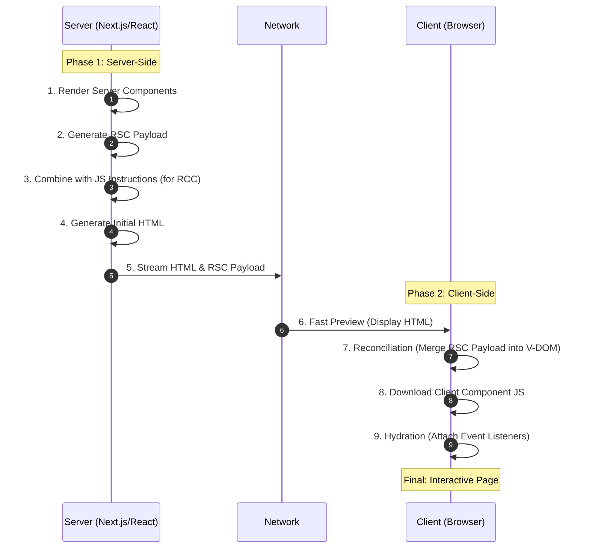

### 1\. 리액트 컴포넌트 및 렌더링의 본질

#### 1\.1 컴포넌트의 정의

- <strong>함수적 구조:</strong> 데이터\(Props\)를 입력받아 JSX\(JavaScript XML\)를 반환하는 자바스크립트 함수임\.
- <strong>데이터 관리:</strong> 내부 동적 데이터는 ` state `로 관리하며, 상태 변경 시 컴포넌트 재호출이 발생함\.
- <strong>현대적 분류:</strong> 실행 환경에 따라 서버 컴포넌트\(RSC\)와 클라이언트 컴포넌트\(RCC\)로 구분됨\.

#### 1\.2 렌더링 파이프라인

1. <strong>Transpiling \(Babel\):</strong> 브라우저가 해석할 수 없는 JSX 문법을 표준 자바스크립트 객체로 변환함\. <strong>Babel</strong>은 이 과정을 수행하는 트랜스파일러임\.
1. <strong>React Element 생성:</strong> 트랜스파일링 결과로 UI의 구조를 기술하는 자바스크립트 객체가 생성됨\.
1. <strong>Fiber Tree 확장:</strong> 리액트 엔진은 각 엘리먼트를 <strong>Fiber</strong> 노드로 확장함\. Fiber는 작업 우선순위 제어 및 비동기 처리가 가능한 가상 돔의 최소 작업 단위임\.
1. <strong>Virtual DOM 반영:</strong> 가상 돔\(Virtual DOM\)에서 변경 사항을 계산한 후, 최종적으로 실제 DOM에 패치\(Patch\)함\.
   - <strong>Virtual DOM의 가치:</strong> 실제 DOM 조작은 비용이 높으므로, 가상의 메모리 트리에서 차이점\(Diffing\)을 먼저 계산하여 브라우저의 연산 부하를 최소화함\.

> 💡
> 
> #### Virtual DOM &amp; Fiber: 왜 직접 DOM을 조작하지 않는가?
> 
> <strong>배경:</strong> 실제 브라우저의 DOM 노드는 수천 개의 속성을 가진 거대 객체임\. 작은 변화에도 브라우저가 전체 레이아웃을 다시 계산하는 &\#39;Reflow&\#39;와 &\#39;Repaint&\#39; 과정을 거치며, 이는 성능 저하의 주범이 됨\.
> 
> <strong>필요성:</strong> \* <strong>효율성:</strong> 메모리 상의 가벼운 복사본\(Virtual DOM\)에서 계산을 마친 후, 꼭 필요한 변화만 실제 DOM에 일괄 적용\(Batching\)하여 연산 횟수를 줄임\.
> 
> - <strong>동시성\(Concurrency\):</strong> Fiber 아키텍처는 렌더링 작업을 잘게 쪼개어 브라우저의 메인 스레드가 멈추지 않게 함\. 즉, 렌더링 도중에도 사용자 입력을 처리할 수 있는 반응성을 보장함\.

---

### 2\. 서버 컴포넌트와 Next\.js의 조율\(Orchestration\)

#### 2\.1 Next\.js: 오케스트레이터\(Orchestrator\)

Next\.js는 리액트 API를 활용하여 서버와 클라이언트 간의 렌더링 흐름을 지휘함\. 렌더링 시점과 코드 배치를 최적화하여 성능을 극대화함\.

#### 2\.2 렌더링 작업 단위

- <strong>Route Segment:</strong> 파일 시스템 기반 라우팅의 각 경로 조각을 의미함\. Next\.js는 이 세그먼트 단위로 코드를 분할하여 관리함\.
- <strong>Suspense Boundary:</strong> 비동기 작업의 완료를 기다리는 경계선임\. 이 경계를 기준으로 렌더링 작업을 청크\(Chunk\) 단위로 분리하여 점진적 전송이 가능하게 함\.

> 💡
> 
> #### Orchestration: Next\.js는 왜 지휘자가 되었는가?
> 
> <strong>배경:</strong> 클라이언트 사이드 렌더링\(CSR\)은 모든 JS 파일을 다운로드해야 화면이 보이기 때문에 초기 로딩 속도\(FCP\)가 느리고 SEO에 취약함\.
> 
> <strong>필요성:</strong> \* <strong>성능 최적화:</strong> 서버에서 미리 HTML을 만들고\(SSR\), 정적인 부분은 서버에서 끝냄으로써 클라이언트로 전송되는 JS 파일 크기를 획기적으로 줄임\.
> 
> - <strong>사용자 경험:</strong> 화면의 각 부분을 독립적으로 렌더링\(Streaming\)하여 데이터 로딩이 끝난 부분부터 순차적으로 보여주기 위해 정교한 조율\(Orchestration\)이 필수적임\.

---

### 3\. RSC 페이로드\(Payload\)의 구조와 역할

#### 3\.1 RSC 페이로드 정의

서버에서 렌더링된 결과물을 클라이언트로 전송하기 위한 직렬화된\(Serialized\) 데이터 포맷임\.

#### 3\.2 주요 구성 요소

1. <strong>서버 컴포넌트 결과물:</strong> 서버에서 실행 완료된 UI 트리 구조\.
1. <strong>Placeholder:</strong> 클라이언트 컴포넌트가 삽입될 위치 정보\.
1. <strong>자바스크립트 참조\(Reference\):</strong> 클라이언트 컴포넌트 실행을 위해 필요한 JS 파일의 경로\.
1. <strong>전달 Props:</strong> 서버에서 클라이언트로 넘겨주는 직렬화된 데이터 집합\.

> 💡
> 
> #### RSC Payload: 왜 JSON이 아닌 특수 포맷인가?
> 
> <strong>배경:</strong> 기존 JSON 방식은 컴포넌트 트리 구조나 리액트 엘리먼트의 특수성\(참조 정보 등\)을 온전히 담아내기 어려움\.
> 
> <strong>필요성:</strong> \* <strong>직렬화\(Serialization\):</strong> 클라이언트 컴포넌트와 서버 컴포넌트가 뒤섞인 복잡한 트리 구조를 문자열 형태의 바이너리로 변환하여 네트워크 전송을 최적화함\.
> 
> - <strong>스트리밍 호환:</strong> 전체 파일이 다운로드되기 전에도 데이터를 읽어 가상 돔을 점진적으로 구성할 수 있도록 설계됨\.

---

### 4\. 단계별 렌더링 프로세스 \(서버 및 클라이언트\)

#### 4\.1 서버 사이드\(Server\-Side\) 프로세스

1. <strong>RSC 페이로드 생성:</strong> 리액트가 서버 컴포넌트를 실행하여 RSC 페이로드를 도출함\.
1. <strong>초기 HTML 렌더링:</strong> Next\.js가 RSC 페이로드와 <strong>클라이언트 컴포넌트 자바스크립트 인스트럭션\(JS Instruction\)</strong>을 조합하여 정적 HTML을 생성함\.
   - <strong>JS Instruction:</strong> 클라이언트 컴포넌트의 초기 상태 및 실행 로직을 담은 명령어 뭉치임\.

#### 4\.2 클라이언트 사이드\(Client\-Side\) 프로세스

1. <strong>Preview\(미리보기\):</strong> 생성된 HTML을 브라우저가 즉시 렌더링함\. 사용자는 상호작용은 불가능하지만 화면은 즉시 인지 가능함\.
1. <strong>Reconciliation\(재조정\):</strong> 브라우저가 RSC 페이로드를 분석하여 가상 돔 트리를 재구성함\. 이때 HTML 내의 빈자리\(Placeholder\)에 클라이언트 컴포넌트 트리를 병합함\.
1. <strong>Hydration\(하이드레이션\):</strong>
   - 다운로드된 자바스크립트 로직과 이벤트 핸들러를 정적 HTML에 결합함\.
   - ` JS Instruction `에 따라 버튼 클릭, 상태 변경 등의 인터랙티브 기능이 활성화됨\.

> 💡
> 
> #### Hydration: 왜 &\#39;수분 공급&\#39;이라고 부르는가?
> 
> <strong>배경:</strong> 서버에서 받은 HTML은 단순한 &\#39;메마른&\#39; 문서에 불과함\. 버튼은 보이지만 눌러도 아무런 동작을 하지 않음\.
> 
> <strong>필요성:</strong> \* <strong>상호작용 주입:</strong> 미리 그려진 HTML 뼈대 위에 자바스크립트라는 &\#39;수분\(이벤트 핸들러, 로직\)&\#39;을 공급하여 생동감을 부여함\.
> 
> - <strong>이질감 해소:</strong> 사용자가 이미 보고 있는 화면과 리액트의 메모리 내 상태를 일치시켜, 화면 깜빡임 없이 매끄럽게 기능을 활성화하기 위함임\.

> 💡
> 
> #### JS Instruction: 명령어가 왜 뭉쳐있어야 하는가?
> 
> <strong>배경:</strong> 하이드레이션 과정에서 클라이언트 컴포넌트가 어떻게 초기화되어야 하는지에 대한 가이드가 없으면 서버와 클라이언트의 결과가 달라지는 &\#39;Hydration Mismatch&\#39;가 발생함\.
> 
> <strong>필요성:</strong> \* <strong>일관성 유지:</strong> 서버에서 결정된 초기 ` props `와 ` state ` 값을 명령어 형태로 전달함으로써, 클라이언트에서도 서버와 동일한 상태로 컴포넌트가 시작되도록 강제함\.
