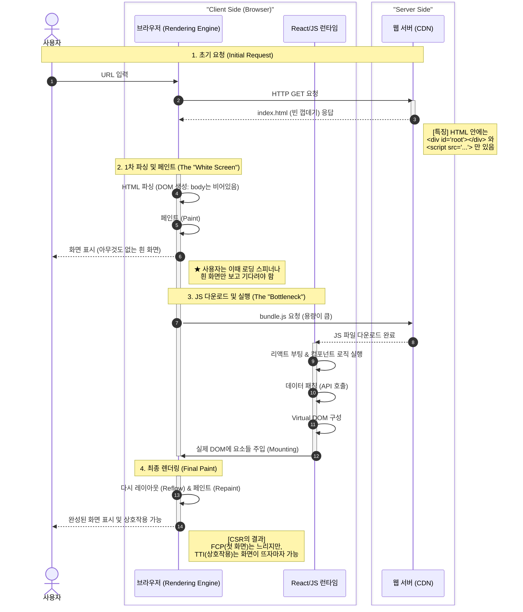
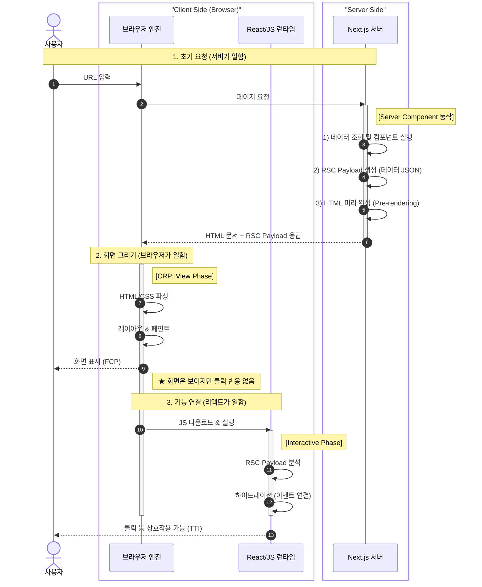
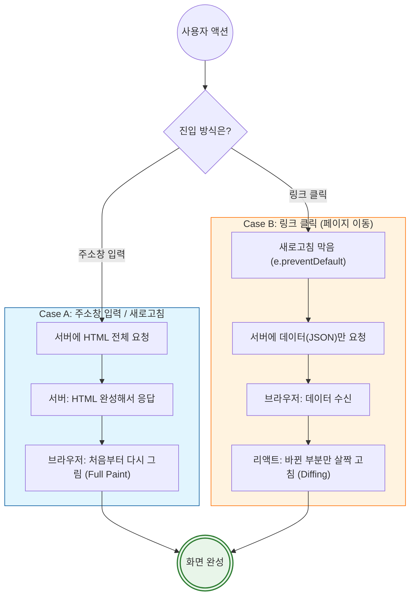

> **💡 핵심 요약**

1. **브라우저:** URL 입력 후 화면이 그려지는 과정 \(CRP\) 이해\.
1. **Next\.js:** 서버에서 미리 그리는 방식 \(SSR\)과 그 이후의 동작 \(Hydration\) 이해\.
1. **목적:** &quot;주소창에 URL을 입력하면 무슨 일이 일어나는가?&quot;에 대한 완벽한 답변 준비\.

---

### 1\. 개요 \(Overview\)

웹 성능 최적화의 핵심은 \*\*&quot;브라우저가 화면을 그리는 과정을 얼마나 줄이느냐&quot;\*\*에 달렸다\. 이를 이해하려면 브라우저가 HTML을 픽셀로 바꾸는 과정과, 리액트/Next\.js가 그 사이에 어떻게 개입하는지 알아야 한다\.

---

### 2\. 브라우저가 화면을 그리는 과정 \(기본 원리\)

Next\.js 사용 여부와 관계없이 브라우저는 반드시 아래 5단계\(CRP\)를 거쳐 화면을 그린다\.

1. **파싱 \(Parsing\):**
   - **HTML → DOM 트리:** 뼈대 구축\.
   - **CSS → CSSOM 트리:** 스타일 정보 분석\.
1. **스타일 \(Style\):**
   - **렌더 트리:** 실제 화면에 보일 요소만 추출함\. \(` display: none ` 제거\)
1. **레이아웃 \(Layout / Reflow\):**
   - 각 요소가 화면의 **어디에**, **어떤 크기**로 배치될지 계산함\. \(px 단위 변환\)
1. **페인트 \(Paint\):**
   - 계산된 위치에 픽셀\(색상, 텍스트\)을 채워 넣음\.
1. **합성 \(Composite\):**
   - 여러 레이어를 합쳐 최종 화면 생성\.

> **⚠️ 성능 포인트**

- **Reflow \(비쌈\):** 레이아웃\(크기, 위치\) 변경 시 전체 재계산 발생\. 성능 저하의 주범임\.
- **Repaint \(쌈\):** 색상만 변경 시 레이아웃 계산을 건너뛰므로 비교적 가벼움\.

---

### 3\. 렌더링 방식 비교 \(CSR vs SSR\)

#### 3\.1\. CSR \(Client Side Rendering\)

- **방식:** 서버는 빈 껍데기\(` div#root `\)만 제공함\. 브라우저가 JS를 다운로드 및 실행한 뒤 화면을 조립함\.
- **단점:** JS 다운로드 전까지 **흰 화면\(White Screen\)** 지속됨\. SEO에 불리함\.

#### 3\.2\. SSR \(Server Side Rendering \- Next\.js\)

- **방식:** 서버가 미리 완성된 HTML을 생성해서 전달함\.
- **장점:** 화면이 즉시 보임\(FCP 빠름\)\. SEO 최적화 유리\.
- **단점:** 화면은 보이나 JS 연결 전까지 클릭 등 상호작용 불가\. \(Hydration 대기\)

---

### 4\. Next\.js의 하이브리드 메커니즘 \(핵심\)

Next\.js는 **&quot;초기 로딩은 SSR로 빠르게, 페이지 이동은 CSR로 부드럽게&quot;** 처리하는 전략을 사용함\.

#### 4\.1\. 첫 접속 시 \(Initial Load\)

사용자가 주소창에 URL을 입력했을 때의 과정임\. \(SSR \+ Hydration\)

#### 4\.2\. 페이지 이동 시 \(Routing\)

Link 태그 클릭 시, 전체 새로고침 없이 부드럽게 이동하는 원리임\.

---

### 5\. 용어 정리 \(Cheatsheet\)

<table>
<tbody><tr><td>용어</td><td>설명</td><td>비유</td></tr><tr><td><strong>DOM</strong></td><td>HTML 태그를 브라우저가 이해하는 트리 형태.</td><td>집 설계도.</td></tr><tr><td><strong>Reflow</strong></td><td>레이아웃(크기, 위치)을 다시 계산하는 과정.</td><td>인테리어 대공사 (비쌈).</td></tr><tr><td><strong>Hydration</strong></td><td>정적인 HTML에 자바스크립트 기능을 붙이는 과정.</td><td>마네킹에 생명 불어넣기.</td></tr><tr><td><strong>RSC Payload</strong></td><td>서버에서 보내주는 데이터 조각 (JSON 포맷).</td><td>가구 조립 부품.</td></tr><tr><td><strong><code>use client</code></strong></td><td>브라우저에서 실행될 컴포넌트임을 명시.</td><td>&quot;여기는 사용자가 조작함&quot;.</td></tr></tbody>
</table>

---

### 6\. 결론

1. **기본:** 브라우저는 HTML을 받아 파싱하고 그린다\. \(DOM → Layout → Paint\)
1. **Next\.js:** 브라우저 렌더링 부하를 줄이기 위해 **서버에서 미리 HTML을 완성**해서 보냄\. \(초기 속도 향상\)
1. **하이드레이션:** 미리 그려진 화면에 JS가 후속으로 붙어 **기능\(이벤트\)을 활성화**함\.
1. **페이지 이동:** 초기 진입만 HTML을 받고, 이후 이동은 **데이터\(JSON\)만 받아서** CSR처럼 부드럽게 처리함\.

> **🚀 Best Practice**

- 가능한 \*\*Server Component\(` page.tsx `\)\*\*를 기본으로 사용하여 데이터 처리를 서버에 위임한다\.
- ` useState `, ` onClick ` 등 상호작용이 필수인 말단 컴포넌트에만 \*\*` use client `\*를 붙여 JS 번들 사이즈를 줄인다\.
