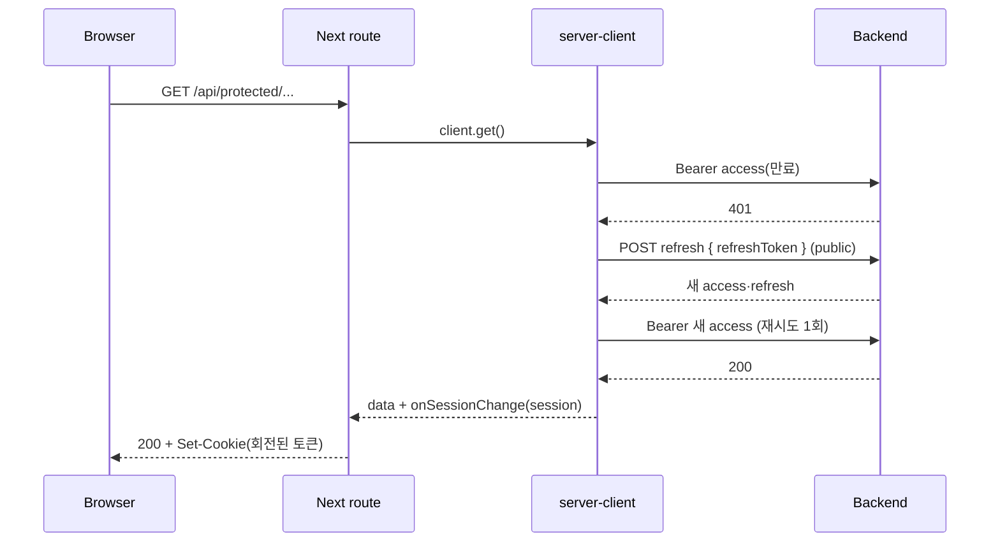
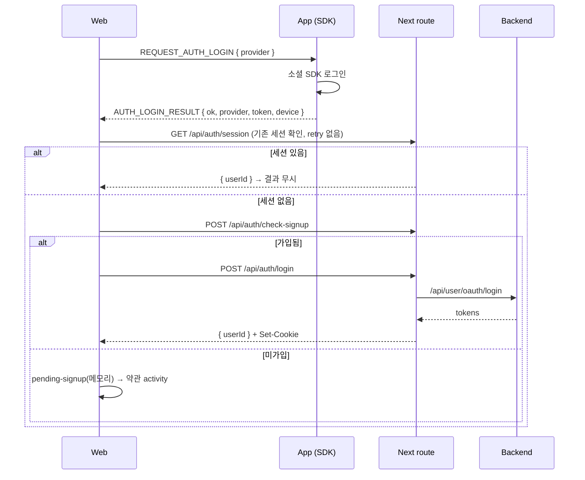

> 표기: 프로젝트 고유 접두사는 ` {prefix} `, 패키지 scope는 ` @scope `로 바꿔 적었다\.

### 문서 목적

WebView 안에서 동작하는 Next\.js Web이 로그인 토큰을 어떻게 다루는지 정리한다\. 브라우저에서 토큰을 걷어내고 Next API route를 BFF\(Backend for Frontend\)로 둔 이유, HttpOnly cookie와 서버 세션 bootstrap, 보호 API의 refresh·재시도, middleware guard, 세션 만료 정규화, 로그아웃, 네이티브 소셜 로그인과의 연결을 다룬다\. 운영하면서 발견하고 고친 결함도 함께 기록한다\.

### 1\. 토큰을 브라우저에서 걷어낸 이유

초기 구현은 로그인 결과를 browser storage\(localStorage\)에 세션으로 저장했다\. 이 구조에서는 같은 출처에서 실행되는 스크립트가 토큰을 읽을 수 있고, logout·refresh 요청 body도 브라우저가 조립해야 했다\.

그래서 다음 원칙으로 바꿨다\.

- 로그인·refresh로 받은 access·refresh token은 HttpOnly persistent cookie에만 저장한다\.
- 브라우저가 소유하는 세션은 공개 값 ` { userId } `로 한정한다\. 비밀이 없다\.
- logout·refresh의 백엔드 request body는 브라우저 입력이 아니라 서버가 refresh cookie로 조립한다\.
- 이전 버전이 남긴 localStorage 세션 값은 인증 bootstrap 시 지운다\.
- 최초 가입 대기 중인 provider token은 JS 런타임 메모리에만 둔다\. 새로고침되면 가입 절차를 다시 시작한다\.

이 전환과 함께, 게스트 진입 경로가 없는 백엔드 계약에 맞춰 &quot;로그인 없이 들어가기&quot; 버튼도 제거했다\.

### 2\. 전체 구조

```text
[Browser (WebView)]
  ├─ apiClient (baseUrl '', credentials: include)  ── 토큰 없음
  └─ TanStack Query: ['auth','session'] = { userId }
          │  same-origin
          ▼
[Next.js]
  ├─ middleware.ts            cookie 유무 1차 guard
  ├─ /api/auth/[action]       check-signup·login·signup·logout (public client)
  ├─ /api/auth/session        세션 bootstrap (protected client)
  ├─ /api/protected/*         보호 API (protected route client)
  └─ /api/notices, /api/terms, /api/faqs   공개 API (public client)
          │  Authorization: Bearer <access>
          ▼
[Backend API]
```

<div class="notion-table-wrap">
<table>
<thead><tr><th scope="col">파일</th><th scope="col">책임</th></tr></thead>
<tbody><tr><td><code>shared/api/auth-cookie.ts</code></td><td>cookie 이름, 옵션, 수명, 설정·삭제</td></tr><tr><td><code>shared/api/server-client.ts</code></td><td>public/protected 서버 client, Bearer, 401 refresh·재시도, single-flight</td></tr><tr><td><code>shared/api/protected-route.ts</code></td><td>보호 route용 client와 응답 생성, 회전 cookie 기록</td></tr><tr><td><code>app/api/auth/[action]/route.ts</code></td><td>인증 action proxy</td></tr><tr><td><code>app/api/auth/session/route.ts</code></td><td>서버 세션 bootstrap</td></tr><tr><td><code>middleware.ts</code></td><td>보호 API·보호 화면 guard</td></tr><tr><td><code>shared/api/client.ts</code></td><td>브라우저 client, 최종 401 이벤트 발행</td></tr></tbody>
</table>
</div>

### 3\. Cookie 정책

```typescript
const COOKIE_OPTIONS = {
  httpOnly: true,
  sameSite: 'lax',
  secure: process.env.NODE_ENV === 'production',
  path: '/',
};

// BE 세션 계약(access 12시간, refresh 30일)에 맞춰 persistent cookie로 발급한다.
const ACCESS_TOKEN_MAX_AGE_SECONDS = 12 * 60 * 60;
const REFRESH_TOKEN_MAX_AGE_SECONDS = 30 * 24 * 60 * 60;
```

세션 cookie가 아니라 ` maxAge `가 있는 persistent cookie로 발급한 이유는 WebView가 종료돼도 refresh cookie가 남아야 하기 때문이다\. 다시 열면 refresh cookie로 서버 세션을 복원한다\. iOS에서는 App의 WebView에 ` sharedCookiesEnabled `를 켜 persistent auth cookie를 OS cookie store와 공유하게 했다\.

cookie 이름은 ` {prefix}-access-token `, ` {prefix}-refresh-token ` 두 개다\. 백엔드 세션 만료 시각은 timezone 없는 문자열로 내려와, cookie 만료를 그 시각에 정확히 맞추지 않고 계약상 수명을 고정값으로 쓴다\.

### 4\. 인증 proxy route

` POST /api/auth/{check-signup|login|logout|signup|invitation-login} ` dynamic route가 public client를 사용한다\. ` invitation-login `만 백엔드 ` /api/v1/invitations/login `으로 보내고 나머지는 ` /api/user/oauth/{action} `으로 보낸다\.

1. action이 허용 목록에 있는지 확인한다\. 없으면 404다\.
1. logout이 아니면 요청 body를 action별 Zod schema로 검증한다\. 실패하면 400이다\.
1. 백엔드 응답을 action별 schema로 검증한다\.
1. 응답에 토큰이 있으면 cookie에 쓰고, 브라우저에는 ` { userId } `만 돌려준다\.

```typescript
const response = NextResponse.json(
  isAuthTokenPayload(data) ? { userId: data.userId } : data,
);
if (isAuthTokenPayload(data)) setAuthCookies(response, data);
```

action 판별은 처음에 ` in ` 연산자를 썼다\. ` in `은 프로토타입 체인까지 통과시켜 ` /api/auth/constructor ` 같은 요청이 schema 조회 단계에서 500이 됐다\. ` Object.hasOwn `으로 바꿔 404로 거른다\.

#### CBT 초대 코드 로그인

현재 비로그인 홈은 소셜 버튼 대신 ` InvitationSection `을 그린다\. ` POST /api/auth/invitation-login `은 ` { code, device } `를 검증해 BE ` POST /api/v1/invitations/login `으로 전달한다\. ` /validate `는 호출하지 않으며 이미 claim된 코드도 ` /login ` 응답으로 판정한다\. 발급 토큰은 기존과 같은 HttpOnly cookie에 저장하고 공개 ` { userId } `만 반환한다\. 신규·기존 사용자 모두 바로 홈으로 이동하며 약관 화면을 거치지 않는다\.

기기 정보는 ` REQUEST_AUTH_DEVICE ` → ` AUTH_DEVICE `로 받으며, 5초 무응답이면 App 업데이트 안내를 표시한다\. App 밖 브라우저는 요청마다 새 ` DV_web-<uuid> `를 만든다\. 초대 코드 오류는 403\(코드 확인\)·429\(잠시 후\)·기타로만 나누며 원문 코드는 로그에 남기지 않는다\.

소셜 로그인·약관 로직과 ` NativeAuthSync `는 CBT 이후 복귀용으로 유지한다\. 개발 서버의 ` ?fakeNative=1 `일 때만 소셜 진입을 함께 표시한다\. Google은 Google Identity Services에서 실제 idToken을 받고 승인된 JavaScript origin 등록이 필요하다\. 운영 빌드는 해당 개발 진입을 제외한다\.

### 5\. 서버 세션 bootstrap

브라우저는 ` GET /api/auth/session `으로 로그인 여부를 확인한다\. route는 protected client로 백엔드 ` GET /api/user `를 부르고, 공개 값 ` { userId } `만 돌려준다\. access token이 만료됐으면 client가 refresh cookie로 갱신하고 회전된 cookie를 응답에 싣는다\.

브라우저 쪽은 이 응답을 TanStack Query의 ` ['auth', 'session'] ` 키로 소유한다\.

```typescript
// 세션 만료(401)는 재시도해도 결과가 같다. 일시적 네트워크·5xx는 1회 재시도한다.
export function shouldRetryAuthSession(failureCount: number, error: unknown) {
  const statusCode = (error as FetchError | undefined)?.statusCode;
  return statusCode !== 401 && failureCount < 1;
}
```

일시 오류에서 바로 로그인 화면을 그리면 로그인된 사용자가 로그아웃된 것처럼 보이기 때문에 1회 재시도를 둔다\.

### 6\. Public client와 protected client

<div class="notion-table-wrap">
<table>
<thead><tr><th scope="col">client</th><th scope="col">용도</th><th scope="col">인증 헤더</th></tr></thead>
<tbody><tr><td><code>createPublicServerApiClient</code></td><td>로그인·가입·로그아웃, refresh, 공지·약관·FAQ</td><td>없음</td></tr><tr><td><code>createServerApiClient</code></td><td>보호 API, 세션 bootstrap</td><td><code>Authorization: Bearer &lt;access&gt;</code></td></tr></tbody>
</table>
</div>

백엔드에는 브라우저의 raw ` Cookie ` 헤더를 넘기지 않고 Bearer access token만 전달한다\. 인증 요청과 공개 API에는 토큰을 싣지 않는다\.

공지·약관·FAQ는 세션이 없을 때도 호출된다\. 예를 들어 가입 약관 화면은 로그인 전에 약관 목록을 읽는다\. 그래서 이 route들은 ` /api/protected ` 밖\(` /api/notices `, ` /api/terms `, ` /api/faqs `\)에 두고 public client를 쓴다\. middleware matcher에도 들어가지 않는다\.

### 7\. 401 → refresh → 1회 재시도

protected client의 요청 흐름이다\.

```typescript
} catch (error) {
  const statusCode = getStatusCode(error);
  // 403은 세션 만료가 아니라 리소스 권한 거부다.
  if (statusCode !== 401 || hasRetried || params.endpoint === REFRESH_ENDPOINT) {
    throw error;
  }

  const refreshToken = refreshedSession?.refreshToken ?? cookieRefreshToken;
  if (!refreshToken) {
    options.onSessionChange?.(null);
    throw createSessionExpiredError();
  }

  try {
    refreshedSession = await refreshSession(refreshToken);
    options.onSessionChange?.(refreshedSession);
    return request(method, params, true);
  } catch (refreshError) {
    if (!isRefreshRejected(getStatusCode(refreshError))) throw refreshError;
    options.onSessionChange?.(null);
    throw createSessionExpiredError();
  }
}
```

- 401일 때만 refresh한다\. 재시도는 한 번뿐이고, refresh 요청 자체의 401은 다시 refresh하지 않는다\.
- refresh token이 없으면 바로 ` SESSION_EXPIRED `다\.
- GET뿐 아니라 POST·PATCH·DELETE도 같은 메서드로 재시도한다\.



### 8\. 회전형 refresh token과 single\-flight

백엔드 refresh token은 사용할 때마다 새 토큰으로 회전한다\. 한 화면이 보호 API 여러 개를 동시에 부르면, 같은 access token이 동시에 만료돼 같은 refresh token으로 refresh가 여러 번 나간다\. 두 번째 요청부터는 이미 회전된 옛 토큰을 쓰는 셈이 된다\.

그래서 refresh를 refresh token별로 하나의 promise에 합친다\.

```typescript
const refreshRequests = new Map<string, Promise<AuthSessionTokens>>();
const REFRESH_RESULT_GRACE_MS = 5_000;

async function refreshSession(refreshToken: string) {
  const pending = refreshRequests.get(refreshToken);
  if (pending) return pending;
  // ... public client로 refresh 요청을 만들고 Map에 등록
  // 성공하면 5초 동안 결과를 남겨 늦게 도착한 같은 cookie 요청도 재사용하게 한다.
  // 실패하면 즉시 Map에서 지운다.
}
```

성공 결과를 바로 지우지 않고 5초 동안 남기는 이유는, 첫 refresh 직후 회전 전 cookie를 들고 늦게 도착한 요청도 같은 결과를 받게 하기 위해서다\. 이 동작은 &quot;동시에 만료된 보호 요청은 하나의 refresh 결과를 공유한다&quot;, &quot;첫 refresh 직후 늦게 도착한 동일 cookie 요청도 회전 결과를 재사용한다&quot; 통합 테스트로 고정했다\.

single\-flight Map은 서버 인스턴스 메모리에 있다\. 같은 인스턴스 안의 동시 요청만 합친다\.

### 9\. 회전된 cookie를 응답에 싣기

refresh 결과는 ` onSessionChange ` 콜백으로 route에 전달되고, route가 응답에 cookie를 쓴다\. 보호 route는 이 처리를 ` createProtectedRouteClient `로 공통화했다\.

```typescript
const response = (data: unknown, init?: ResponseInit) => {
  const nextResponse = NextResponse.json(data, init);
  if (sessionChanged && refreshedSession) setAuthCookies(nextResponse, refreshedSession);
  else if (sessionChanged) clearAuthCookies(nextResponse);
  return nextResponse;
};
```

성공 응답이든 오류 응답이든 같은 ` response() `를 거친다\. 오류 응답에서도 회전된 cookie가 기록돼야 하기 때문이다\(10절 결함 1\)\.

보호 route의 형태는 거의 같다\.

```typescript
export async function GET() {
  const routeClient = createProtectedRouteClient();
  try {
    const data = await routeClient.client.get({ endpoint: USER_ENDPOINT.me, responseSchema });
    return routeClient.response(data);
  } catch (error) {
    return routeClient.error(error); // statusCode가 없으면 502
  }
}
```

회원 탈퇴처럼 백엔드가 모든 세션을 끝내는 요청은 성공 뒤 ` client.clearSession() `을 불러 cookie도 함께 지운다\.

### 10\. 세션 만료 정규화

refresh 실패를 두 종류로 나눈다\.

```typescript
/** refresh 실패 중 토큰 거부(4xx)인지. 5xx·네트워크와 408·429는 일시 오류다. */
export function isRefreshRejected(statusCode: number | undefined) {
  return statusCode != null && statusCode >= 400 && statusCode < 500
    && statusCode !== 408 && statusCode !== 429;
}
```

<div class="notion-table-wrap">
<table>
<thead><tr><th scope="col">상황</th><th scope="col">서버 처리</th><th scope="col">브라우저 결과</th></tr></thead>
<tbody><tr><td>요청 401 → refresh 4xx 거부</td><td>cookie 삭제</td><td><code>401 SESSION_EXPIRED</code></td></tr><tr><td>refresh token 없음</td><td>cookie 삭제</td><td><code>401 SESSION_EXPIRED</code></td></tr><tr><td>refresh 5xx·네트워크·408·429</td><td>cookie 유지</td><td>원래 오류 그대로</td></tr><tr><td>요청 403</td><td>refresh 안 함, cookie 유지</td><td>403 그대로</td></tr></tbody>
</table>
</div>

브라우저 client는 응답이 401이거나 code가 ` SESSION_EXPIRED `이면 ` {prefix}:api-unauthorized ` 이벤트를 발행한다\. 전역에 마운트된 인증 동기화 hook이 이를 받아 공개 세션을 지운다\. 세션이 ` null `로 바뀌면 세션 쿼리를 제외한 TanStack Query 캐시를 비우고, 홈 activity가 스택을 홈까지 정리한 뒤 로그인 화면을 그린다\.

```typescript
if (!customEvent.detail) {
  queryClient.removeQueries({ predicate: (q) => q.queryKey[0] !== AUTH_SESSION_QUERY_KEY[0] });
}
```

세션 쿼리를 남기는 이유는 커밋 기록에 있다\. 전체 캐시를 지우면 세션 쿼리까지 사라져 로그인 화면이 뜨지 않았다\. 반대로 아무것도 지우지 않으면, 세션 만료 뒤 새로고침 없이 다른 계정으로 로그인했을 때 이전 계정의 내 정보가 staleTime 동안 보였다\.

### 11\. Middleware guard

```typescript
export function middleware(request: NextRequest) {
  // cookie 유무만 본다. 유효성은 BE가 판정하고, 만료된 세션은 보호 API의 401이 정리한다.
  const hasSession = Boolean(access) || Boolean(refresh);

  if (!hasSession) {
    if (!pathname.startsWith('/api/')) return NextResponse.redirect(homeUrl);
    return NextResponse.json({ code: 'SESSION_EXPIRED', ... }, { status: 401 });
  }

  requestHeaders.set('x-{prefix}-request-path', `${pathname}${request.nextUrl.search}`);
  return NextResponse.next({ request: { headers: requestHeaders } });
}

export const config = {
  matcher: ['/api/protected/:path*', '/body-analysis/:path*', '/closet/:path*', '/my-page/:path*', ...],
};
```

- API 경로는 ` 401 SESSION_EXPIRED ` JSON을, 화면 경로는 홈으로 redirect를 돌려준다\. 딥링크나 새로고침으로 로그인 전용 화면에 직접 들어오는 경우다\.
- refresh cookie만 있어도 통과시킨다\. access가 만료됐더라도 보호 API가 refresh로 복구할 수 있다\.
- ` /api/auth/* `는 cookie 없이 호출해야 하므로 matcher에 넣지 않는다\.
- 통과시킬 때 쿼리를 포함한 요청 경로를 헤더로 넘겨, 새로고침·딥링크에서 activity param이 복원되게 한다\.

#### src 아래에 둬야 하는 이유

처음에는 middleware 파일을 workspace 루트에 뒀다\. Next는 ` src ` 디렉터리를 쓰는 프로젝트에서 루트의 middleware를 읽지 않는다\. 그래서 ` /api/protected ` guard가 빌드 산출물에 실리지 않은 채 동작하지 않고 있었다\. ` web/src/middleware.ts `로 옮기고 빌드의 middleware manifest에 matcher가 들어갔는지 확인했다\.

#### Next 16 ` proxy `로 옮기지 않은 이유

Next 16으로 올리면서 ` middleware `는 deprecated 경고와 ` proxy ` 전환 codemod가 안내된다\. 하지만 ` proxy `는 Node 런타임 전용이고, Web을 배포하는 OpenNext Cloudflare는 Node 미들웨어를 지원하지 않는다\. 그래서 Edge 미들웨어로 유지하고, 이 결정을 web workspace 규칙 문서에 남겼다\. 업그레이드 뒤 로컬 Worker 미리보기에서 세션 없는 보호 화면이 307, 보호 API가 401로 막히는 것을 확인했다\.

### 12\. 로그아웃

로그아웃 body는 브라우저가 보내지 않는다\. route가 refresh cookie로 조립한다\.

```typescript
if (action === 'logout') {
  const refreshToken = cookies().get(REFRESH_COOKIE)?.value;
  if (!refreshToken) {
    // 이미 세션이 없다 — cookie를 지우고 성공으로 본다.
    return clearAndSucceed();
  }
  upstreamRequest = { refreshToken };
}
// ...
catch (error) {
  // BE가 refresh token 자체를 거부(4xx)하면 세션은 이미 끝났다.
  if (action === 'logout' && isRefreshRejected(error.statusCode)) return clearAndSucceed();
  // 일시 오류는 cookie를 유지해 재시도하게 둔다.
}
```

클라이언트는 서버 로그아웃이 성공한 뒤에만 정리한다\.

```typescript
export function endClientAuthSession() {
  requestNativeAuthLogout(); // 네이티브 SDK 로그아웃
  clearAuthSession();        // 공개 세션·캐시 정리
}
```

브라우저→Next나 Next→백엔드 요청이 실패하면 기존 세션을 유지해 다시 시도할 수 있다\. 회원 탈퇴도 성공 뒤 같은 ` endClientAuthSession `을 쓴다\.

### 13\. 네이티브 소셜 로그인과의 연결

소셜 SDK는 App\(React Native\)이 실행하고, 서버 세션은 Web이 소유한다\. App은 SDK 토큰과 디바이스 정보만 Web에 넘긴다\.



- payload는 ` @scope/shared/auth ` schema로 브리지 경계에서 검증한다\. API route가 같은 schema로 다시 검증하므로 mutation에서는 한 번 더 검증하지 않는다\.
- 처리 중 중복 수신은 ref flag로 막는다\.
- 실패하면 Web이 ` AUTH_LOGIN_RESULT `를 ` ok: false `로 다시 발행해 로그인 UI가 오류를 보여주게 한다\.
- 가입 성공 뒤 로그인만 실패하면 재시도는 로그인부터 한다\.

### 14\. 발견하고 고친 결함

<div class="notion-table-wrap">
<table>
<thead><tr><th scope="col">결함</th><th scope="col">원인</th><th scope="col">수정</th></tr></thead>
<tbody><tr><td>middleware guard가 동작하지 않음</td><td>루트 middleware를 Next가 읽지 않음</td><td><code>src/</code>로 이동, 화면 경로 matcher 추가</td></tr><tr><td>bootstrap 오류 응답에서 회전 cookie 유실</td><td>refresh 성공 뒤 재시도한 원 요청이 일시 오류로 실패하면 오류 응답에 새 cookie를 싣지 않음. 구 토큰이 남아 다음 요청에서 세션이 끊김</td><td>만료가 아닌 오류 경로에서도 회전 cookie 기록</td></tr><tr><td>403으로 전체 로그아웃</td><td>403을 세션 만료로 승격해 유효한 cookie까지 삭제. 남의·폐기된 리소스 ID 딥링크가 로그아웃을 유발할 수 있었음</td><td>세션 만료는 401 + refresh 실패로 한정</td></tr><tr><td>일시 오류로 영구 로그아웃</td><td>refresh의 5xx·네트워크 오류에도 cookie 삭제</td><td>토큰 거부(4xx)일 때만 삭제</td></tr><tr><td>408·429로 cookie 삭제</td><td>4xx 전체를 토큰 거부로 판정. cookie는 지워지고 백엔드 refresh token은 살아 남음</td><td>408·429를 일시 오류로 분류</td></tr><tr><td>한 route 안 연속 요청의 강제 로그아웃</td><td>응답 cookie는 다음 요청부터 반영되는데, 같은 route의 다음 요청이 회전 전 access token을 다시 읽음. 5초 grace 이후 옛 refresh token 재사용으로 거부됨</td><td>회전된 세션을 client 클로저에 두고 우선 사용</td></tr><tr><td>WebView 리로드마다 로그인 반복</td><td>App이 리로드(<code>WEB_READY</code>)마다 마지막 로그인 결과를 다시 보냄. provider token 만료 뒤엔 가만히 있던 사용자에게 실패 표시</td><td>세션 조회가 성공하면 결과 무시</td></tr><tr><td>첫 로그인 지연</td><td>기존 세션 확인 <code>fetchQuery</code>가 전역 기본 retry를 타 재시도 대기만큼 늦음</td><td><code>retry: false</code>, 조회 실패는 세션 없음으로 처리</td></tr><tr><td>로그아웃 실패 시 세션 소실</td><td>백엔드 결과와 무관하게 클라이언트 정리</td><td>서버 성공 뒤에만 web·native 정리, 빈 토큰·비성공 응답은 schema로 거부</td></tr></tbody>
</table>
</div>

403 결함은 리소스 단위 보호 API\(단건 분석 조회\)를 처음 연결하면서 드러났다\. 당시에는 별도 ` /api/auth/refresh ` route도 있었는데, 호출처가 없어 이후 정리했다\. 지금은 refresh 경로가 ` server-client.ts ` 안에만 있고 브라우저 route는 없다\.

### 현재 제약

- middleware는 cookie 유무만 본다\. 위조·만료된 cookie는 보호 API의 401에서 정리된다\.
- single\-flight는 서버 인스턴스 메모리 기준이다\. 서로 다른 인스턴스로 흩어진 동시 refresh는 합치지 못한다\.
- cookie 수명은 백엔드 계약값을 고정 상수로 쓴다\. 백엔드 만료 시각에 timezone이 포함되기 전까지 정확히 맞추지 않는다\.
- 브리지의 ` source: 'native' ` 검사는 위조 방지가 아니다\. 같은 출처 스크립트는 CustomEvent를 만들 수 있다\.
- 최초 가입 중 provider token은 메모리에만 있어 새로고침하면 가입을 처음부터 다시 한다\.
- ` proxy ` 전환은 OpenNext Cloudflare가 Node 미들웨어를 지원할 때 다시 검토한다\.

### 참고

- 관련 글: WebView 하이브리드 앱의 프론트엔드 아키텍처 전략, Native\-Web 브리지 계약과 보안 설계, 체형 분석 비동기 흐름 설계

### 구현 근거와 검토 범위

2026\-11\-11, FE commit ` 645a584 ` 기준으로 코드·설정과 관련 변경 이력을 대조했다\. 근거: ` web/src/app/api/auth/[action]/route.ts `, ` web/src/features/auth/README.md `\. 문서에 인용한 이전 검증 기록과 이번 검토를 구분하며, 이번 작업에서 앱·브라우저 런타임 테스트를 재실행하지 않았다\.

### 관련 구현 문서

[Native\-Web 브리지 계약과 보안 설계](<https://app.notion.com/p/4150d0f75cd681acb3bffe3589d97679>)

[체형 분석 비동기 흐름 설계](<https://app.notion.com/p/4150d0f75cd681878d65e741f18e2b83>)
