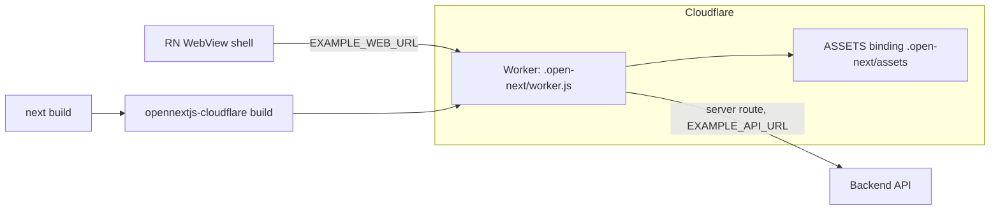
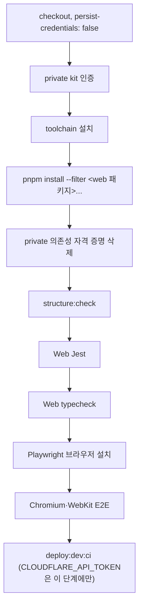

Next\.js를 OpenNext로 Cloudflare Workers에 배포하면 framework 빌드와 Worker 런타임의 호환성을 함께 관리해야 한다\. Next\.js 16 구성 사례를 통해 Turbopack·middleware·환경 변수·배포 관문과 WebView 개발 문제를 살펴본다\.

버전 표·경로·환경 변수·브랜치·사용자 정의 script는 예시다\. 공개 도구의 버전별 지원 범위는 설치한 조합의 문서를 기준으로 확인하며, 이 글의 사례를 최신 지원 보장으로 해석하지 않는다\.

### 1\. 런타임과 구성 예시



<div class="notion-table-wrap">
<table>
<thead><tr><th scope="col">항목</th><th scope="col">구성 예시</th></tr></thead>
<tbody><tr><td>Next.js</td><td><code>16.4.3</code>, App Router, dev·build 모두 Turbopack</td></tr><tr><td>어댑터</td><td><code>@opennextjs/cloudflare</code> <code>^1.20.14</code></td></tr><tr><td>런타임 플래그</td><td><code>nodejs_compat</code></td></tr><tr><td>배포 대상</td><td><code>dev</code> 환경 Worker 하나</td></tr><tr><td>자동 배포</td><td><code>dev</code> 브랜치 push만</td></tr></tbody>
</table>
</div>

App의 WebView는 Web을 URL로 불러온다\. BE 호출은 App이 아니라 Web의 서버 route가 서버 전용 ` EXAMPLE_API_URL `로 한다\. 그래서 Web 서버 런타임이 Workers 위에서 돌아야 한다\.

### 2\. framework·adapter·배포 도구를 함께 올리기

OpenNext의 지원 버전 검사와 peer 범위가 맞지 않으면 로컬 Next 빌드는 가능해도 adapter 빌드·배포가 차단될 수 있다\. Next만 올리지 않고 OpenNext·Wrangler·관련 ESLint 설정의 호환 범위를 함께 확인한다\.

업그레이드에 딸려 온 변경은 다음과 같다\.

<div class="notion-table-wrap">
<table>
<thead><tr><th scope="col">변경</th><th scope="col">내용</th></tr></thead>
<tbody><tr><td>Turbopack 기본</td><td>Next 16은 dev·build 기본이 Turbopack이고, 커스텀 webpack 설정이 있으면 build가 실패한다. SVGR webpack 설정을 <code>turbopack.rules</code>로 옮기고 webpack 함수를 지웠다</td></tr><tr><td>ESLint</td><td><code>eslint-config-next</code> 16은 ESLint 9와 flat config를 요구해 <code>.eslintrc.json</code>을 <code>eslint.config.mjs</code>로 옮겼다. flat config는 <code>.gitignore</code>를 읽지 않아 <code>.open-next</code>, <code>.wrangler</code> 등 산출물을 <code>ignores</code>에 넣었다</td></tr><tr><td>React Hooks 규칙</td><td>react-hooks 7의 React Compiler 전제 규칙은 Compiler를 쓰지 않아 끄고 이전과 같은 범위만 검사한다</td></tr><tr><td>생성 파일</td><td><code>tsconfig</code>(<code>jsx: react-jsx</code>), <code>next-env.d.ts</code>는 Next 16 생성 형식을 따랐다</td></tr><tr><td>middleware</td><td><code>proxy</code>로 바꾸지 않았다(4절)</td></tr></tbody>
</table>
</div>

검증은 lint·typecheck·unit·구조 검사·브라우저 E2E·OpenNext 빌드와 Worker 미리보기로 나눈다\. 미리보기에서 홈, 비인증 보호 화면 redirect, 보호 API의 401, SVG asset 응답을 확인한다\. 로컬 미리보기 성공을 실기기·실제 배포 성공으로 간주하지 않는다\.

iOS 최소 지원 버전도 Next 16과 묶여 있다\. WKWebView 엔진이 OS에 묶이므로 Next\.js 16의 공식 지원 브라우저\(Safari 16\.4\+\)에 맞춰 iOS 16\.4로 정했다\.

### 3\. 설정 파일

#### ` next.config.ts `

```typescript
const SVG_URL_QUERY = /[?&]url(?=&|$)/;

const nextConfig: NextConfig = {
  reactStrictMode: true,
  distDir: process.env.EXAMPLE_E2E === '1' ? '.next-e2e' : '.next',
  // 개발 서버는 다른 origin의 HMR을 막고, 막히면 클라이언트가 페이지를 계속 새로 고친다.
  allowedDevOrigins: ['10.*.*.*', '172.*.*.*', '192.168.*.*'],
  transpilePackages: [/* shared, design-system, navigation-core */],
  turbopack: {
    rules: {
      '*.svg': [
        { condition: { query: SVG_URL_QUERY }, type: 'asset' },
        { condition: { not: { query: SVG_URL_QUERY } }, loaders: [/* @svgr/webpack + svgo override */], as: '*.js' },
      ],
    },
  },
};
```

- ` ?url `로 가져오는 SVG는 파일 URL\(asset\), 나머지는 SVGR React 컴포넌트다\.
- svgo override 중 ` convertShapeToPath: false `는 Figma diamond gradient가 뒤집힌 rect 4장으로 내보내지는데 path로 합치면 뒤집기가 사라져 흰색으로 렌더되기 때문이다\.
- ` distDir ` 분기는 E2E 전용 빌드가 개발 서버의 ` .next `와 충돌하지 않게 한다\. 「WebView 하이브리드 앱의 테스트 계층 설계」에서 다뤘다\.

#### ` open-next.config.ts `와 ` wrangler.jsonc `

OpenNext 설정은 기본값 그대로다\.

```typescript
import { defineCloudflareConfig } from '@opennextjs/cloudflare';
export default defineCloudflareConfig();
```

```json
{
  "main": ".open-next/worker.js",
  "compatibility_flags": ["nodejs_compat"],
  "workers_dev": true,
  "preview_urls": false,
  "assets": { "directory": ".open-next/assets", "binding": "ASSETS" },
  "observability": { "enabled": true },
  "env": {
    "dev": {
      "workers_dev": true,
      "preview_urls": false,
      "vars": { "EXAMPLE_API_URL": "<API 주소>" }
    }
  }
}
```

` env.dev.vars `에는 공개되어도 되는 API 주소 하나만 둔다\. 배포된 dev Worker의 런타임 값은 이 파일이 단일 기준이며 GitHub Variable로 전달하지 않는다\. 주소를 바꾸려면 이 파일을 고쳐 배포한다\. secret은 여기에 두지 않는다\.

### 4\. ` middleware.ts `를 ` proxy `로 바꾸지 않는다

Next 16은 ` middleware.ts `에 deprecated 경고를 띄우고 ` proxy `로의 codemod를 안내한다\. 하지만 ` proxy `는 Node 런타임 전용이고 OpenNext Cloudflare는 Node 미들웨어를 지원하지 않는다\. 이 조합에서는 Edge middleware를 유지하는 선택을 검토한다\. deprecated 경고만 보고 codemod를 실행하기 전에 adapter 런타임 지원을 확인하고 이유를 소유 문서에 남긴다\.

#### ` src/ ` 밖의 middleware는 조용히 죽는다

src 기반 구성에서 middleware 위치가 잘못되면 guard가 빌드 산출물에서 빠질 수 있다\. framework가 읽는 위치에 배치하고 middleware manifest의 matcher와 비인증 deep link·API 응답을 검증한다\.

#### middleware가 하는 일

```typescript
export function middleware(request: NextRequest) {
  const { pathname } = request.nextUrl;
  // cookie 유무만 본다. 유효성은 BE가 판정하고, 만료된 세션은 보호 API의 401이 정리한다.
  const hasSession = Boolean(/* access cookie */) || Boolean(/* refresh cookie */);

  if (!hasSession) {
    if (!pathname.startsWith('/api/')) {
      const homeUrl = request.nextUrl.clone(); // redirect는 절대 URL만 받는다. host·protocol 유지
      homeUrl.pathname = '/';
      homeUrl.search = '';
      return NextResponse.redirect(homeUrl);
    }
    return NextResponse.json({ code: 'SESSION_EXPIRED', message: '...' }, { status: 401 });
  }

  const requestHeaders = new Headers(request.headers);
  // 쿼리까지 넘겨야 새로고침·딥링크에서 activity의 선택 param이 복원된다.
  requestHeaders.set('x-example-request-path', `${pathname}${request.nextUrl.search}`);
  return NextResponse.next({ request: { headers: requestHeaders } });
}

export const config = {
  matcher: ['/api/private/:path*', '/image-analysis', '/image-analysis/:path*', '/assets', '/assets/:path*', '/account', '/account/:path*'],
};
```

catch\-all page는 이 header를 StackFlow ` initialContext `로 넘겨, 서버 렌더링 시점에도 요청 경로의 Activity를 그린다\.

```typescript
export default async function StackPage() {
  const requestPath = (await headers()).get('x-example-request-path');
  return <Stack initialContext={requestPath ? { req: { path: requestPath } } : undefined} />;
}
```

로그인·가입·세션 bootstrap\(` /api/session/* `\)은 cookie 없이 호출해야 하므로 matcher에 넣지 않는다\. matcher 밖의 경로에서는 header가 없고, page는 ` initialContext `를 넘기지 않는다\.

### 5\. 빌드·배포 script

```json
"build:dev": "node ../scripts/example-env-runner.mjs .env.dev opennextjs-cloudflare build --env dev",
"build:prd": "node ../scripts/example-env-runner.mjs .env.prd next build",
"assert-dev-branch": "[ \"${GITHUB_REF_NAME:-$(git branch --show-current)}\" = dev ] || { echo '...'; exit 1; }",
"deploy:dev": "pnpm run assert-dev-branch && pnpm run build:dev && node ../scripts/example-env-runner.mjs .env.dev opennextjs-cloudflare deploy --env dev",
"deploy:dev:ci": "pnpm run assert-dev-branch && opennextjs-cloudflare build --env dev && opennextjs-cloudflare deploy --env dev",
"upload:dev": "pnpm run assert-dev-branch && pnpm run build:dev && node ../scripts/example-env-runner.mjs .env.dev opennextjs-cloudflare upload --env dev",
"preview:dev": "pnpm run build:dev && node ../scripts/example-env-runner.mjs .env.dev opennextjs-cloudflare preview --env dev",
"cf-typegen": "wrangler types --env-interface CloudflareEnv cloudflare-env.d.ts"
```

<div class="notion-table-wrap">
<table>
<thead><tr><th scope="col">Script</th><th scope="col">용도</th><th scope="col">차이</th></tr></thead>
<tbody><tr><td><code>deploy:dev</code></td><td>로컬 수동 배포</td><td><code>.env.dev</code>를 로드해 빌드·배포</td></tr><tr><td><code>deploy:dev:ci</code></td><td>GitHub Actions 배포</td><td>CI에는 env 파일이 없어 envfile loader를 거치지 않는다</td></tr><tr><td><code>upload:dev</code></td><td>배포 없이 새 Worker 버전만 업로드</td><td>버전 upload에도 배포와 같은 브랜치 확인을 적용</td></tr><tr><td><code>preview:dev</code></td><td>로컬 Worker 미리보기</td><td>브랜치 제한 없음</td></tr><tr><td><code>build:prd</code></td><td>prd 빌드</td><td>별도 배포 구성 전까지 Next 빌드만 수행</td></tr></tbody>
</table>
</div>

` assert-dev-branch `는 CI에서는 ` GITHUB_REF_NAME `, 로컬에서는 현재 Git 브랜치를 본다\. ` example-env-runner.mjs `는 Node 내장 ` parseEnv `로 env 파일을 읽어 shell 값을 덮어쓴다\. ` process.loadEnvFile `은 우선순위가 반대라 쓰지 않는다고 주석에 적혀 있다\. env 파일이 없으면 팀 secret manager 값으로 만들라는 메시지와 함께 실패한다\.

` cf-typegen `이 만드는 ` cloudflare-env.d.ts `는 gitignore 대상이다\. Next 16 flat ESLint config가 ` .gitignore `를 읽지 않아 이 파일이 있으면 lint가 경고 0 기준으로 실패했고, 그래서 ESLint ` ignores `에도 넣었다\.

### 6\. dev 자동 배포 workflow

` .github/workflows/deploy-web.yml `은 ` dev ` 브랜치 push와 수동 실행\(` workflow_dispatch `\)에서만 돈다\.

<div class="notion-table-wrap">
<table>
<thead><tr><th scope="col">설정</th><th scope="col">값</th></tr></thead>
<tbody><tr><td>path filter</td><td>workflow 자신, <code>.github/actions/**</code>, 루트 manifest·lockfile·workspace 설정, <code>scripts/**</code>, <code>packages/shared/**</code>, <code>packages/design-system/**</code>, <code>web/**</code></td></tr><tr><td>concurrency</td><td>고정 그룹, <code>cancel-in-progress: true</code></td></tr><tr><td>environment</td><td>GitHub Environment <code>dev</code></td></tr><tr><td>permissions</td><td><code>contents: read</code></td></tr></tbody>
</table>
</div>



설계상 눈여겨볼 점은 셋이다\.

- <strong>설치 범위 제한\.</strong> 배포 job이 App workspace의 patch postinstall까지 실행해 React Native 패치 대상 누락으로 설치가 중단될 수 있다\. 따라서 Web과 그 의존 workspace만 설치한다\.
- <strong>토큰 노출 범위 최소화\.</strong> ` CLOUDFLARE_API_TOKEN `은 배포 단계의 ` env `로만 넘긴다\. job env로 올리면 설치 lifecycle script, 테스트, E2E가 읽을 수 있다\. private 의존성용 토큰은 설치 직후 runner의 Git 설정과 함께 지운다\.
- <strong>배포 직전 재검증\.</strong> PR 검증만으로 merge를 차단할 수 없는 조건에서는 배포 workflow가 구조 검사와 테스트·E2E를 다시 돌린 뒤에만 배포한다\. 이 배경은 AI Agent 지원 체계 글에서 다뤘다\.

배포 성공 여부는 GitHub Actions와 Cloudflare Workers 대시보드에서 확인한다\.

### 7\. 환경 변수

<div class="notion-table-wrap">
<table>
<thead><tr><th scope="col">위치</th><th scope="col">역할</th></tr></thead>
<tbody><tr><td><code>web/env.d.ts</code></td><td>Web이 읽는 환경 변수 타입. 현재 서버 전용 <code>EXAMPLE_API_URL</code> 하나</td></tr><tr><td><code>web/.env.local</code>·<code>.env.dev</code>·<code>.env.prd</code></td><td>로컬 실행·빌드용. Git에 없고 팀 secret 값으로 만든다</td></tr><tr><td><code>wrangler.jsonc</code> <code>env.dev.vars</code></td><td>배포된 dev Worker의 런타임 값</td></tr><tr><td>GitHub Environment <code>dev</code></td><td><code>CLOUDFLARE_API_TOKEN</code> secret</td></tr></tbody>
</table>
</div>

```typescript
declare namespace NodeJS {
  interface ProcessEnv {
    /** 서버 전용 API base URL */
    EXAMPLE_API_URL?: string;
  }
}
```

Web 코드는 ` process.env.EXAMPLE_API_URL `을 env 모듈 한 곳에서 읽고, 서버 route는 값이 없으면 500과 &quot;not configured&quot; 메시지를 돌려준다\. repository harness는 ` env.d.ts `, ` wrangler.jsonc `의 ` vars `, workflow가 넘기는 환경 변수가 실제 runtime 코드에서 읽히는지 검사한다\. 사용처를 지우면 선언도 지워야 ` structure:check `를 통과한다\.

local·dev·prd의 실행·배포 범위를 각각 정한다\. production 이름의 빌드가 개발 Web·API에 연결되지 않는지도 확인한다\.

### 8\. WebView 개발 환경에서 만난 dev 서버 문제

Next 16 dev 서버는 시작한 hostname 밖 origin에서 오는 ` /_next/* ` dev 리소스\(JS chunk, HMR\) 요청을 기본으로 막는다\. WebView 개발 환경에서는 이 기본값이 두 번 문제가 됐다\.

<div class="notion-table-wrap">
<table>
<thead><tr><th scope="col">시점</th><th scope="col">증상</th><th scope="col">원인</th></tr></thead>
<tbody><tr><td>업그레이드 직후</td><td>LAN 실기기 WebView가 HTML만 받고 JS가 막힘. dev 로그에 <code>Blocked cross-origin request to Next.js dev resource /_next/hmr</code></td><td>실기기는 Mac의 LAN IP로 <code>--hostname 0.0.0.0</code> dev 서버에 붙는다</td></tr><tr><td>이후</td><td>Android 에뮬레이터 WebView가 약 80초마다 전체 새로고침을 반복하며 로딩 스피너에서 벗어나지 못함. iOS 시뮬레이터는 정상</td><td>에뮬레이터는 <code>10.0.2.2</code>로 접속해 HMR 연결이 거부되고, Next 클라이언트가 새로고침을 반복</td></tr></tbody>
</table>
</div>

해결은 ` allowedDevOrigins `에 사설 IP 대역을 넣는 것이다\.

```typescript
allowedDevOrigins: ['10.*.*.*', '172.*.*.*', '192.168.*.*'],
```

사설 대역을 예시로 허용하면 네트워크 변경 때마다 특정 IP를 수정하는 부담을 줄일 수 있다\. 개발 환경의 접근 범위를 확인하고 LAN 실기기와 Android 에뮬레이터를 따로 재검증한다\. 이 설정은 dev 서버용이며 production·OpenNext 배포 설정과 구분한다\.

같은 맥락에서 dev 서버를 다른 포트로 띄우면 App 쪽 ` EXAMPLE_WEB_URL `도 맞춰야 한다\. App은 이 값을 빌드 타임에 바인딩한다\.

#### Wrangler 생성 타입과 DOM 충돌

` pnpm run cf-typegen `이 만드는 ` web/cloudflare-env.d.ts `는 Git 제외 대상이다\. Web의 ` **/*.ts ` 포함 범위에 이 파일까지 들어오면 생성된 전역 선언과 DOM 타입이 충돌해 typecheck·E2E용 Next build가 실패할 수 있었다\. 생성된 CloudflareEnv를 소비하지 않는 구성이라면 tsconfig의 exclude에 생성 타입을 명시하는 선택이 가능하다\. 파일을 생성한 상태에서도 typecheck·E2E 빌드를 확인하고 수동 삭제에 기대지 않는다\.

### 9\. deep link hydration과 popstate

#### hydration 오류

하위 화면을 deep link로 열면 route의 ` defaultHistory `가 부모 화면을 아래에 깐다\. 이때 전환을 함께 쌓으면 전환 상태가 요청 시각으로 정해져, 서버\(요청 시각\)와 브라우저\(hydration 시각\)의 basic\-ui 전환 시간 CSS 변수가 달라졌다\. 결과는 ` Hydration failed `였다\.

해결은 두 단계를 거쳤다\.

1. 첫 시도: 탭 루트만 서버에서 그리고 하위 화면은 브라우저에서만 그렸다\. 그러자 Next가 history를 패치한 뒤 StackFlow가 첫 렌더에서 history를 써서 ` Cannot update a component (Router) while rendering Stack ` 오류가 새로 났다\. 이 변경은 되돌렸다\.
1. 최종: ` defaultHistory `에 ` skipDefaultHistorySetupTransition: true `를 켜 서버와 브라우저가 같은 idle 상태로 그리게 했다\. 새로고침·deep link에서 부모 화면이 밀려 들어오는 전환도 사라졌다\.

production 빌드의 minified hydration 오류도 E2E에서 검사한다\. 복원 옵션을 바꿨을 때 테스트가 실패하는지 확인하면 회귀를 잡는 범위를 알 수 있다\.

#### popstate ` __NA ` 우회

Next App Router는 자신이 쓰지 않은\(내부 표식 ` __NA `가 없는\) history 항목으로 ` popstate `가 오면 페이지를 새로 고친다\. ` defaultHistory ` 항목은 Next가 history를 패치하기 전에 쓰여 표식이 없다\. 그래서 ` stackflow.ts `가 모듈 로드 시 capture 단계 리스너로 StackFlow 항목에 표식을 붙인다\.

```typescript
if (typeof window !== 'undefined') {
  window.addEventListener('popstate', (event) => {
    const state = event.state as { __NA?: boolean; usr?: { _TAG?: string } } | null;
    if (state?.usr?._TAG === '@stackflow/plugin-history-sync' && !state.__NA) state.__NA = true;
  }, { capture: true });
}
```

Next 내부 표식에 기대는 우회이므로, 코드 주석에 Next를 올릴 때 deep link E2E가 깨지면 여기부터 보라고 적어 두었다\. 자세한 흐름은 StackFlow 내비게이션 글에서 다뤘다\.

### 10\. 설치 버전의 문서를 기준으로 변경하기

framework가 갱신하는 Agent 안내와 설치된 버전의 문서를 확인한다\. proxy·Turbopack·ESLint 설정을 이전 버전 지식만으로 되돌리지 않게 하고, 자동 생성 안내가 반복 변경된다면 소유권과 갱신 규칙을 문서화한다\.

### 배포·검증 경계

- ` middleware.ts `는 Next 16에서 deprecated 경고를 낸다\. OpenNext Cloudflare가 Node 미들웨어를 지원하기 전까지 ` proxy `로 옮길 수 없다\.
- dev 자동 배포 예시와 prd 운영 구성은 별개다\. 환경 이름만으로 격리가 완료됐다고 판단하지 않는다\.
- 배포 workflow는 path filter 밖의 변경\(문서·skill만 바꾼 push\)에는 돌지 않는다\.
- popstate 우회는 Next 내부 표식에 의존하므로 Next 업그레이드마다 deep link 복원을 회귀 검증해야 한다\.
- allowedDevOrigins 변경 후에는 LAN 실기기 접속도 별도로 확인한다\.
- 브라우저 E2E는 Worker 런타임이 아니라 로컬 ` next start `에서 돈다\. 따라서 Worker 위 동작은 미리보기·배포 환경에서 별도로 확인해야 한다\.

### 정리

- framework·adapter·Wrangler를 호환 조합으로 검증한다\.
- middleware 위치·런타임·matcher는 빌드 산출물과 실제 응답으로 확인한다\.
- 로컬 환경 파일·Worker vars·배포 secret의 책임을 나눈다\.
- LAN HMR·deep link hydration·Worker 실행을 브라우저 테스트와 별도로 확인한다\.

### 관련 글

- StackFlow 화면 스택과 내비게이션 설계
- Next\.js BFF의 HttpOnly cookie 인증 설계
- WebView 하이브리드 앱의 테스트 계층과 검증 경계
- 모노레포의 AI Agent 문서·검증 체계 설계
