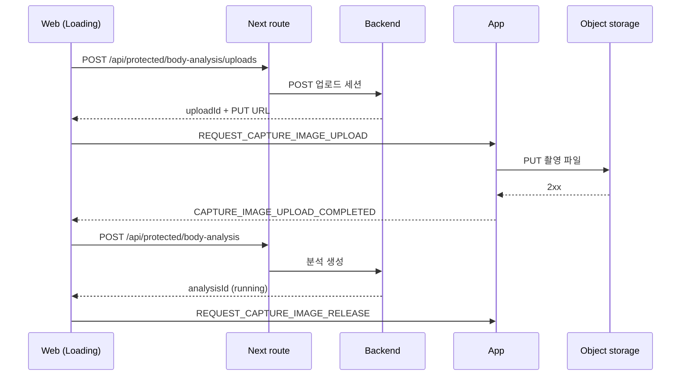

> 표기: 프로젝트 고유 접두사는 ` {prefix} `, 패키지 scope는 ` @scope `로 바꿔 적었다\.

### 문서 목적

전신 사진과 포즈 landmark, 신체 치수를 서버에 보내고 비동기로 체형 분석 결과를 받는 흐름을 정리한다\. 업로드 세션 생성, 네이티브 바이너리 업로드, 분석 생성, 단건 polling과 한도, 분석 중 화면의 내비게이션 처리, 결과·내역 화면, 실패 문구, 백엔드 고정 문구 대체, 예시\(mock\) 결과를 걷어낸 과정을 다룬다\.

신체 이미지와 치수를 다루므로 로그·URL에 이미지, 치수, 서명 URL을 남기지 않는 것을 전제로 한다\.

### 1\. 전체 흐름

```text
Home → push Guide → push Measure → replace Loading → replace Result   (업로드·분석)
Home → push History → push Result                                     (내역)
```

<div class="notion-table-wrap">
<table>
<thead><tr><th scope="col">단계</th><th scope="col">실행 주체</th><th scope="col">내용</th></tr></thead>
<tbody><tr><td>촬영</td><td>App 또는 브라우저</td><td>카메라·앨범·파일 선택 후 포즈 검출과 조정, landmark 9개 반환</td></tr><tr><td>업로드 세션</td><td>Web → Next → 백엔드</td><td>파일 메타데이터로 <code>uploadId</code>와 사전서명 PUT URL 발급</td></tr><tr><td>바이너리 업로드</td><td>native 또는 브라우저</td><td>촬영 파일·메모리 사진을 사전서명 URL로 PUT</td></tr><tr><td>분석 생성</td><td>Web → Next → 백엔드</td><td><code>uploadId</code>·landmark·치수로 분석 생성, <code>analysisId</code> 수신</td></tr><tr><td>촬영 이미지 해제</td><td>native 또는 브라우저</td><td>제출 성공 후 파일·메모리 사진 해제</td></tr><tr><td>결과 수신</td><td>Web</td><td>단건 API를 2초 간격 polling</td></tr><tr><td>결과 표시</td><td>Web</td><td><code>succeeded</code>면 결과 화면으로 replace</td></tr></tbody>
</table>
</div>

분석 생성·조회·대표 지정·삭제 API는 ` /api/protected/body-analysis ` route를 거치며 HttpOnly cookie 인증과 401 refresh 1회 재시도를 적용한다\. 이미지 바이너리 업로드는 사전서명 URL로 직접 PUT한다\(App은 native, App 밖은 브라우저\)\. 비로그인 공유 조회는 별도의 서버 컴포넌트 경로다\. 체형 분석 화면은 로그인 사용자 전용이라 cookie가 없으면 middleware가 홈으로 돌린다\.

### 2\. 상태 소유 분리

클라이언트 작업 상태와 서버 분석 상태를 나눴다\.

<div class="notion-table-wrap">
<table>
<thead><tr><th scope="col">상태</th><th scope="col">소유</th><th scope="col">값</th></tr></thead>
<tbody><tr><td>업로드·제출 진행</td><td>Zustand</td><td><code>IDLE → CAPTURE_READY → REQUESTING_UPLOAD_URL → UPLOADING_IMAGE → SUBMITTING_ANALYSIS → POLLING_ANALYSIS</code>, 실패 시 <code>FAILED</code></td></tr><tr><td>서버 분석 상태</td><td>TanStack Query</td><td><code>running</code> / <code>succeeded</code> / <code>failed</code></td></tr></tbody>
</table>
</div>

서버 status는 세 값뿐이다\. 백엔드 내부의 대기·처리 상태가 ` running ` 하나로 합쳐져 내려오므로 Web은 세 값만 안다\. 서버 상태는 Zustand에 복제하지 않는다\.

새 촬영\(` setCapture `\)은 이전 ` analysisId `를 지운다\. 남아 있으면 두 번째 분석이 이전 결과로 바로 넘어가기 때문이다\.

```typescript
setCapture: (capture) => set({ capture, status: 'CAPTURE_READY', error: null, analysisId: null }),
setSubmission: (analysisId) => set({ analysisId, status: 'POLLING_ANALYSIS' }),
```

### 3\. 준비 단계: 업로드 세션 → 업로드 → 분석 생성

세 요청을 ` prepareBodyAnalysis ` 한 함수로 묶었다\.

```typescript
export async function prepareBodyAnalysis(capture, measurements, onStatus) {
  onStatus('REQUESTING_UPLOAD_URL');
  const uploadSession = await createUploadSession(buildCreateUploadSessionRequest(capture));

  onStatus('UPLOADING_IMAGE');
  await uploadNativeCaptureImage({
    captureId: capture.captureId,
    uploadId: uploadSession.uploadId,
    ...uploadSession.upload, // method: 'PUT', url, headers
  });

  onStatus('SUBMITTING_ANALYSIS');
  const submitRequest = buildBodyAnalysisSubmitRequest(uploadSession.uploadId, capture, measurements);
  const submission = await submitAnalysis(submitRequest);
  releaseNativeCaptureImage(capture.captureId);
  return { submitRequest, submission };
}
```

업로드 세션은 한 번만 제출할 수 있다\. 백엔드가 같은 ` uploadId `의 두 번째 제출을 400으로 막는다\. 그래서 준비 흐름 전체를 다시 실행하면 새 업로드 세션이 생겨 분석이 하나 더 만들어진다는 점을 호출부가 알고 있어야 한다\(6절\)\.

#### 제출 전에 막는 값

백엔드 검증과 같은 값을 Zod schema로 먼저 검사해, 백엔드 400 대신 제출 전에 잡는다\.

<div class="notion-table-wrap">
<table>
<thead><tr><th scope="col">항목</th><th scope="col">규칙</th></tr></thead>
<tbody><tr><td>파일 형식</td><td><code>image/jpeg</code>·<code>jpg</code>·<code>png</code>·<code>webp</code>·<code>heic</code>·<code>heif</code> (현재 촬영본은 jpeg)</td></tr><tr><td>파일 크기</td><td>양수, 15MiB 이하</td></tr><tr><td>checksum</td><td>SHA256의 base64(44자)</td></tr><tr><td><code>heightMm</code></td><td>500~3000</td></tr><tr><td><code>weightKg</code>(선택)</td><td>10~500, 소수 둘째 자리까지. 입력 화면의 <code>분석 시작</code> 활성 조건과 같은 함수</td></tr><tr><td>landmark <code>source</code></td><td><code>detected</code>·<code>adjusted</code>·<code>derived</code>만. 촬영 계약의 <code>initialized</code>는 거부</td></tr><tr><td><code>schemaVersion</code>·landmark 버전</td><td><code>1</code> 고정</td></tr></tbody>
</table>
</div>

최소 해상도·세로 비율·최소 용량 같은 이미지 하한은 두지 않았다\. Web에서 먼저 넣었다가 테스트를 막아 걷어냈고, 규격이 확정되면 백엔드 검증과 함께 넣기로 했다\.

#### 브라우저 캡처도 같은 준비 흐름 사용

App 밖에서는 ` WebPoseReview `가 사진 선택·검출·9점 조정으로 같은 캡처 계약을 만든다\. ` capture_web- ` 이미지의 업로드·해제는 pose\-camera의 함수가 메모리 사진을 직접 처리하므로 ` prepareBodyAnalysis `는 출처를 분기하지 않는다\. 브라우저 완료에는 HTTPS/[localhost](<http://localhost/>)의 SHA\-256과 저장소 CORS가 필요하다\. 새로고침하면 메모리 사진은 사라진다\.

### 4\. 네이티브 바이너리 업로드 브리지

이미지 파일은 App의 네이티브 저장소에 있다\. WebView로 바이너리를 옮기지 않고, Web이 사전서명 URL을 App에 넘겨 App이 직접 PUT한다\. 계약은 ` @scope/shared/pose `에 있다\.

<div class="notion-table-wrap">
<table>
<thead><tr><th scope="col">방향</th><th scope="col">token</th><th scope="col">payload 핵심</th></tr></thead>
<tbody><tr><td>Web → App</td><td><code>REQUEST_CAPTURE_IMAGE_UPLOAD</code></td><td><code>captureId</code>, <code>uploadId</code>, <code>method: &#39;PUT&#39;</code>, <code>url</code>, <code>headers</code></td></tr><tr><td>App → Web</td><td><code>CAPTURE_IMAGE_UPLOAD_COMPLETED</code></td><td><code>captureId</code>, <code>uploadId</code>, <code>statusCode</code>(200~299), <code>etag?</code></td></tr><tr><td>App → Web</td><td><code>CAPTURE_IMAGE_UPLOAD_FAILED</code></td><td><code>code</code>, <code>captureId?</code>, <code>uploadId?</code>, <code>message?</code></td></tr><tr><td>Web → App</td><td><code>REQUEST_CAPTURE_IMAGE_RELEASE</code></td><td><code>captureId</code></td></tr></tbody>
</table>
</div>



Web 쪽 대기 규칙이다\.

- 요청은 shared schema로 검증한 뒤 발신한다\.
- 완료 응답은 ` captureId `와 ` uploadId `가 현재 요청과 모두 일치해야 수락한다\. 다른 업로드의 응답은 무시한다\.
- 실패 응답은 식별자가 있으면 일치할 때만 수락한다\.
- WebView 밖이라 발신할 수 없으면 바로 실패한다\.
- 60초 안에 응답이 없으면 시간 초과로 실패한다\.

App 쪽은 요청 schema 검증에 실패하면 ` INVALID_UPLOAD_REQUEST `, 네이티브 업로드가 실패하면 ` CAPTURE_UPLOAD_FAILED `로 응답한다\. 네이티브 모듈의 반환값도 schema로 검증한다\. 범용 파일 API는 이 흐름에서 쓰지 않는다\.

### 5\. Next 보호 route

` /api/protected/body-analysis/[[...segments]] ` 하나의 optional catch\-all route가 다음 요청을 나눈다\.

<div class="notion-table-wrap">
<table>
<thead><tr><th scope="col">브라우저 요청</th><th scope="col">segments</th><th scope="col">백엔드</th></tr></thead>
<tbody><tr><td><code>POST .../uploads</code></td><td><code>[&#39;uploads&#39;]</code></td><td>업로드 세션 생성</td></tr><tr><td><code>POST ...</code></td><td><code>[]</code></td><td>분석 생성</td></tr><tr><td><code>GET ...?page&amp;size</code></td><td><code>[]</code></td><td>분석 목록</td></tr><tr><td><code>GET .../{analysisId}</code></td><td><code>[id]</code></td><td>분석 단건</td></tr><tr><td><code>POST .../{analysisId}/representative</code></td><td><code>[id, representative]</code></td><td><code>PUT /api/v1/body-analysis/{id}/representative</code></td></tr><tr><td><code>DELETE .../{analysisId}</code></td><td><code>[id]</code></td><td><code>DELETE /api/v1/body-analysis/{id}</code></td></tr></tbody>
</table>
</div>

그 외 segment 조합은 404다\. 외부 경로 상수는 이 route 파일 한 곳에만 둔다\.

단건 ID는 백엔드 형식이 확정되지 않아 인코딩해 그대로 전달하되, 경로 조작 값은 거부한다\.

```typescript
// 인코딩으로도 남는 `.`·`..`는 BE 경로를 상위로 올리므로 거부한다.
export const bodyAnalysisIdSchema = z
  .string().min(1).max(128)
  .refine((value) => value !== '.' && value !== '..', 'Invalid analysis id');
```

남의 분석이나 폐기된 분석 ID로 들어와 백엔드가 403을 주면 그대로 403을 전달한다\. 이 경로는 처음에 403을 세션 만료로 승격해 전체 로그아웃을 일으킬 수 있었고, 세션 만료 판정을 401 \+ refresh 실패로 한정해 고쳤다\.

### 6\. 실패와 재시도 경계

준비 단계에서 어디서 실패했는지에 따라 재시도 방법이 다르다\.

<div class="notion-table-wrap">
<table>
<thead><tr><th scope="col">실패 지점</th><th scope="col">재시도</th></tr></thead>
<tbody><tr><td>업로드 세션·업로드</td><td>준비 흐름 재실행(<code>다시 시도</code>)</td></tr><tr><td>분석 제출</td><td>자동 재전송 안 함. 성공 여부를 알 수 없어 다시 보내면 분석이 중복될 수 있음</td></tr><tr><td>단건 조회 오류</td><td>GET만 다시 실행(<code>상태 다시 확인</code>)</td></tr></tbody>
</table>
</div>

```typescript
const canRetryPreparation = Boolean(error) && failedStage !== 'SUBMITTING_ANALYSIS';
```

### 7\. 단건 polling과 한도

` running `일 때만 2초 간격으로 단건을 다시 조회하고, ` succeeded `·` failed `에서 멈춘다\.

```typescript
export const BODY_ANALYSIS_POLL_INTERVAL_MS = 2_000;
export const BODY_ANALYSIS_POLL_TIMEOUT_MS = 3 * 60_000;

export function getBodyAnalysisPollingInterval(status, pollingSince, now) {
  if (status !== 'running') return false;
  if (pollingSince !== null && now - pollingSince >= BODY_ANALYSIS_POLL_TIMEOUT_MS) return false;
  return BODY_ANALYSIS_POLL_INTERVAL_MS;
}
```

백엔드는 대기·처리 상태를 각각 30분까지 유지한 뒤 timeout으로 ` failed ` 처리한다\. 그 구간을 계속 polling하면 분석 하나에 수백 번 요청이 쌓이므로, 화면 polling은 3분까지만 하고 이후에는 내역에서 확인하게 했다\.

#### 한도를 관측 시점 기준으로 바꾼 이유

처음에는 서버 시각\(` startedAt `/` createdAt `\)과 현재 시각을 비교했다\. 단말 시계가 서버와 어긋나면 방금 만든 분석도 이미 한도를 넘긴 것으로 판정돼 polling이 시작조차 하지 못했다\. 그래서 화면이 ` running `을 처음 관측한 시점부터 재도록 바꿨다\.

```typescript
refetchInterval: (query) => {
  const status = query.state.data?.status;
  if (status !== 'running') {
    pollingSinceRef.current = null;
    return false;
  }
  pollingSinceRef.current ??= Date.now();
  const interval = getBodyAnalysisPollingInterval(status, pollingSinceRef.current, Date.now());
  // 한도 도달은 렌더 밖에서 결정되므로 state로 올린다.
  if (interval === false) setIsPollingStopped(true);
  return interval;
},
```

한도 도달은 ` refetchInterval ` 콜백 안에서 결정돼 렌더가 알 수 없다\. 그래서 hook이 ` isPollingExhausted `를 state로 노출한다\. 결과 화면은 이 값으로 &quot;자동으로 갱신됩니다&quot; 문구 대신 수동 재확인 버튼을 보여준다\. 실제 대상은 내역에서 3분이 지난 ` running ` 항목에 들어온 경우다\.

완료 push 알림이나 WebSocket은 이번 범위에서 제외하고 polling으로 가기로 했다\.

### 8\. 분석 중\(Loading\) 화면의 내비게이션

#### Swipe\-back 봉인

```typescript
// 분석 생성 전에는 되돌아가면 업로드가 유실되므로 백을 막고,
// 생성 뒤에는 서버가 이어서 분석하고 내역에서 다시 볼 수 있으므로 떠날 수 있게 둔다.
const preventSwipeBack = !hasFailure && analysisId === null;
```

` analysisId `를 받거나 실패하면 봉인을 푼다\. 실패 상태에서 계속 막으면 사용자가 화면에 갇힌다\.

#### 전환 중 도착한 결과는 보류

` succeeded `가 StackFlow 전환 중에 도착할 수 있다\. 공용 내비게이션의 ` replace `는 navigation lock이 잡혀 있으면 조용히 드롭된다\. 처음에는 준비 결과를 소비한 뒤 ` replace `를 불러, 드롭되면 전환이 영구 유실되고 사용자가 back이 막힌 화면에 갇혔다\.

지금은 ` succeeded ` 상태를 지우지 않고 유지한 채 조건이 맞을 때만 이동한다\.

```typescript
useEffect(() => {
  if (analysisQuery.data?.status !== 'succeeded' || isTransitioning || !activity.isTop || !analysisId) return;
  void queryClient.invalidateQueries({ queryKey: bodyAnalysisQueryKeys.lists() });
  replace('BodyAnalysisResultActivity', { analysisId });
}, [activity.isTop, analysisId, analysisQuery.data?.status, isTransitioning, queryClient, replace]);
```

전환이 끝나 lock이 풀린 렌더에서 effect가 다시 실행돼 이동한다\. 이동하면서 분석 목록 query를 무효화해 내역과 마이페이지 체형 카드가 새 결과를 보이게 한다\.

#### 화면을 떠난 뒤 도착한 결과는 버림

준비 요청이 진행되는 동안 사용자가 다른 경로로 화면을 떠날 수 있다\. 늦게 도착한 결과가 새 세션의 store를 덮어쓰거나 엉뚱한 화면 위에서 결과로 이동하지 않도록, store 기록 전에 top 여부를 확인한다\.

```typescript
const result = await prepareBodyAnalysis(capture, measurements, onStatus);
if (!isTopRef.current) return;
setSubmission(result.submission.analysisId);
```

` isTopRef `는 렌더마다 ` activity.isTop `과 동기화한다\. 비동기 콜백 안에서 오래된 클로저 값을 읽지 않기 위해서다\.

#### 처음부터 다시 시작

Loading은 Measure를 ` replace `해 열리므로 바로 아래가 Guide다\. 새 Guide를 얹으면 스택에 Guide가 중복되므로 ` pop `으로 돌아간다\. 다시 시작할 때에는 촬영 이미지를 먼저 해제한다\. 하위 경로의 ` defaultHistory `가 홈·안내를 복원하므로 불필요한 Guide를 새로 쌓지 않는다\.

Measure → Loading도 처음에는 ` push `였다\. 이 상태에서 결과에서 뒤로 가면 이미 보낸 촬영본이 남은 입력 화면이 나와 같은 촬영으로 분석을 또 만들 수 있었고, ` 처음부터 다시 시작 `이 촬영본이 비워진 입력 화면에 떨어졌다\. ` replace `로 되돌렸다\.

### 9\. 결과·내역 화면

결과 화면은 단건 query를 쓴다\. Loading이 채운 캐시를 재사용한다\. 결과를 그리기 전에는 상태 화면을 고른다\.

<div class="notion-table-wrap">
<table>
<thead><tr><th scope="col">조건</th><th scope="col">화면</th></tr></thead>
<tbody><tr><td>조회 중 / <code>running</code></td><td>spinner, <code>running</code>이면 자동 갱신 안내</td></tr><tr><td>polling 한도 초과</td><td>수동 <code>지금 다시 확인</code></td></tr><tr><td><code>failed</code></td><td>코드별 실패 문구 + <code>다시 분석하기</code></td></tr><tr><td>조회 오류, 또는 <code>succeeded</code>인데 <code>result</code> 형태가 계약과 다름</td><td><code>다시 확인</code></td></tr></tbody>
</table>
</div>

` result `는 응답 경계에서 ` unknown `으로 받고, 화면이 읽는 ` bodyType `·` scores `와 개인화 표시 필드만 표시 시점에 ` safeParse `한다\. 나머지 필드 형태 차이로 실제 결과가 오류 화면으로 바뀌지 않게 하기 위해서다\. 백엔드 ` PEAR `는 UI의 삼각형 테마로 연결한다\.

내역 화면은 목록을 20개씩 페이지로 읽고, ` placeholderData: keepPreviousData `로 페이지 전환 중에도 이전 목록을 유지한다\. 이 옵션이 없을 때는 페이지를 넘길 때마다 목록이 전체 spinner로 사라졌다\. 항목을 열 때 키\(` heightCm `\)를 activity param으로 넘긴다\. 단건 응답에는 신체 치수가 없기 때문이다\.

결과의 닫기\(X\)는 내역으로 돌아간다\. 내역에서 열었으면 ` pop `, 방금 분석한 흐름이면 결과를 내역으로 ` replace `한다\.

#### 대표 분석 지정·선택 삭제·횟수 사전 안내

대표 표시는 결과 화면이 아니라 분석 아카이빙의 헤더·별·칩이 담당한다\. 완료된 본인 분석을 대표로 지정하면 BE가 이전 대표를 해제한다\. 대표 변경은 목록·단건 캐시를 무효화하며 내 정보의 대표 값은 app 조립부가 함께 갱신한다\.

대표 분석은 삭제 대상에서 제외한다\. 대표 여부를 알 수 없으면 삭제를 막고 이유와 다시 조회를 제공한다\. 일괄 삭제는 ` Promise.allSettled `로 모으고 목록을 다시 조회한다\. 응답 실패로 보인 항목도 목록에서 사라졌으면 삭제 완료로 간주한다\(` b64817f `\)\. 남아 있는 실패 항목만 재선택해 재시도하며 성공 항목의 단건 캐시만 제거한다\. 삭제는 soft delete이고 분석 사용 횟수는 돌려주지 않는다\.

내 정보의 남은 횟수가 0일 때 촬영 전에 막으며, 값을 모르면 선제 차단하지 않는다\. 제출 시 서버의 429 ` BODY_ANALYSIS_LIMIT_EXCEEDED `가 최종 판정이다\. 남은 횟수 표시 UI는 아직 대기 상태다\.

#### 비로그인 결과 공유

` /share/body-analysis/{analysisId} `는 StackFlow 보호 화면과 별도의 서버 페이지다\. ` getSharedBodyAnalysis `가 토큰 없이 ` GET /api/public/v1/body-analysis/{id} `를 부르고 메타데이터·본문이 요청 단위 cache를 공유한다\. 완료·미삭제 결과만 보여주며 4xx 또는 응답 계약 오류는 404로, 5xx·네트워크 오류는 서버 오류로 남긴다\. 보호 단건 조회나 로그인 세션을 공유 페이지에 재사용하지 않는다\.

### 10\. 실패 코드 → 문구

서버 ` failure.message `는 백엔드 실패\(영어\)와 AI 실패\(한국어\)가 섞여 있다\. 그대로 붙였더니 시간 초과 같은 백엔드 실패에서 영어 원문이 사용자에게 보였다\. 사용자가 할 수 있는 일은 다시 시도뿐이라 code로 문구를 고른다\.

```typescript
export const BODY_ANALYSIS_FAILURE_MESSAGE = {
  ANALYSIS_TIMEOUT: '분석이 너무 오래 걸려 중단됐어요. 처음부터 다시 시도해 주세요.',
  default: '분석 중 문제가 생겼어요. 처음부터 다시 시도해 주세요.',
} as const;

export function getBodyAnalysisFailureMessage(failure) {
  return failure?.code === 'ANALYSIS_TIMEOUT'
    ? BODY_ANALYSIS_FAILURE_MESSAGE.ANALYSIS_TIMEOUT
    : BODY_ANALYSIS_FAILURE_MESSAGE.default;
}
```

큐 발행 실패, 잘못된 요청, AI 분석 실패, 모르는 code, failure 없음은 모두 기본 문구다\. Loading과 결과 화면이 같은 함수를 쓴다\. 문구는 기획 확정 전 임시값이다\.

HTTP 오류 쪽에서는 백엔드가 오류 코드를 ` errorCode ` 필드에 담는데 공통 fetch 유틸이 ` code `만 읽어 모든 코드를 버리고 있었다\. ` code ?? errorCode `로 옮겨 분석 횟수 초과 같은 백엔드 코드가 중간에 버려지지 않게 했다\.

### 11\. 탭 문구: 백엔드 ` fixedContent ` 우선, 앱 문구 대체

결과 탭\(나의 분석 3줄, 추천 핏, 코디 팁\)은 체형별 고정 문구다\. 처음에는 기획서 문구를 코드에 고정해, 관리자가 문구를 고쳐도 앱에 반영되지 않았다\. 백엔드가 결과 응답의 ` personalization.fixedContent `로 체형별 문구를 내려주기 시작하면서 이를 우선 쓰도록 바꿨다\.

```typescript
export function resolveBodyTypeContent(type: BodyType, fixedContent: unknown): BodyTypeContent {
  const fallback = BODY_TYPE_CONTENT[type];
  const parsed = bodyTypeFixedContentSchema.safeParse(fixedContent);
  if (!parsed.success) return fallback;
  // 항목 배열은 쉼표로 잇고, WORST 소화법 tip은 '→' 앞뒤를 방법·효과로 나눈다.
  ...
}
```

- 값이 없거나, 채우기 전 빈 값이거나, 카테고리가 빠지면 같은 체형의 앱 문구를 쓴다\. 다른 체형 문구로 채우지 않는다\.
- 앱 문구는 백엔드 seed와 같은 원문으로 맞췄다\. 대조 결과 BEST 이유 16곳의 접두어만 달라 앱 문구에서 뺐다\.
- 개인화 수식어·설명이 없을 때도 같은 체형의 기획서 문구로 채운다\.

### 12\. 예시\(mock\) 결과에서 실제 흐름으로

<div class="notion-table-wrap">
<table>
<thead><tr><th scope="col">시점</th><th scope="col">상태</th></tr></thead>
<tbody><tr><td>초기</td><td><code>분석 시작</code>이 업로드·분석 없이 예시 결과(<code>analysisId: &#39;mock&#39;</code>)로 바로 이동</td></tr><tr><td>로컬 백엔드·AI로 계약이 동작한 뒤</td><td>Loading을 다시 연결해 실제 업로드·분석·polling으로 전환. 예시 결과는 직접 주소·테스트용으로만 남김</td></tr><tr><td>상태 화면 보강</td><td>실제 <code>analysisId</code>는 <code>succeeded</code>일 때만 결과를 그림. 실패·진행 중 분석이 예시 결과로 보이던 문제 수정</td></tr><tr><td>결과 계약 확정 뒤</td><td>예시 결과 상수와 <code>&#39;mock&#39;</code> 미리보기 id 삭제. 형태가 다르면 남의 예시 대신 조회 오류 화면</td></tr></tbody>
</table>
</div>

예시 결과의 마지막 역할은 &quot;완료됐는데 결과 형태가 다를 때 다른 사람의 예시 체형을 보여주는 것&quot;뿐이었다\. 삭제 조건이던 결과 계약 확정이 이미 충족돼 지웠고, 지금은 다른 체형의 예시 대신 조회 오류 화면을 그린다\. 테스트는 완료된 결과 응답 fixture를 쓴다\.

### 13\. 검증 배치

<div class="notion-table-wrap">
<table>
<thead><tr><th scope="col">대상</th><th scope="col">계층</th></tr></thead>
<tbody><tr><td>polling 간격·한도 계산, schema, payload 생성, 문구 변환</td><td>unit</td></tr><tr><td>route 경로 전달·ID 인코딩, 준비 오케스트레이션, Loading 내비게이션(lock 경합 재시도, 이탈 후 결과 무시, back 봉인, root 재시작, 한도 초과), 결과·내역 화면</td><td>integration</td></tr><tr><td>안내 화면 버튼, 하위 화면 직접 진입 시 hydration</td><td>E2E</td></tr></tbody>
</table>
</div>

네이티브 촬영·업로드 단계는 실기기 검증이 필요하며, 관련 변경 기록에는 실기기 미확인이 함께 남아 있다\.

### 현재 제약

- 화면 polling은 3분까지다\. 그 뒤의 ` running `은 수동 재확인이나 내역에서 확인한다\.
- 제출 결과를 알 수 없는 오류에서 잃어버린 ` analysisId `를 되찾는 경로는 목록 조회뿐이다\.
- 실패·취소 시 업로드된 이미지 정리 정책은 확정되지 않았다\.
- 최소 이미지 규격이 없다\. ` widthPx `·` heightPx `는 클라이언트 자기신고값이라 백엔드가 업로드된 이미지를 직접 확인해야 계약이 된다\.
- 세부 분석\(허리 위치·상체 길이·하체 길이\) 문장을 만드는 API가 없어 해당 섹션은 그리지 않는다\.
- 실패 문구는 기획 확정 전 임시값이다\.
- 신체 이미지·치수의 보존 기간, 삭제, 접근 권한, 동의 정책은 출시 전 결정 사항이다\.

### 참고

- 관련 글: Next\.js API route를 BFF로 둔 인증 설계, Native\-Web 브리지 계약과 보안 설계, StackFlow 기반 WebView 내비게이션 설계, StackFlow 기반 WebView: 커스텀 Swipe\-back 구현 배경과 설계

### 구현 근거와 검토 범위

2026\-11\-11, FE commit ` 645a584 ` 기준으로 코드·설정과 관련 변경 이력을 대조했다\. 근거: ` web/src/features/body-analysis/api/body-analysis.mutation.ts `, ` web/src/features/body-analysis/api/body-analysis-public.request.ts `, ` web/src/features/body-analysis/README.md `\. 문서에 인용한 이전 검증 기록과 이번 검토를 구분하며, 이번 작업에서 앱·브라우저 런타임 테스트를 재실행하지 않았다\.

### 관련 구현 문서

[Next\.js API route를 BFF로 둔 인증 설계](<https://app.notion.com/p/4150d0f75cd68132974dfd5fed689c7d>)

[WebView 앱의 네이티브 포즈 카메라 설계](<https://app.notion.com/p/4150d0f75cd68154a2f0da3ae8aa9fcd>)
