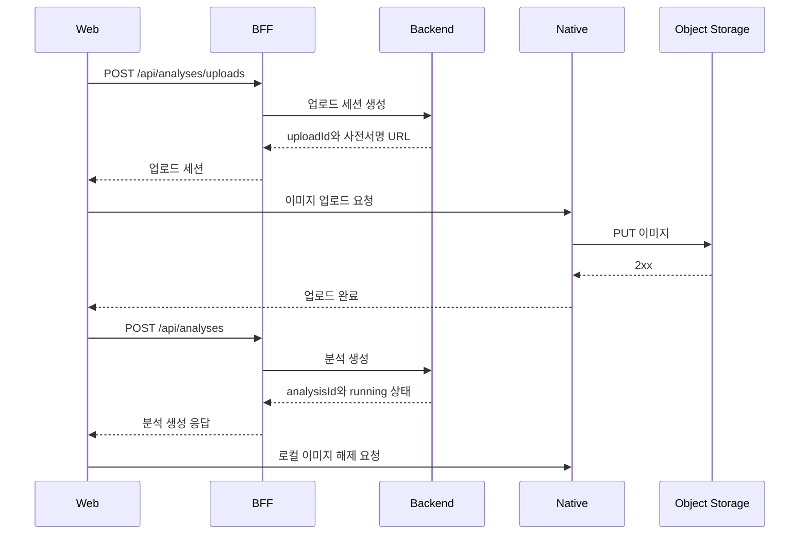

모바일에서 이미지를 업로드하고 비동기 분석 결과를 받는 기능은 파일 전송, 작업 생성, 상태 조회, 화면 이동을 함께 다뤄야 한다\. 네트워크 오류나 화면 이탈이 발생하면 업로드한 파일과 분석 작업, 화면에 표시된 상태가 서로 어긋나기 쉽다\.

이 글에서는 React Native WebView와 Next\.js를 사용하는 환경에서 업로드 세션과 분석 작업을 분리하는 설계를 살펴본다\. 특히 중복 제출 방지, polling 중단 기준, 늦게 도착한 응답과 화면 전환의 경합에 집중한다\.

### 1\. 배경과 설계 범위

이미지는 네이티브 임시 파일이나 브라우저 메모리에 존재한다\. 분석 요청에는 이미지뿐 아니라 이미지에서 추출한 N개의 keypoint와 사용자 입력값이 함께 필요하다\.

이미지 바이너리는 사전서명 URL을 이용해 객체 저장소로 직접 전송한다\. 인증이 필요한 업로드 세션 발급과 분석 API는 Next\.js API route를 BFF로 거치며, 인증 토큰은 HttpOnly cookie로 관리한다\.

이 구조에서는 다음 경계를 구분해야 한다\.

- 촬영한 이미지를 보관하는 클라이언트의 수명
- 객체 저장소로 파일을 전송하는 업로드의 수명
- 서버가 실행하는 분석 작업의 수명
- 분석 결과를 기다리는 화면의 수명

분석 작업이 생성된 뒤에는 화면을 떠나도 서버 작업이 이어질 수 있다\. 반면 작업 생성 전 화면을 떠나면 로컬 이미지나 제출에 필요한 상태를 잃을 수 있다\.

이 글의 API 경로와 식별자는 설명을 위한 예시다\. 업로드 응답 대기 60초, polling 간격 2초, 화면 polling 한도 3분 등의 수치도 이 설계의 예시 값이며, 서비스 계약과 실행 환경에 맞춰 조정해야 한다\.

### 2\. 전체 흐름

```text
홈 → 안내 → 입력 → 처리 중 → 결과
홈 → 내역 → 결과
```

입력 화면에서 처리 중 화면으로, 처리 중 화면에서 결과 화면으로 이동할 때는 기존 화면을 ` replace `한다\. 사용을 마친 입력 화면이 뒤로 가기 경로에 남지 않게 하기 위해서다\.

<div class="notion-table-wrap">
<table>
<thead><tr><th scope="col">단계</th><th scope="col">실행 주체</th><th scope="col">내용</th></tr></thead>
<tbody><tr><td>이미지 준비</td><td>네이티브 또는 브라우저</td><td>사진 선택·촬영, keypoint 검출·조정, 메타데이터 생성</td></tr><tr><td>업로드 세션 생성</td><td>Web → BFF → 백엔드</td><td>파일 메타데이터로 <code>uploadId</code>와 사전서명 PUT URL 발급</td></tr><tr><td>바이너리 업로드</td><td>네이티브 또는 브라우저</td><td>준비한 이미지를 객체 저장소로 직접 PUT</td></tr><tr><td>분석 생성</td><td>Web → BFF → 백엔드</td><td><code>uploadId</code>, keypoint, 사용자 입력값을 제출하고 <code>analysisId</code> 수신</td></tr><tr><td>로컬 이미지 해제</td><td>네이티브 또는 브라우저</td><td>분석 생성 성공 후 임시 파일·메모리 이미지 해제</td></tr><tr><td>결과 조회</td><td>Web</td><td>단건 조회 API를 주기적으로 호출</td></tr><tr><td>결과 표시</td><td>Web</td><td><code>succeeded</code> 상태가 되면 결과 화면으로 이동</td></tr></tbody>
</table>
</div>

분석 생성·목록·단건 조회·대표 지정·삭제는 인증이 필요한 API다\. BFF는 HttpOnly cookie를 사용하고, 401 응답에는 토큰 갱신 후 한 번 재시도하는 흐름을 적용한다\.

이미지 바이너리는 BFF를 통과시키지 않는다\. 네이티브 환경에서는 네이티브가, 브라우저 환경에서는 브라우저가 직접 PUT한다\. 비로그인 공유 조회는 보호된 단건 조회와 별도의 경로로 구성한다\.

### 3\. 클라이언트 진행 상태와 서버 작업 상태 분리

클라이언트가 진행하는 업로드·제출 단계와 서버가 반환하는 분석 상태를 같은 store에 섞지 않는다\.

<div class="notion-table-wrap">
<table>
<thead><tr><th scope="col">상태</th><th scope="col">소유</th><th scope="col">값</th></tr></thead>
<tbody><tr><td>업로드·제출 진행</td><td>Zustand</td><td><code>IDLE → CAPTURE_READY → REQUESTING_UPLOAD_URL → UPLOADING_IMAGE → SUBMITTING_ANALYSIS → POLLING_ANALYSIS</code>, 실패 시 <code>FAILED</code></td></tr><tr><td>서버 분석 상태</td><td>TanStack Query</td><td><code>running</code> / <code>succeeded</code> / <code>failed</code></td></tr></tbody>
</table>
</div>

이 설계에서는 서버 내부의 대기·처리 상태를 ` running ` 하나로 묶어 클라이언트에 전달한다\. 클라이언트는 공개된 세 가지 상태만 해석하며, query가 소유한 서버 상태를 Zustand에 다시 복제하지 않는다\.

새 이미지를 준비할 때는 이전 ` analysisId `를 지워야 한다\. 이전 식별자가 남으면 두 번째 분석을 시작하자마자 과거 결과로 이동할 수 있다\.

```typescript
setCapture: (capture) =>
  set({
    capture,
    status: 'CAPTURE_READY',
    error: null,
    analysisId: null,
  }),

setSubmission: (analysisId) =>
  set({
    analysisId,
    status: 'POLLING_ANALYSIS',
  }),
```

### 4\. 업로드 세션 → 바이너리 업로드 → 분석 생성

준비 단계는 하나의 함수로 묶되, 각 단계의 상태를 외부에 알린다\.

```typescript
export async function prepareImageAnalysis(
  capture,
  inputValues,
  onStatus,
) {
  onStatus('REQUESTING_UPLOAD_URL');

  const uploadSession = await createUploadSession(
    buildCreateUploadSessionRequest(capture),
  );

  onStatus('UPLOADING_IMAGE');

  await uploadCaptureImage({
    captureId: capture.captureId,
    uploadId: uploadSession.uploadId,
    ...uploadSession.upload,
  });

  onStatus('SUBMITTING_ANALYSIS');

  const submitRequest = buildAnalysisSubmitRequest(
    uploadSession.uploadId,
    capture,
    inputValues,
  );

  const submission = await submitAnalysis(submitRequest);

  releaseCaptureImage(capture.captureId);

  return { submitRequest, submission };
}
```

` uploadCaptureImage `와 ` releaseCaptureImage `는 이미지가 네이티브 파일인지 브라우저 메모리 이미지인지에 따라 적절한 구현을 사용한다\. 준비 함수를 호출하는 쪽은 이미지 출처를 분기하지 않는다\.

#### 업로드 세션의 일회성 사용

이 설계에서는 업로드 세션을 한 번만 분석 제출에 사용할 수 있다\. 같은 ` uploadId `를 다시 제출하면 서버가 400으로 거절한다\.

하지만 준비 함수 전체를 다시 실행하면 새 업로드 세션이 발급된다\. 이전 제출이 성공했는지 모르는 상황에서 전체 함수를 재실행하면 별도의 분석 작업이 하나 더 만들어질 수 있다\.

따라서 준비 함수를 하나로 묶는 것과 전체 흐름을 안전하게 재시도할 수 있는 것은 별개의 문제다\.

#### 제출 전 검증

서버에서 거절할 값을 클라이언트에서도 먼저 검사하면 불필요한 업로드와 오류 응답을 줄일 수 있다\. Zod schema와 서버 검증 규칙은 같은 계약을 따라야 한다\.

<div class="notion-table-wrap">
<table>
<thead><tr><th scope="col">항목</th><th scope="col">검증 기준</th></tr></thead>
<tbody><tr><td>이미지 형식</td><td>허용 MIME·확장자 계약과 일치</td></tr><tr><td>파일 크기</td><td>양수이며 서버의 크기 상한 이하</td></tr><tr><td>checksum</td><td>SHA-256을 base64로 표현한 형식</td></tr><tr><td>사용자 입력값</td><td>서버가 허용하는 범위·정밀도 충족</td></tr><tr><td>keypoint 출처</td><td>검출·조정·계산 완료 값만 허용하고 초기화용 값은 거부</td></tr><tr><td>schema·keypoint 버전</td><td>서버가 지원하는 버전과 일치</td></tr></tbody>
</table>
</div>

예를 들어 크기 상한을 15MiB로 정했다면 클라이언트와 서버가 같은 단위와 경계를 사용해야 한다\. 입력 화면의 제출 버튼 활성 조건도 제출 payload 검증과 같은 함수를 사용해야 한다\.

최소 해상도·종횡비·최소 용량은 근거 없이 추가하지 않는다\. 클라이언트에만 하한을 넣으면 서버가 받을 수 있는 이미지도 입력 단계에서 막힐 수 있다\. 필요한 규격은 서버 검증과 함께 계약으로 확정한다\.

또한 ` widthPx `와 ` heightPx `는 클라이언트가 보낸 메타데이터다\. 서버가 실제 업로드된 이미지를 확인하지 않으면 이 값만으로 이미지 규격을 보장할 수 없다\.

#### 브라우저에서도 같은 준비 흐름 사용

브라우저에서도 사진 선택, keypoint 검출·조정 후 동일한 캡처 계약을 만든다\. 업로드·해제 함수가 메모리 이미지를 처리하면 분석 준비 함수는 네이티브와 같은 형태로 유지할 수 있다\.

브라우저에서는 다음 제약을 함께 확인해야 한다\.

- SHA\-256 계산에 필요한 HTTPS 또는 [localhost](<http://localhost/>) 환경
- 객체 저장소의 CORS 설정
- 새로고침 시 메모리 이미지가 사라지는 특성

### 5\. 네이티브 바이너리 업로드 브리지

이미지가 네이티브 임시 저장소에 있다면 바이너리를 WebView로 옮기지 않고 네이티브가 직접 업로드한다\. Web은 업로드 세션을 발급받아 URL과 headers를 네이티브에 전달한다\.

<div class="notion-table-wrap">
<table>
<thead><tr><th scope="col">방향</th><th scope="col">메시지</th><th scope="col">payload 핵심</th></tr></thead>
<tbody><tr><td>Web → Native</td><td><code>REQUEST_CAPTURE_IMAGE_UPLOAD</code></td><td><code>captureId</code>, <code>uploadId</code>, <code>method: &#39;PUT&#39;</code>, <code>url</code>, <code>headers</code></td></tr><tr><td>Native → Web</td><td><code>CAPTURE_IMAGE_UPLOAD_COMPLETED</code></td><td><code>captureId</code>, <code>uploadId</code>, <code>statusCode</code>, <code>etag?</code></td></tr><tr><td>Native → Web</td><td><code>CAPTURE_IMAGE_UPLOAD_FAILED</code></td><td><code>code</code>, <code>captureId?</code>, <code>uploadId?</code>, <code>message?</code></td></tr><tr><td>Web → Native</td><td><code>REQUEST_CAPTURE_IMAGE_RELEASE</code></td><td><code>captureId</code></td></tr></tbody>
</table>
</div>



#### 요청과 응답의 상관관계

Web은 다음 규칙으로 응답을 기다린다\.

- 요청을 공통 schema로 검증한 뒤 발신한다\.
- 완료 응답은 ` captureId `와 ` uploadId `가 요청과 모두 일치해야 수락한다\.
- 다른 업로드의 완료 응답은 무시한다\.
- 실패 응답에 식별자가 있으면 요청과 일치하는지 확인한다\.
- 네이티브 브리지를 사용할 수 없으면 즉시 실패한다\.
- 예시로 60초 안에 응답이 없으면 시간 초과로 처리한다\.

네이티브도 요청 schema와 업로드 모듈의 반환값을 검증한다\. 요청 형식 오류와 업로드 실행 오류를 구분해 응답하면 Web이 실패 단계를 판단하기 쉬워진다\.

업로드에 필요한 범위로 브리지 계약을 제한하고, 이 흐름을 범용 파일 접근 API로 확장하지 않는다\.

### 6\. BFF route와 인증 오류 경계

예시로 ` /api/analyses/[[...segments]] ` 하나의 optional catch\-all route에서 다음 요청을 분기할 수 있다\.

<div class="notion-table-wrap">
<table>
<thead><tr><th scope="col">브라우저 요청</th><th scope="col">segments</th><th scope="col">백엔드 작업</th></tr></thead>
<tbody><tr><td><code>POST /api/analyses/uploads</code></td><td><code>[&#39;uploads&#39;]</code></td><td>업로드 세션 생성</td></tr><tr><td><code>POST /api/analyses</code></td><td><code>[]</code></td><td>분석 생성</td></tr><tr><td><code>GET /api/analyses?page&amp;size</code></td><td><code>[]</code></td><td>분석 목록</td></tr><tr><td><code>GET /api/analyses/{analysisId}</code></td><td><code>[id]</code></td><td>분석 단건</td></tr><tr><td><code>POST /api/analyses/{analysisId}/representative</code></td><td><code>[id, representative]</code></td><td>대표 지정</td></tr><tr><td><code>DELETE /api/analyses/{analysisId}</code></td><td><code>[id]</code></td><td>분석 삭제</td></tr></tbody>
</table>
</div>

그 외 조합은 404로 처리한다\. 백엔드 경로 상수는 route를 조립하는 경계에 모아 둔다\.

#### 식별자 인코딩과 경로 조작 방지

식별자를 경로에 전달할 때는 인코딩하되 ` . `과 ` .. `처럼 경로 의미를 바꾸는 값은 별도로 거부한다\.

```typescript
export const analysisIdSchema = z
  .string()
  .min(1)
  .max(128)
  .refine(
    (value) => value !== '.' && value !== '..',
    'Invalid analysis id',
  );
```

#### 403을 세션 만료로 처리하지 않기

접근 권한이 없는 분석이나 사용할 수 없는 분석에 서버가 403을 반환하면 그 의미를 유지한다\.

403까지 세션 만료로 처리하면 특정 리소스의 권한 문제 때문에 전체 로그인 상태가 해제될 수 있다\. 세션 만료 판정은 401 이후 토큰 갱신도 실패한 경우로 한정한다\.

로그인 전용 화면의 진입 제한과 API에서 수행하는 권한 검증도 구분한다\. 화면 진입을 막는 것만으로 리소스 접근 권한이 검증되지는 않는다\.

### 7\. 실패 지점에 따른 재시도

재시도는 실패한 요청의 성격에 따라 나눈다\.

<div class="notion-table-wrap">
<table>
<thead><tr><th scope="col">실패 지점</th><th scope="col">처리</th></tr></thead>
<tbody><tr><td>업로드 세션 생성·바이너리 업로드</td><td>준비 흐름을 다시 실행할 수 있음</td></tr><tr><td>분석 제출</td><td>성공 여부가 불명확할 수 있으므로 자동 재전송하지 않음</td></tr><tr><td>단건 상태 조회</td><td>GET 요청만 다시 실행</td></tr></tbody>
</table>
</div>

```typescript
const canRetryPreparation =
  Boolean(error) &&
  failedStage !== 'SUBMITTING_ANALYSIS';
```

분석 제출 요청을 보낸 뒤 응답을 받지 못했다면 서버에서는 이미 작업을 생성했을 수 있다\. 이때 새 업로드 세션으로 다시 제출하면 중복 분석이 생길 수 있다\.

제출 결과를 알 수 없어 ` analysisId `를 확보하지 못한 경우에는 목록 조회가 복구 경로가 된다\. 서버와 합의한 제출 멱등성이나 별도의 복구 계약이 없다면 이를 자동 재시도로 해결했다고 볼 수 없다\.

조회 실패와 분석 실패도 구분한다\. 상태 조회가 실패했다고 해서 서버의 분석 작업까지 실패한 것은 아니다\.

### 8\. 단건 polling과 중단 기준

단건 조회는 ` running `일 때만 반복하고 ` succeeded ` 또는 ` failed `가 되면 멈춘다\.

다음은 2초 간격, 화면 진입 후 최대 3분을 사용하는 예시다\.

```typescript
export const ANALYSIS_POLL_INTERVAL_MS = 2_000;
export const ANALYSIS_POLL_TIMEOUT_MS = 3 * 60_000;

export function getAnalysisPollingInterval(
  status,
  pollingSince,
  now,
) {
  if (status !== 'running') return false;

  if (
    pollingSince !== null &&
    now - pollingSince >= ANALYSIS_POLL_TIMEOUT_MS
  ) {
    return false;
  }

  return ANALYSIS_POLL_INTERVAL_MS;
}
```

서버 작업의 제한 시간과 화면 polling 한도는 목적이 다르다\. 서버가 작업을 오래 유지한다고 해서 화면도 같은 시간 동안 반복 조회할 필요는 없다\.

예를 들어 서버가 대기·처리에 각각 최대 30분을 허용하더라도 화면 polling은 3분까지만 수행할 수 있다\. 이후에는 수동 재확인이나 내역 조회로 연결해 반복 요청을 제한한다\.

#### 서버 시각 대신 관측 시점 사용

서버의 ` startedAt ` 또는 ` createdAt `을 단말의 현재 시각과 비교하면 시계 차이 때문에 새 분석도 이미 한도를 초과한 것으로 판정될 수 있다\.

화면 polling 한도는 화면이 ` running `을 처음 관측한 시점부터 계산한다\.

```typescript
refetchInterval: (query) => {
  const status = query.state.data?.status;

  if (status !== 'running') {
    pollingSinceRef.current = null;
    return false;
  }

  pollingSinceRef.current ??= Date.now();

  const interval = getAnalysisPollingInterval(
    status,
    pollingSinceRef.current,
    Date.now(),
  );

  if (interval === false) {
    setIsPollingStopped(true);
  }

  return interval;
},
```

한도 도달 여부가 ` refetchInterval ` 콜백에서 결정되면 UI도 그 변화를 알 수 있어야 한다\. hook이 ` isPollingExhausted ` 같은 state를 노출하고, 화면은 자동 갱신 안내를 수동 재확인 버튼으로 바꾼다\.

내역에서 오래된 ` running ` 항목을 다시 열어도 서버 생성 시각만으로 polling 시작을 막지 않는다\. 화면에서 상태를 관측하는 시간과 서버 작업의 경과 시간을 구분하는 것이다\.

이 설계는 완료 push 알림이나 WebSocket 대신 polling을 사용한다\. 따라서 자동 조회가 멈춘 뒤에는 사용자가 상태를 다시 확인할 수 있는 경로가 필요하다\.

### 9\. 처리 중 화면과 내비게이션 경합

#### 분석 생성 전에는 뒤로 가기 제한

분석 작업이 생성되기 전에는 화면 이탈로 업로드·제출 상태를 잃을 수 있으므로 swipe\-back을 제한한다\.

```typescript
const preventSwipeBack =
  !hasFailure &&
  analysisId === null;
```

` analysisId `를 받으면 서버 작업을 내역에서 다시 찾을 수 있으므로 제한을 푼다\. 실패했을 때도 제한을 풀어야 한다\. 오류 화면에서도 뒤로 가기를 계속 막으면 사용자가 빠져나갈 수 없다\.

#### 전환 중 도착한 완료 상태 유지

분석 완료가 StackFlow 화면 전환 중에 도착할 수 있다\. navigation lock이 잡혀 있을 때 ` replace ` 호출을 버리는 구조라면, 완료 상태를 먼저 소비하고 이동을 요청해서는 안 된다\.

이동 요청이 사라지면 완료된 분석이 있어도 처리 중 화면에 남게 된다\. 완료 상태를 유지하고 이동 가능한 조건이 충족될 때 다시 시도한다\.

```typescript
useEffect(() => {
  if (
    analysisQuery.data?.status !== 'succeeded' ||
    isTransitioning ||
    !activity.isTop ||
    !analysisId
  ) {
    return;
  }

  void queryClient.invalidateQueries({
    queryKey: analysisQueryKeys.lists(),
  });

  replace('AnalysisResultActivity', { analysisId });
}, [
  activity.isTop,
  analysisId,
  analysisQuery.data?.status,
  isTransitioning,
  queryClient,
  replace,
]);
```

전환이 끝나면 effect가 다시 실행돼 결과 화면으로 이동한다\. 이동할 때 목록 query를 무효화하면 내역과 요약 카드도 새 결과를 조회할 수 있다\.

#### 화면 이탈 뒤 도착한 응답 무시

준비 요청 중 다른 경로로 화면을 떠날 수도 있다\. 늦게 도착한 응답이 새 화면의 store를 덮어쓰거나 다른 화면 위에서 결과 이동을 실행하지 않게 해야 한다\.

```typescript
const result = await prepareImageAnalysis(
  capture,
  inputValues,
  onStatus,
);

if (!isTopRef.current) return;

setSubmission(result.submission.analysisId);
```

` isTopRef `는 렌더마다 ` activity.isTop `과 동기화한다\. 비동기 콜백이 오래된 클로저의 화면 상태를 읽지 않도록 하기 위해서다\.

#### 다시 시작할 때 스택과 이미지 정리

입력 화면에서 처리 중 화면을 ` push `하면 뒤로 가기 경로에 제출을 마친 입력 화면이 남는다\. 같은 이미지로 분석을 다시 만들거나, 이미지가 해제된 입력 화면으로 돌아가는 문제가 생길 수 있다\.

입력 → 처리 중 → 결과는 ` replace `로 연결한다\. 처리 중 화면 바로 아래에 안내 화면이 남는 구조라면 다시 시작할 때 새 안내 화면을 추가하지 않고 ` pop `한다\.

다시 시작하기 전에는 보관 중인 로컬 이미지를 해제한다\. 하위 경로 직접 진입 시 복원하는 기본 화면 이력과도 이 규칙을 맞춰야 한다\.

### 10\. 결과·내역 화면과 캐시

결과 화면은 단건 query를 사용하며, 처리 중 화면이 채운 캐시를 재사용한다\. 결과를 그리기 전에 조회 상태와 분석 상태를 먼저 구분한다\.

<div class="notion-table-wrap">
<table>
<thead><tr><th scope="col">조건</th><th scope="col">표시</th></tr></thead>
<tbody><tr><td>조회 중</td><td>로딩 표시</td></tr><tr><td><code>running</code>이며 polling 진행 중</td><td>진행 상태·자동 갱신 안내</td></tr><tr><td>polling 한도 초과</td><td>수동 재확인 버튼</td></tr><tr><td><code>failed</code></td><td>실패 코드에 맞는 안내·재시작 경로</td></tr><tr><td>조회 오류</td><td>재확인 경로</td></tr><tr><td><code>succeeded</code>지만 결과 형식 불일치</td><td>결과 조회 오류 화면</td></tr></tbody>
</table>
</div>

#### 결과 payload의 검증 범위

결과 payload는 응답 경계에서 ` unknown `으로 받고, 화면이 사용하는 필드를 표시 시점에 ` safeParse `한다\.

예를 들어 분류값, 점수, 설명을 표시한다면 해당 필드의 계약을 검증한다\. 화면이 사용하지 않는 부가 필드의 형태 차이 때문에 유효한 결과 전체가 오류로 바뀌지 않도록 검증 범위를 구분한다\.

필수 표시 필드가 잘못된 경우에는 오류 화면을 보여준다\. 완료 상태라는 이유만으로 예시 결과를 대신 표시해서는 안 된다\.

서버 분류값과 UI 테마의 대응도 표시 경계에 모아 둔다\.

#### 내역 페이지 전환

내역은 예를 들어 20개 단위로 페이지를 조회한다\. ` placeholderData: keepPreviousData `를 사용하면 다음 페이지를 가져오는 동안 이전 목록이 유지된다\.

이 처리가 없으면 페이지를 바꿀 때마다 목록 전체가 spinner로 대체될 수 있다\.

단건 응답에 없는 입력값을 결과 화면이 필요로 한다면 전달 경로도 정해야 한다\. 목록 항목에서 화면 param으로 넘기는 방식을 사용했다면, 단건 응답만으로 결과를 구성할 수 있다는 가정을 두지 않는다\.

결과 화면을 닫을 때는 진입 경로를 고려한다\.

- 내역에서 결과를 열었다면 ` pop `으로 돌아간다\.
- 새 분석을 마친 직후라면 결과 화면을 내역으로 ` replace `한다\.

### 11\. 대표 지정·삭제·사용 한도

대표 결과, 삭제, 사용 한도는 업로드 전송과 별도의 리소스 정책이다\. 화면과 서버가 같은 정책을 사용해야 한다\.

다음은 정책을 구성하는 한 가지 예다\.

#### 대표 결과 지정

완료된 본인 분석만 대표로 지정한다\. 새 대표가 지정되면 서버가 이전 대표를 해제한다\.

대표 변경 후에는 목록·단건 캐시와 사용자 요약 정보를 함께 갱신해야 한다\. 대표 표시를 담당하는 내역 화면과 요약 카드가 서로 다른 캐시를 보고 있다면 무효화 범위도 함께 확인한다\.

#### 선택 삭제와 부분 실패

대표 결과는 삭제 대상에서 제외하는 정책을 사용할 수 있다\. 대표 여부를 알 수 없다면 삭제를 막고 이유와 재조회 경로를 제공한다\.

여러 항목의 삭제는 ` Promise.allSettled `로 결과를 모은 뒤 목록을 다시 조회한다\. 응답을 받지 못했더라도 서버 조회로 삭제 완료가 확인된 항목은 실패 항목으로 남기지 않는다\.

남아 있는 실패 항목만 재선택하고, 삭제 성공이 확인된 항목의 단건 캐시를 제거한다\.

soft delete와 사용 횟수 반환 여부는 별도로 정의한다\. 이 예시에서는 삭제가 사용 횟수를 되돌리지 않는다\.

#### 사용 한도의 사전 안내

남은 횟수가 0임을 알고 있다면 촬영 전에 안내할 수 있다\. 값을 모르는 상태에서는 한도 초과로 단정해 차단하지 않는다\.

최종 판정은 분석 제출 시 서버가 수행한다\. 예를 들어 서버의 429와 ` ANALYSIS_LIMIT_EXCEEDED ` 코드를 사용해 한도 초과를 표시할 수 있다\.

### 12\. 비로그인 결과 공유

공유 결과는 로그인 전용 단건 조회와 분리한다\.

예시로 ` /share/analyses/{analysisId} ` 서버 페이지가 공개 조회 API를 호출하도록 구성할 수 있다\. 이 경로에서는 보호 단건 조회 함수나 로그인 세션을 재사용하지 않는다\.

공개 범위는 완료됐고 삭제되지 않은 결과로 제한한다\. 페이지 메타데이터와 본문이 같은 조회 결과를 쓰도록 요청 단위 cache를 공유한다\.

오류도 구분한다\.

<div class="notion-table-wrap">
<table>
<thead><tr><th scope="col">상황</th><th scope="col">처리 예시</th></tr></thead>
<tbody><tr><td>공개할 수 없는 결과, 4xx, 응답 계약 오류</td><td>404</td></tr><tr><td>백엔드 5xx, 네트워크 오류</td><td>서버 오류</td></tr></tbody>
</table>
</div>

서버 장애까지 404로 바꾸면 결과가 없는 상황과 일시적인 장애를 구분하기 어렵다\.

### 13\. 오류 코드와 표시 문구 분리

서버의 ` failure.message `에는 내부 설명이나 서로 다른 언어의 문장이 섞일 수 있다\. 사용자에게 필요한 행동을 안정적으로 안내하려면 code를 기준으로 표시 문구를 고른다\.

```typescript
export const ANALYSIS_FAILURE_MESSAGE = {
  ANALYSIS_TIMEOUT:
    '분석이 너무 오래 걸려 중단됐어요. 처음부터 다시 시도해 주세요.',
  default:
    '분석 중 문제가 생겼어요. 처음부터 다시 시도해 주세요.',
} as const;

export function getAnalysisFailureMessage(failure) {
  return failure?.code === 'ANALYSIS_TIMEOUT'
    ? ANALYSIS_FAILURE_MESSAGE.ANALYSIS_TIMEOUT
    : ANALYSIS_FAILURE_MESSAGE.default;
}
```

시간 초과 외의 처리 실패, 알 수 없는 code, failure 정보가 없는 경우에는 기본 문구를 사용한다\. 처리 중 화면과 결과 화면도 같은 변환 함수를 사용한다\.

위 문구는 표시 방식의 예시다\. 최종 문구는 사용자가 실제로 수행할 수 있는 복구 행동과 맞춰야 한다\.

HTTP 오류를 정규화하는 계층에서도 코드를 보존해야 한다\. 서버가 ` errorCode `를 반환하는데 공통 fetch 함수가 ` code `만 읽으면 화면까지 오류 의미가 전달되지 않는다\.

```typescript
const normalizedCode = error.code ?? error.errorCode;
```

### 14\. 서버 제공 설명과 로컬 대체 문구

분석 분류에 따라 고정 설명을 보여주는 경우, 문구를 클라이언트에만 넣으면 서버에서 내용을 수정해도 반영되지 않는다\.

서버가 제공하는 ` fixedContent `를 우선 사용하고, 값이 없거나 계약에 맞지 않을 때 같은 분류의 로컬 문구를 대체값으로 사용한다\.

```typescript
export function resolveResultContent(
  category,
  fixedContent,
) {
  const fallback = RESULT_CONTENT[category];
  const parsed = resultContentSchema.safeParse(fixedContent);

  if (!parsed.success) return fallback;

  return parsed.data;
}
```

대체 규칙은 명확해야 한다\.

- 빈 값이나 필수 항목 누락도 검증한다\.
- 다른 분류의 문구로 빈자리를 채우지 않는다\.
- 서버와 로컬 대체 문구의 기준을 맞춘다\.
- 서버 응답을 UI용 문장으로 바꾸는 규칙은 변환 함수에 모은다\.

배열을 문장으로 연결하거나 구분자로 합쳐진 내용을 나누는 처리도 화면 여러 곳에서 반복하지 않는다\.

#### 예시 결과로 실제 오류를 가리지 않기

개발용 예시 결과가 실행 경로에 남으면 실제 분석이 실패했거나 결과 계약이 달라졌는데도 정상 결과처럼 보일 수 있다\.

실제 ` analysisId `의 결과는 ` succeeded `이고 필수 payload가 유효할 때만 표시한다\. 계약 불일치는 조회 오류로 처리하며, 다른 예시 결과로 대체하지 않는다\.

테스트에서는 완료된 결과 응답 fixture를 사용하고, 실행 경로의 결과와 구분한다\.

### 15\. 검증 계층과 남는 정책

이 흐름은 브라우저 테스트 하나로 모두 검증할 수 없다\.

<div class="notion-table-wrap">
<table>
<thead><tr><th scope="col">대상</th><th scope="col">적합한 검증 계층</th></tr></thead>
<tbody><tr><td>polling 간격·한도 계산, schema, payload 생성, 문구 변환</td><td>unit</td></tr><tr><td>route 전달·ID 인코딩, 준비 요청 순서, 단계별 실패</td><td>integration</td></tr><tr><td>navigation lock 이후 이동, 화면 이탈 후 응답 무시, 뒤로 가기 제한, 재시작 경로</td><td>integration</td></tr><tr><td>결과·내역의 상태 표시, polling 한도 초과</td><td>integration</td></tr><tr><td>안내 화면 진입, 하위 화면 직접 접근과 hydration</td><td>E2E</td></tr><tr><td>네이티브 촬영·권한·바이너리 PUT</td><td>실기기 검증</td></tr></tbody>
</table>
</div>

네이티브 모듈을 대체한 테스트는 요청·응답을 처리하는 클라이언트 로직을 검증한다\. 실제 권한 요청, 파일 접근, 저장소 업로드 성공 여부는 별도로 확인해야 한다\.

설계를 마무리하려면 다음 정책도 결정해야 한다\.

- 실패·취소 후 객체 저장소에 남은 이미지의 정리 방식
- 제출 결과가 불명확할 때 작업을 복구하는 방법
- 실제 이미지 검사에 근거한 최소 규격
- 이미지와 사용자 입력값의 보존 기간·삭제·접근 권한·동의
- 분석 결과가 제공하지 않는 정보를 화면에서 생략하는 기준

이미지, 민감한 입력값, 사전서명 URL은 로그와 화면 주소에 남기지 않는다\. 저장 위치뿐 아니라 오류 출력과 진단 과정도 같은 기준으로 점검한다\.

### 정리

- 업로드 세션, 바이너리 전송, 분석 생성의 책임과 실패 경계를 나눈다\.
- 제출 결과가 불명확하면 자동 재전송 대신 중복 가능성과 복구 경로를 먼저 확인한다\.
- polling은 화면이 상태를 관측한 시점부터 제한하고 수동 재확인 경로를 제공한다\.
- 완료 상태는 화면 이동이 가능할 때까지 유지하고, 화면 이탈 뒤 도착한 응답은 무시한다\.
- 결과 계약 오류를 예시 데이터로 가리지 않고, 네이티브 업로드는 실기기로 별도 검증한다\.

### 관련 글

- keypoint 기반 이미지 분석 API 계약
- 네이티브 이미지 업로드와 Web 오케스트레이션
- 모바일 이미지 업로드 클라이언트 구현 체크리스트
- 사전서명 업로드 URL과 객체 저장소 공개 주소 설계
- Next\.js BFF의 HttpOnly cookie 인증 설계
- Native\-Web 브리지의 메시지 계약과 보안
- StackFlow 화면 스택과 내비게이션 설계
