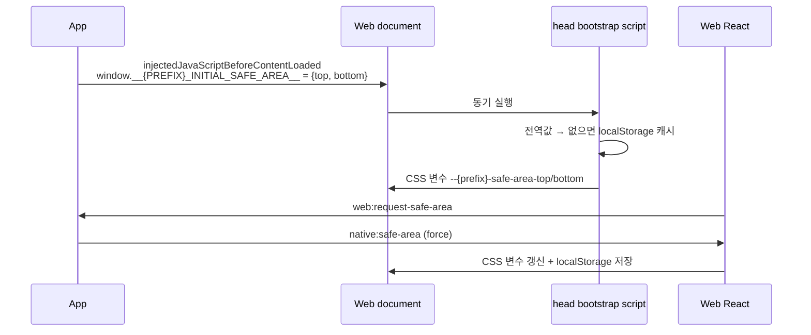

> 표기: 프로젝트 고유 접두사는 ` {prefix} `, 패키지 scope는 ` @scope `로 바꿔 적었다\.

### 문서 목적

WebView 하나로 전체 화면을 그리는 앱에서 기기 safe area inset과 바운스 영역 배경색을 Native와 Web 사이에 어떻게 맞췄는지 정리한다\. 첫 페인트 전 주입, ` <head> ` bootstrap script, 변경 이벤트, Layout과 StackScreen의 소비 방식, 화면 배경색을 App에 알리는 ` web:page-background `를 다룬다\.

아키텍처 전략 글의 Safe Area 절을 구현 단위로 풀어 쓴 글이다\.

### 1\. 책임 분할

<div class="notion-table-wrap">
<table>
<thead><tr><th scope="col">영역</th><th scope="col">담당</th><th scope="col">방법</th></tr></thead>
<tbody><tr><td>좌우 inset</td><td>Native</td><td><code>SafeAreaView edges={[&#39;right&#39;, &#39;left&#39;]}</code></td></tr><tr><td>상하 inset</td><td>Web</td><td>CSS 변수 <code>--{prefix}-safe-area-top/bottom</code></td></tr><tr><td>상태 표시줄</td><td>Native</td><td>투명하게 화면 위에 겹침</td></tr><tr><td>바운스 영역 배경</td><td>Native</td><td>Web이 알려 준 색으로 WebView·루트 배경 칠하기</td></tr></tbody>
</table>
</div>

```typescript
// app/src/app/App.tsx
<SafeAreaProvider initialMetrics={initialWindowMetrics}>
  {/* edge-to-edge(gradle.properties)라 상태 표시줄은 투명하게 화면 위에 겹친다 */}
  <StatusBar barStyle="dark-content" />
  <SafeAreaView edges={['right', 'left']} style={styles.safeArea}>
    <WebViewScreen />
  </SafeAreaView>
</SafeAreaProvider>
```

Android는 ` gradle.properties `의 ` edgeToEdgeEnabled=true `로 edge\-to\-edge를 켰다\. 그래서 WebView는 상태 표시줄과 홈 인디케이터 영역까지 그리고, 위·아래 여백은 화면마다 Web이 정한다\.

### 2\. 계약

계약은 ` packages/shared/src/safe-area.ts `가 소유한다\.

```typescript
export const REQUEST_SAFE_AREA = 'web:request-safe-area';
export const SAFE_AREA_CHANGED = 'native:safe-area';
export const MAX_SAFE_AREA_INSET = 120;

export const safeAreaPayloadSchema = z.object({
  top: z.number().int().min(0).max(MAX_SAFE_AREA_INSET),
  bottom: z.number().int().min(0).max(MAX_SAFE_AREA_INSET),
});
```

payload에는 top과 bottom만 있다\. 좌우 inset은 Native가 처리하므로 계약에 넣지 않았다\.

### 3\. Native: 정규화와 전송

` react-native-safe-area-context `의 ` useSafeAreaInsets ` 값을 ` normalizeSafeAreaInset `이 정수로 반올림하고 0~120으로 clamp한다\(` Math.max(0, Math.min(120, Math.round(value || 0))) `\)\. 테스트는 ` -10 → 0 `, ` 12.4 → 12 `, ` 12.6 → 13 `, ` 140 → 120 `을 확인한다\.

` useSafeAreaBridge `는 마지막으로 보낸 값을 ref에 두고, 값이 같으면 다시 보내지 않는다\. ` force `가 true면 같은 값이라도 보낸다\.

<div class="notion-table-wrap">
<table>
<thead><tr><th scope="col">시점</th><th scope="col">전송</th></tr></thead>
<tbody><tr><td>inset 값 변경</td><td>값이 다를 때만 <code>native:safe-area</code></td></tr><tr><td><code>AppState</code>가 <code>active</code>로 전환</td><td>force 재전송</td></tr><tr><td>Web이 <code>web:request-safe-area</code> 전송</td><td>force 재전송</td></tr><tr><td>Web이 <code>WEB_READY</code> 전송</td><td>force 재전송</td></tr></tbody>
</table>
</div>

상태는 hook 내부 ref만 쓰고 전역 store를 두지 않는다\. ` WEB_READY ` 재전송은 WebView 리로드나 재마운트로 새 문서가 떴을 때를 위한 복구 경로다\.

### 4\. 첫 페인트: 주입과 bootstrap

React가 hydrate된 뒤 이벤트로 inset을 받으면, 첫 화면이 inset 없이 그려졌다가 밀리는 깜빡임이 생긴다\. 그래서 두 단계로 첫 페인트 전에 값을 넣는다\.



#### Native 주입

App은 현재 payload로 전역 변수를 만드는 script를 ` injectedJavaScriptBeforeContentLoaded `로 넘긴다\. 문서 content가 로드되기 전에 실행된다\.

```typescript
export function createSafeAreaBootstrapScript(payload: SafeAreaPayload) {
  return `
    window.__{PREFIX}_INITIAL_SAFE_AREA__ = ${JSON.stringify(payload)};
    true;
  `;
}
```

#### Web ` <head> ` bootstrap

` web/src/app/layout.tsx `는 ` <head> `에 문자열 IIFE를 넣어 동기 실행한다\. 이 script는 번들 밖에서 돌기 때문에 zod를 쓸 수 없다\. 그래서 값을 직접 숫자로 바꾸고 범위를 다시 clamp한다\.

```javascript
(() => {
  if (!window.ReactNativeWebView) return;   // 일반 브라우저에서는 적용하지 않음
  const initialSafeArea = window.__{PREFIX}_INITIAL_SAFE_AREA__;

  configs.forEach(([insetName, storageKey, cssVariable]) => {
    let rawValue = initialSafeArea?.[insetName];
    if (rawValue === undefined) {
      try { rawValue = window.localStorage.getItem(storageKey) ?? undefined; }
      catch { rawValue = undefined; }
    }
    const storedValue = Number(rawValue);
    if (rawValue === undefined || !Number.isFinite(storedValue)) return;

    const inset = Math.max(0, Math.min(120, Math.round(storedValue)));
    document.documentElement.style.setProperty(cssVariable, inset + 'px');
  });
})();
```

<div class="notion-table-wrap">
<table>
<thead><tr><th scope="col">순서</th><th scope="col">값 출처</th></tr></thead>
<tbody><tr><td>1</td><td>App이 주입한 전역 변수</td></tr><tr><td>2</td><td>localStorage 캐시(이전 실행에서 저장한 값)</td></tr><tr><td>3</td><td>둘 다 없거나 숫자가 아니면 아무것도 하지 않음 → CSS 기본값</td></tr></tbody>
</table>
</div>

테스트는 script 문자열을 ` Function `으로 직접 실행해, 전역값이 있으면 캐시를 읽지 않는 것과 캐시의 ` 140 `·` -10 `이 ` 120px `·` 0px `로 clamp되는 것을 확인한다\.

CSS 기본값은 ` globals.css `의 ` :root `에 있으며, ` --{prefix}-safe-area-top/bottom `을 각각 ` env(safe-area-inset-top, 0px) `, ` env(safe-area-inset-bottom, 0px) `로 둔다\. 일반 브라우저에서는 bootstrap이 바로 return하므로 이 ` env() ` 기본값이 그대로 쓰인다\.

#### 이후 변경

` SafeAreaSync `가 마운트되면 ` native:safe-area `를 구독하고 ` web:request-safe-area `를 보낸다\. 받은 payload는 ` safeAreaPayloadSchema.safeParse `를 통과해야 하고, 실패는 조용히 무시한다\. 통과한 값은 ` applySafeArea `가 CSS 변수에 쓰고 localStorage에 저장한다\.

상태는 React state가 아니라 CSS 변수가 source of truth다\. localStorage는 다음 실행의 첫 페인트용 캐시일 뿐이라, 저장이 실패해도 무시한다\.

### 5\. 소비: Layout과 StackScreen

#### Layout

화면 외곽은 ` Layout.Content `와 ` Layout.Bottom `의 ` safeAreaVariant `로 정한다\. 값은 ` 'none' | 'top' | 'bottom' | 'both' `다\.

```typescript
const safeAreaVariantStyles: Record<LayoutSafeAreaVariant, string> = {
  none: '',
  top: 'pt-[var(--{prefix}-safe-area-top)]',
  bottom: 'pb-[var(--{prefix}-safe-area-bottom)]',
  both: 'pt-[var(--{prefix}-safe-area-top)] pb-[var(--{prefix}-safe-area-bottom)]',
};
```

safe area padding은 바깥 wrapper에, 호출부의 ` paddingVariant `와 ` className `은 안쪽 요소에 붙인다\. 호출부가 ` py-0 ` 같은 class를 넘겨도 safe area padding을 지우지 못하게 하려고 둘을 분리했다\. 테스트가 이 배치를 고정한다\.

새 화면에서는 ` env(safe-area-inset-*) `를 직접 계산하지 않는다\. full\-bleed 영역이나 fixed overlay처럼 Layout 밖에 배치해야 하면 같은 CSS 변수를 쓴다\.

#### StackScreen의 AppBar offset

AppBar가 있는 화면은 콘텐츠를 AppBar 높이와 상단 inset만큼 내린다\.

```typescript
const APP_BAR_OFFSET =
  'calc(var(--stackflow-plugin-basic-ui-app-bar-height, 3.5rem) + ' +
  'max(var(--stackflow-plugin-basic-ui-app-bar-min-safe-area-inset-top, 0px), env(safe-area-inset-top)))';
```

StackFlow basic\-ui의 최소 상단 inset 변수를 CSS에서 우리 변수로 연결한다\.

```css
.{prefix}-stack-screen-safe-area {
  --stackflow-plugin-basic-ui-app-bar-min-safe-area-inset-top: var(--{prefix}-safe-area-top);
}
```

결과적으로 offset은 ` AppBar 높이 + max(Native가 알려 준 top, env(safe-area-inset-top)) `이다\. AppBar와 Layout이 같은 변수를 읽으므로 상단 여백 기준이 한 곳으로 모인다\.

### 6\. 바운스 배경색 동기화

#### 문제

기기에서 화면을 위·아래로 끌면 WebView 바깥의 App 바탕색\(` #F2F2F7 `\)이 보였고, 화면마다 배경색이 달라 이 영역이 어긋났다\.

#### Web: 맨 위 배경색 읽기

` NativeBridgeSync `가 App 안에서만 400ms마다 화면 맨 위의 불투명 배경색을 읽고, 직전 값과 다를 때만 보낸다\.

```typescript
export function readPageBackground(doc: Document = document): string | null {
  const x = Math.round(doc.documentElement.clientWidth / 2);
  for (const element of doc.elementsFromPoint(x, 1)) {
    const color = toOpaqueHex(getComputedStyle(element).backgroundColor);
    if (color) return color;
  }
  return null;
}
```

화면 맨 위 가운데 지점\(y=1\)에 겹친 요소를 위에서부터 보며 처음 나오는 불투명 배경색을 쓴다\. ` toOpaqueHex `는 ` rgb() `·` rgba() ` 계산값 중 alpha가 1 미만이면 ` null `을 돌려, dim 같은 반투명 레이어를 건너뛰고 그 아래 요소를 본다\. 테스트는 반투명 dim 아래의 화면 배경색이 선택되는 것을 확인한다\.

화면 전환이나 시트를 따로 구독하지 않고 주기적으로 읽는 방식은 의도적인 단순화다\. 코드 주석에 전환 이벤트가 생기면 그쪽으로 옮긴다고 남겨 두었다\.

#### App: WebView와 루트에 칠하기

App은 ` web:page-background `를 ` #RRGGBB ` 정규식으로 검증한 뒤 상태에 넣고, WebView ` style `과 WebView를 감싼 루트 View 배경에 같이 쓴다\. 기본값은 ` #FFFFFF `다\.

integration 테스트는 Web이 알려 준 색이 WebView 바탕에 적용되는 것을 확인한다\.

### 일반 브라우저의 런타임 표시와 공통 폭

런타임 표시는 safe\-area bootstrap과 별도의 head script가 첫 페인트 전에 설정한다\. hydration이 HTML 속성을 제거하는 경우 ` NativeBridgeSync `가 ` data-{prefix}-runtime `을 복구한다\. 일반 브라우저에서는 native 캐시 inset 대신 CSS ` env() ` 기본값을 쓰며, 슬라이드·dim·swipe edge를 끈다\. 내비게이션 hook도 ` animate: false `를 보내 입력 잠금이 남지 않게 한다\.

홈·로그인·약관 화면은 다른 Activity와 같은 공통 Layout 폭을 따른다\. 홈 카드 그림은 넓은 브라우저에서도 카드 오른쪽에 붙도록 배치한다\. native inset과 웹 콘텐츠 최대 폭은 서로 다른 책임이다\.

### 현재 제약

- 계약에 좌우 inset이 없다\. 좌우 여백은 Native ` SafeAreaView `에만 기대며, Web은 좌우 inset 값을 알지 못한다\.
- bootstrap script의 clamp 상한 120은 shared 상수를 문자열에 끼워 넣어 맞춘다\. 검증 로직 자체는 zod schema와 따로 존재한다\.
- 첫 실행에서 주입 전역값도 캐시도 없으면 CSS 기본값 ` env() `로 첫 페인트를 한다\.
- 배경색은 400ms 주기로 읽으므로 화면 전환 직후 최대 한 주기 동안 이전 색이 보일 수 있다\.
- 배경색 판정은 맨 위 한 점만 본다\. 아래쪽 바운스 영역도 같은 색으로 칠한다\.
- 커밋 기록상 바운스 배경색은 실기기에서 아직 확인하지 못한 상태로 들어갔다\.

### 참고

- 관련 글: 프론트엔드 아키텍처 전략, Native\-Web 브리지 계약과 보안 설계, StackFlow 기반 WebView 내비게이션 설계

### 구현 근거와 검토 범위

2026\-11\-11, FE commit ` 645a584 ` 기준으로 코드·설정과 관련 변경 이력을 대조했다\. 근거: ` web/src/app/layout.tsx `, ` web/src/shared/bridge/components/native-bridge-sync.tsx `\. 문서에 인용한 이전 검증 기록과 이번 검토를 구분하며, 이번 작업에서 앱·브라우저 런타임 테스트를 재실행하지 않았다\.

### 관련 구현 문서

[Native\-Web 브리지 계약과 보안 설계](<https://app.notion.com/p/4150d0f75cd681acb3bffe3589d97679>)

[WebView 하이브리드 앱의 테스트 계층 설계](<https://app.notion.com/p/4150d0f75cd681ddaf86eac2325c2082>)
