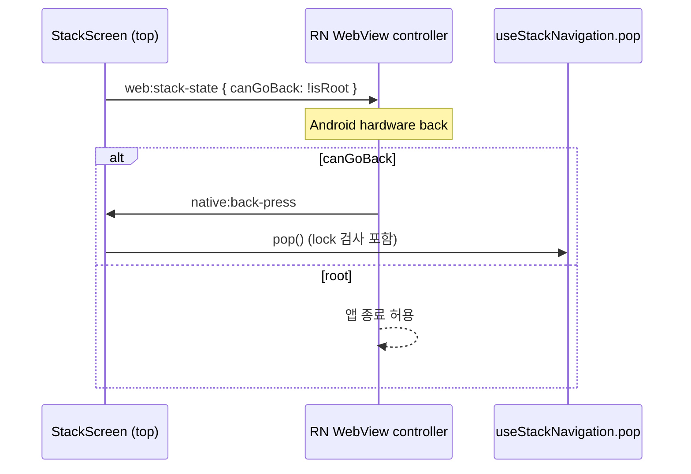

### 문서 목적

WebView 애플리케이션에서 StackFlow로 화면 stack을 구성한 방식을 정리한다\. Activity 등록과 타입 계약, URL 동기화와 deep link 복원, 공용 화면 셸, navigation lock, 네이티브 hardware back 연동을 현재 코드 기준으로 다룬다\.

> 표기: 내부 패키지 scope는 ` @scope `로 바꿔 적었다\.

### 1\. 적용 배경

URL 교체만으로는 다음 요구사항을 일관되게 처리하기 어려웠다\.

- 화면을 ` push `, ` replace `, ` pop ` 단위로 쌓고 이전 화면 상태를 유지
- 모바일 앱 같은 좌우 전환과 AppBar
- 브라우저 URL과 Activity stack 동기화, 새로고침·deep link 복원
- Android hardware back과 Web stack 상태 연결
- 여러 단계로 이어지는 흐름에서 중복 내비게이션 방지

StackFlow는 stack 상태와 렌더링, UI, history 기능을 plugin으로 조립할 수 있어 이 경계를 나누기 좋았다\.

### 2\. 설치 버전

<div class="notion-table-wrap">
<table>
<thead><tr><th scope="col">Package</th><th scope="col">Version</th><th scope="col">책임</th></tr></thead>
<tbody><tr><td><code>@stackflow/core</code></td><td><code>1.3.0</code></td><td>Activity stack과 transition 상태</td></tr><tr><td><code>@stackflow/react</code></td><td><code>1.12.0</code></td><td>React <code>Stack</code>과 action·state hook</td></tr><tr><td><code>@stackflow/plugin-renderer-basic</code></td><td><code>1.1.13</code></td><td>기본 DOM 렌더링</td></tr><tr><td><code>@stackflow/plugin-basic-ui</code></td><td><code>1.19.2</code></td><td>Cupertino theme와 AppBar</td></tr><tr><td><code>@stackflow/plugin-history-sync</code></td><td><code>1.9.0</code></td><td>Activity ↔ browser history·URL 동기화</td></tr><tr><td><code>@stackflow/react-ui-core</code></td><td><code>1.3.8</code></td><td>Activity UI 상태와 transition helper</td></tr><tr><td><code>@stackflow/config</code></td><td><code>1.2.2</code></td><td>설정 타입</td></tr><tr><td><code>@scope/stackflow-kit</code></td><td>고정 commit</td><td>navigation lock, 안전한 action, 스프링 swipe-back, screen lifecycle</td></tr></tbody>
</table>
</div>

v1 형식인 ` stackflow({ activities, plugins }) `를 쓴다\. 모든 ` @stackflow/* `는 ` ^ ` 없이 정확한 버전으로 고정했다\. patch 번호 안에서도 peer 범위가 바뀌는 경우가 있어서다\(renderer\-basic은 1\.1\.14부터 core ` ^2 `를 요구한다\)\. v2 config\-first API로 옮길 때는 migration guide를 기준으로 따로 검증한다\.

### 3\. 런타임 구성

```text
Next.js catch-all route
web/src/app/[[...stack]]/page.tsx
  -> <Stack initialContext={요청 경로} />
     -> stackflow/config/stackflow.ts
        -> Activity 등록 + params 타입 registry
        -> basicRendererPlugin
        -> basicUIPlugin (cupertino, AppBar 토큰)
        -> historySyncPlugin (routes + defaultHistory)

Feature Activity
  -> @/shared/stackflow (barrel)
     -> StackScreen (Web adapter)
        -> AppBar·Layout·safe area 주입
        -> native runtime adapter 주입
        -> kit StackScreen: 전환, swipe-back, lock 해제, stack-state 발행
     -> useStackNavigation (kit hook + popTo 확장)
```

route entry는 ` &lt;Stack /&gt; `만 렌더링한다\. middleware가 요청 경로를 header로 넘기고, page가 이를 ` initialContext `로 전달해 서버 렌더링 시점에도 올바른 Activity를 그린다\.

StackFlow 공통 동작\(lock, 안전한 action, swipe, screen lifecycle\)은 별도 패키지로 분리했고, Web에는 AppBar·Layout·bridge를 연결하는 adapter만 남겼다\. 분리 배경은 별도 글에서 다룬다\.

### 4\. Activity와 URL

화면이 늘어나면서 Activity는 영역별로 묶어 관리한다\.

<div class="notion-table-wrap">
<table>
<thead><tr><th scope="col">영역</th><th scope="col">예시 Activity</th><th scope="col">URL 예시</th></tr></thead>
<tbody><tr><td>홈</td><td><code>HomeActivity</code>, <code>NotificationActivity</code></td><td><code>/</code>, <code>/notifications</code></td></tr><tr><td>체형 분석</td><td>Guide, Measure, Loading, Result, History</td><td><code>/body-analysis</code>, <code>/body-analysis/result/:analysisId</code></td></tr><tr><td>옷장</td><td>Closet, ItemDetail, ItemForm, CodiDetail, CodiForm …</td><td><code>/closet</code>, <code>/closet/items/:itemId</code></td></tr><tr><td>마이페이지</td><td>MyPage, ProfileEdit, Faq, Inquiry, Notice, NoticeDetail</td><td><code>/my-page</code>, <code>/my-page/notice/:noticeId</code></td></tr><tr><td>인증</td><td><code>TermsAgreementActivity</code></td><td><code>/terms</code></td></tr></tbody>
</table>
</div>

#### 세 등록부를 컴파일 단계에서 맞추기

Activity를 추가할 때 등록부는 세 곳이다\.

1. ` activities ` 객체
1. params 타입 registry \(` StackActivityRegistry ` module augmentation\)
1. ` historySyncPlugin.routes `

하나라도 빠지면 평소에는 동작하다가 새로고침·deep link에서만 드러난다\. 그래서 컴파일에서 막는다\.

```typescript
declare module '@scope/stackflow-kit' {
  interface StackActivityRegistry {
    HomeActivity: HomeActivityParams;
    BodyAnalysisResultActivity: BodyAnalysisResultActivityParams;
    // ...
  }
}

type ActivityName = keyof typeof activities;

type AssertSameKeys<Actual extends string, Expected extends string> = [Actual] extends [Expected]
  ? [Expected] extends [Actual]
    ? true
    : never
  : never;
const registryMatchesActivities: AssertSameKeys<keyof StackActivityRegistry, ActivityName> = true;

const routes: Record<ActivityName, string | ReturnType<typeof under>> = { /* ... */ };
```

registry가 채워지면 ` push(&#39;DetailActivity&#39;, params) `의 이름과 params도 타입으로 검사된다\.

#### deep link에서 부모 화면 깔아 두기

하위 화면을 deep link나 새로고침\(WebView 재시작 포함\)으로 바로 열면 stack에 그 화면 하나만 남아 뒤로가기·닫기·저장 후 pop이 아무 일도 하지 않는다\. 그래서 route마다 기본 이전 화면을 ` defaultHistory `로 깔아 둔다\.

```typescript
const under = (parent: ActivityName, path: string, between: ActivityName[] = [], parentParams = {}) => ({
  path,
  defaultHistory: () => ({
    entries: [
      { activityName: parent, activityParams: parentParams },
      ...between.map((activityName) => ({ activityName, activityParams: {} })),
    ],
    skipDefaultHistorySetupTransition: true,
  }),
});

const routes = {
  HomeActivity: '/',
  BodyAnalysisMeasureActivity: under('HomeActivity', '/body-analysis/measure', ['BodyAnalysisGuideActivity']),
  NoticeDetailActivity: under('MyPageActivity', '/my-page/notice/:noticeId', ['NoticeActivity']),
  // ...
};
```

기본 history를 깔 때는 전환을 건너뛴다\. 전환을 두면 전환 상태가 요청 시각으로 정해져 서버와 브라우저의 hydration이 어긋난다\. 알 수 없는 초기 URL은 ` HomeActivity `로 fallback한다\.

#### Next App Router와의 popstate 충돌

Next App Router는 자기가 쓰지 않은 history 항목\(내부 표식이 없는 항목\)으로 ` popstate `가 오면 페이지를 새로 고친다\. ` defaultHistory ` 항목은 Next가 history를 패치하기 전에 쓰여 표식이 없다\. 그래서 모듈 로드 시 capture 단계 리스너로 StackFlow history 항목에 표식을 붙여, 새로고침 대신 현재 트리를 유지하게 했다\.

Next 내부 표식에 기대는 우회이므로 Next를 올릴 때 deep link E2E부터 확인한다\.

### 5\. Plugin 책임

#### ` basicRendererPlugin `

StackFlow 상태를 DOM 렌더링에 연결한다\. stack 순서대로 형제 요소를 렌더링하는데, swipe\-back의 뒤 화면 탐색이 이 구조에 기댄다\.

#### ` basicUIPlugin `

` cupertino ` theme와 AppBar를 제공한다\. 높이, 하단 선, 제목·아이콘 색은 디자인 token으로 설정한다\. 공용 ` StackScreen `이 AppBar를 감싸고 ` default `, ` close-only ` variant를 노출한다\.

#### ` historySyncPlugin `

브라우저 history와 Activity stack을 동기화한다\. 직접 URL 진입, 브라우저 뒤로가기, deep link 복원이 같은 route 전이를 쓴다\.

### 6\. 코드 책임 경계

<div class="notion-table-wrap">
<table>
<thead><tr><th scope="col">위치</th><th scope="col">책임</th></tr></thead>
<tbody><tr><td><code>web/src/app/[[...stack]]/stackflow/config</code></td><td>Activity·params registry·route·plugin 조립</td></tr><tr><td><code>web/src/app/[[...stack]]/stackflow/activities</code></td><td>여러 feature를 조합하는 Activity</td></tr><tr><td><code>web/src/features/*/components</code></td><td>feature Activity UI와 동작</td></tr><tr><td><code>web/src/shared/stackflow/components</code></td><td>Web <code>StackScreen</code> adapter (AppBar, Layout)</td></tr><tr><td><code>web/src/shared/stackflow/hooks</code></td><td>kit navigation + <code>popTo</code> 확장</td></tr><tr><td><code>web/src/shared/stackflow/runtime</code></td><td>native back 구독과 stack 상태 발행 adapter</td></tr><tr><td>외부 <code>stackflow-kit</code></td><td>lock, 안전한 action, swipe, screen lifecycle, 전환 상수</td></tr></tbody>
</table>
</div>

화면 코드는 ` @/shared/stackflow ` barrel만 쓴다\. barrel이 ` StackScreen `\(Web adapter\)과 ` useStackNavigation `\(kit\)의 출처 차이를 흡수한다\.

### 7\. ` StackScreen ` 책임

kit ` StackScreen `이 담당:

- ` isRoot `, ` isTop `, ` transitionState `에 따른 위치 계산과 진입·퇴장 transform
- 뒤 화면 패럴랙스\(너비의 30%\)와 dim
- custom swipe\-back과 ` preventSwipeBack `
- 전환 중 추가 touch 차단
- 전환이 idle로 돌아올 때 navigation lock 해제
- 최상단일 때 stack 상태 발행과 back 이벤트 구독

Web adapter가 주입:

- AppBar\(` renderHeader `\)와 ` default `·` close-only ` variant
- ` Layout `\(` renderContent `\)과 AppBar 높이 \+ safe\-area top content offset
- native runtime adapter
- root에서의 닫기 동작: deep link로 root가 된 하위 화면의 닫기·뒤로가기는 홈으로 ` replaceTab `
- ` blockNavigation `: 작업 중이거나 시트가 열린 동안 swipe·hardware back·헤더 back을 함께 막음

### 8\. 공용 Navigation API

화면 코드는 raw action 대신 ` useStackNavigation() `을 쓴다\.

<div class="notion-table-wrap">
<table>
<thead><tr><th scope="col">API</th><th scope="col">동작</th></tr></thead>
<tbody><tr><td><code>push(activity, params)</code></td><td>Activity 추가</td></tr><tr><td><code>replace(activity, params)</code></td><td>현재 Activity 교체</td></tr><tr><td><code>pop()</code></td><td>root가 아닐 때 최상단 Activity 제거</td></tr><tr><td><code>replaceTab(activity, params)</code></td><td>root depth로 정리한 뒤 교체 (탭 전환)</td></tr><tr><td><code>popTo(activity, params)</code></td><td>stack 아래의 해당 Activity까지 전환과 함께 닫기. 없으면 <code>replaceTab</code></td></tr><tr><td><code>isTransitioning</code></td><td>전환 진행 중이거나 lock이 걸린 상태</td></tr></tbody>
</table>
</div>

모든 action은 ` globalTransitionState === &#39;idle&#39; `과 lock을 함께 확인한다\. lock은 Zustand store의 ` getState() `로 동기 획득하므로 같은 frame에 들어온 중복 action도 첫 번째만 통과한다\.

- animated action: 전환이 idle로 돌아오면 ` StackScreen `이 lock을 푼다\.
- ` animate: false ` action: 이 action이 소유한 token으로 다음 frame에 직접 푼다\.
- 비정상 lifecycle: 같은 token일 때만 ` 350 + 650 = 1000ms ` fallback으로 푼다\.

` popTo `는 kit에 없는 동작이라 Web이 확장했다\. 여러 화면을 한 번에 닫을 때 전에는 ` replaceTab `\(전환 없음\)을 써서 화면이 툭 바뀌었는데, ` popTo `는 맨 위 화면만 밀려나는 pop 전환을 쓰고 kit과 같은 lock을 잡는다\.

### 9\. 네이티브 hardware back 연동



처음에는 Native가 ` window.history.back() `을 주입하고 ` historySyncPlugin `이 pop하게 했다\. 이 경로는 navigation lock을 우회해 전환 중 연타에서 이중 pop이 재현됐다\. 지금은 Native가 이벤트만 보내고, 최상단 ` StackScreen `이 버튼 pop과 같은 ` pop() ` 경로로 처리한다\. ` preventSwipeBack `이거나 root이거나 swipe 중이면 무시한다\.

Native는 Web이 ` web:stack-state `를 한 번이라도 보낸 뒤로는 WebView 자체의 ` canGoBack `을 무시한다\. 그 전까지만 WebView navigation state를 fallback으로 쓴다\.

root 탭에서 시트나 메뉴가 열려 있으면 ` blockNavigation `이 ` canGoBack: true `를 발행한다\. 그래야 hardware back이 앱 종료 대신 Web으로 와서 오버레이를 닫는다\.

### 10\. Transition 상태와 곡선

참조하는 핵심 상태:

- ` activity.transitionState `: enter/exit 진행 상태
- ` activity.isRoot `, ` activity.isTop `
- ` stack.globalTransitionState `: 전체 전환의 idle 여부

전환 시간은 ` STACK_TRANSITION_DURATION_MS `\(350ms\) 하나를 StackFlow 설정과 lock fallback이 공유한다\. push·pop 곡선은 swipe\-back과 같은 임계 감쇠 스프링을 정지 상태에서 출발시킨 모양을 CSS ` linear() `로 옮긴 값이다\. ` linear() `를 지원하지 않는 WebView\(iOS 17\.2 미만 등\)는 같은 스프링에 맞춘 ` cubic-bezier ` 근사를 쓴다\.

iOS WKWebView는 기본적으로 60fps에 묶여 있어 ProMotion 기기에서 전환이 덜 부드러웠다\. WebView 라이브러리를 pnpm patch로 수정해 120Hz로 그리게 했다\.

### 11\. Activity 추가 체크리스트

- [ ] feature ` components/ `\(여러 feature 조합이면 app ` activities/ `\)에 Activity 작성
- [ ] ` ActivityComponentType `으로 params 타입 연결
- [ ] ` activities `, ` StackActivityRegistry `, ` routes ` 세 곳을 같은 커밋에서 등록
- [ ] 하위 화면이면 ` under(...) `로 부모 화면을 ` defaultHistory `에 깔기
- [ ] 화면 최상위를 ` StackScreen `으로 감싸기
- [ ] root·처리 중 화면이면 ` preventSwipeBack `, 오버레이가 열리는 root 화면이면 ` blockNavigation `
- [ ] 이동은 ` useStackNavigation `으로
- [ ] 직접 URL 진입·새로고침과 Android hardware back 검증
- [ ] AppBar, safe area, 연타, 전환 검증

### 12\. 제약과 변경 시 확인 사항

- v1 package 조합에 v2 예제를 그대로 적용하지 않는다\.
- Activity의 Client Component 경계를 유지한다\.
- 화면 코드에서 ` @stackflow/react `의 ` useActions() `를 직접 쓰지 않는다\. ` popTo `의 내부 구현만 예외다\.
- route 조립은 app layer에 둔다\.
- Next를 올리면 popstate 우회와 deep link 복원을, StackFlow나 kit을 올리면 swipe\-back·lock·hardware back을 회귀 검증한다\.
- 브라우저 E2E는 hardware back과 native bridge 실동작을 재현하지 못한다\. WebView 실기기·시뮬레이터에서 swipe·hardware back·새로고침을 따로 확인한다\.

### 참고

- StackFlow 공식 소개
- Activity 공식 문서
- History Sync 공식 문서
- StackFlow v1 → v2 Migration Guide
- 관련 글: 커스텀 Swipe\-back 구현 배경 및 설계, StackFlow kit 패키지 분리 배경 및 설계
