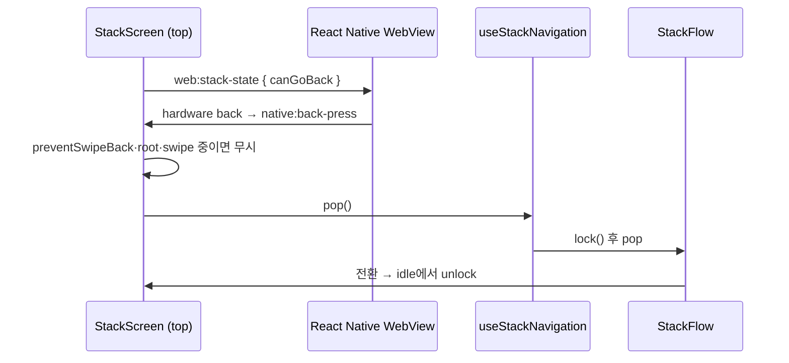
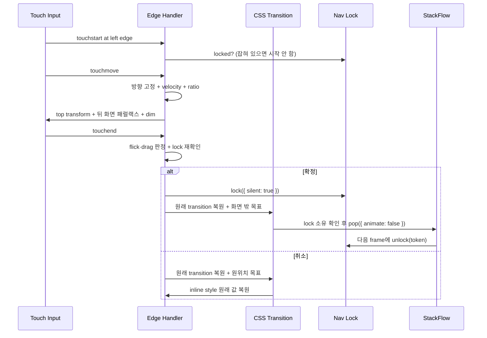

### 문서 목적

WebView 화면의 swipe\-back을 직접 구현한 배경과 설계를 정리한다\. 제스처 판정, CSS 전환 마무리, 패럴랙스 렌더링, navigation lock, StackFlow pop과 네이티브 hardware back의 연결 방식을 다룬다\.

이 구현은 처음에 앱 코드\(` shared/stackflow `\) 안에서 만들었고, 이후 런타임과 무관한 별도 패키지\(` stackflow-kit `\)로 분리했다\. 아래 내용은 분리된 패키지의 현재 구현 기준이다\.

### 1\. 직접 구현한 배경

StackFlow의 stack 상태와 action은 그대로 쓰면서 전환 동작은 세밀하게 제어해야 했다\.

- 손가락 이동 거리와 화면 transform을 즉시 연결하는 interactive gesture
- 짧고 빠른 flick과 충분히 긴 drag를 모두 완료로 판정
- 기준에 못 미친 drag는 같은 전환 곡선으로 원위치 복귀
- 뒤 화면이 함께 움직이는 패럴랙스와 dim
- swipe와 버튼 pop의 감속 모양을 같게 맞추기
- custom 애니메이션이 끝난 뒤 StackFlow pop 애니메이션이 다시 실행되는 문제 방지
- swipe와 버튼 action이 같은 stack을 동시에 바꾸는 race condition 차단
- Web stack의 뒤로가기 가능 여부를 Android hardware back과 공유

그래서 제스처와 애니메이션은 ` useSpringSwipeBack `이, stack 변경은 StackFlow가 맡도록 나눴다\.

### 2\. 구현 파일과 책임

<div class="notion-table-wrap">
<table>
<thead><tr><th scope="col">파일</th><th scope="col">책임</th></tr></thead>
<tbody><tr><td><code>hooks/use-spring-swipe-back</code></td><td>touch 추적, 완료 판정, CSS 전환 마무리, 패럴랙스·dim</td></tr><tr><td><code>components/stack-screen</code></td><td>gesture DOM ref, 화면 셸, pop 확정, touch 차단 overlay, 뒤 화면 위치</td></tr><tr><td><code>hooks/use-stack-navigation</code></td><td>공용 navigation action과 lock 연동</td></tr><tr><td><code>stores/nav-lock.state</code></td><td>token 기반 동기 mutex와 fallback 해제</td></tr><tr><td><code>constants/stack-transition.constant</code></td><td>전환 시간, 스프링 상수, 곡선, 패럴랙스 비율</td></tr><tr><td>앱의 StackFlow 설정</td><td>Activity, plugin, <code>transitionDuration</code></td></tr><tr><td>앱의 runtime adapter</td><td>hardware back 이벤트를 <code>StackScreen</code>에 연결</td></tr></tbody>
</table>
</div>

### 3\. Gesture 시작 조건

root가 아니고 ` preventSwipeBack `이 false인 화면에서만 활성화한다\. touch 시작점은 왼쪽 20px edge로 제한하고, edge는 ` touch-action: pan-y `로 세로 스크롤을 브라우저에 맡긴다\.

시작 시 다음을 확인한다\.

- 확정된 swipe의 CSS 전환이 진행 중이면 새 touch를 무시한다\. 새 touch가 확정된 pop을 취소하지 않게 하기 위해서다\.
- 이미 제스처를 소유한 손가락이 있으면 다른 손가락은 무시한다\. ` touch.identifier `로 소유 touch를 추적한다\.
- 다른 navigation\(버튼 pop/push\)이 lock을 잡고 있으면 제스처를 시작하지 않는다\.
- 취소 전환이 진행 중이면 현재 화면 위치를 읽고 새 제스처가 그 위치에서 이어받는다\.

` dx `, ` dy ` 중 하나가 5px을 넘으면 처음 방향을 고정한다\.

- ` abs(dx) > abs(dy) `이고 ` abs(dx) > 5 `: 가로 swipe 시작\. 판정 지점부터 따라가 화면이 5px 튀지 않게 한다\.
- ` abs(dy) > abs(dx) `이고 ` abs(dy) > 5 `: 세로 제스처로 확정하고 무시
- 시작점보다 왼쪽으로는 끌리지 않게 0으로 clamp

listener는 passive로 등록하고, 드래그 중에는 touch 이동에 맞춰 DOM transform을 갱신한다\. 손을 뗀 뒤의 이동은 CSS transition에 맡긴다\.

### 4\. 완료 판정

손을 뗄 때 velocity 또는 이동 비율 중 하나를 만족하면 pop을 확정한다\.

```typescript
const VELOCITY_THRESHOLD = 200;     // px/s
const MIN_FLICK_DISPLACEMENT = 5;   // px
const DRAG_THRESHOLD_RATIO = 0.35;  // 화면 너비 대비
const STALE_VELOCITY_MS = 80;       // 마지막 이동 후 이 시간이 지나면 flick 아님

const isFlick = velocity > 200 && displacement > 5;
const isDrag = displacement / screenWidth > 0.35;
const swiped = (isFlick || isDrag) && !navigationLocked;
```

velocity는 최근 delta에 더 큰 가중치를 주는 지수 이동 평균이다\. 왼쪽으로 되돌아가는 중에도 갱신해 낡은 속도가 남지 않게 한다\.

```text
velocity = previousVelocity × 0.1 + currentVelocity × 0.9
```

손가락을 멈춘 채 80ms 넘게 있다가 떼면 마지막 속도를 0으로 본다\. 네이티브 iOS처럼 &quot;멈췄다 떼면 flick이 아니다&quot;를 따르기 위해서다\.

확정 직전에 lock을 한 번 더 확인한다\. 제스처 도중 다른 navigation이 시작됐다면 확정하지 않고 원위치로 돌아간다\. 이동량이 0 이하인 무효 제스처는 전환 대기 없이 바로 정리해 입력 차단 시간을 줄인다\.

### 5\. 손을 뗀 뒤 CSS 전환으로 마무리

현재 소비 버전은 ` stackflow-kit 0.2.2 `\(` 4c32989 `\)다\. 드래그 중에는 JS가 손가락 위치를 반영하지만, 손을 떼면 paper·dim·뒤 화면의 원래 transition을 복원하고 목표 값만 바꾼다\.

<div class="notion-table-wrap">
<table>
<thead><tr><th scope="col">대상</th><th scope="col">확정</th><th scope="col">취소</th></tr></thead>
<tbody><tr><td>top paper</td><td><code>translate3d(100%, 0, 0)</code></td><td>원래 transform</td></tr><tr><td>dim</td><td>opacity 0</td><td>원래 opacity</td></tr><tr><td>뒤 화면</td><td>제자리</td><td>원래 패럴랙스 위치</td></tr></tbody>
</table>
</div>

paper 자신의 ` transform `에 대한 ` transitionend `를 완료 신호로 쓴다\. 이벤트가 오지 않는 경우에도 결과를 전달하도록 ` STACK_TRANSITION_DURATION_MS + 100 = 450ms ` fallback을 둔다\. 확정 결과 콜백은 microtask로 넘긴다\.

이전 버전은 강성 576·감쇠 48의 임계 감쇠 스프링을 120Hz 고정 step으로 JS에서 시뮬레이션했다\. 저전력 모드 등으로 WebView의 rAF가 30fps로 제한되면 손을 뗀 뒤에도 움직임이 끊겼다\. 0\.2\.2는 버튼 pop과 같은 CSS 전환을 써 마무리를 컴포지터가 그리게 바꿨다\. 속도는 flick 판정에만 쓰며 마무리 물리의 초기 속도로 전달하지 않는다\.

전환 시간은 350ms이고 곡선은 강성 576·감쇠 48의 스프링을 정지 출발시킨 형태를 CSS ` linear() `로 옮긴 값이다\. ` linear() ` 미지원 환경은 ` cubic-bezier ` 근사를 쓴다\. 드래그 중 갱신은 여전히 메인 스레드 성능과 WebView 주사율의 영향을 받는다\.

### 6\. 화면 transform과 패럴랙스

최상단 paper는 손가락 위치만큼 이동한다\.

```text
top paper: translate3d(x, 0, 0)
```

뒤 화면은 너비의 30%만큼 밀려 있다가 진행 비율에 따라 0으로 돌아온다\. 고정 px\(\-80px\) 대신 너비 비율을 써서 iOS처럼 화면 크기에 비례해 움직인다\.

```text
parallaxOffset = 0.3 × paperWidth
backgroundX    = clamp(-parallaxOffset + parallaxOffset × ratio, -parallaxOffset, 0)
dim opacity    = 1 - ratio
```

뒤 화면은 ` previousElementSibling `으로 찾는다\. renderer가 stack 순서대로 형제 요소를 그리기 때문이다\. replace로 퇴장 중인 화면은 표시 속성으로 건너뛴다\. 뒤 화면 탐색은 제스처 시작 때 한 번만 하고 캐시해 매 frame DOM 탐색과 layout 읽기를 피한다\.

평상시 뒤 화면 위치도 같은 비율을 쓴다\. 처음에는 ` react-ui-core `의 offset 훅에 맡겼는데, pop 때 복귀를 rAF 네 번 뒤로 미뤄 앞 화면보다 늦게 출발하며 끊겨 보였다\. 지금은 ` StackScreen `이 자기 전환과 같은 commit에서 뒤 화면 위치를 직접 바꾼다\.

### 7\. StackFlow pop 확정

CSS 전환 완료 신호 또는 450ms fallback을 받으면 non\-animated pop을 실행한다\.

```typescript
stackPop({ animate: false });
```

custom CSS 전환이 이미 퇴장 애니메이션을 끝냈으므로 StackFlow의 350ms pop 애니메이션은 다시 실행하지 않는다\.

정리 규칙:

- 취소: top paper의 inline transform을 지우고 transition은 <strong>원래 값으로 되돌린다</strong>\. 빈 문자열로 지우면 화면이 넣어 둔 전환 설정까지 사라져 다음 버튼 pop이 다른 시간·곡선으로 움직였다\. 뒤 화면도 기억해 둔 원래 transition과 평상시 패럴랙스 위치로 복귀한다\.
- 확정: 뒤 화면을 0 위치에 고정하고 pop한다\.
- 제스처 도중 훅이 내려가면 cleanup에서 inline style을 정리하고 보류 중인 결과를 반드시 전달한다\. 확정된 pop이 사라지거나 touch 차단 overlay가 남지 않게 하기 위해서다\.
- ` touchcancel `\(전화 수신, OS 제스처 등\)은 네이티브 의미에 맞춰 항상 원위치로 돌아간다\.

### 8\. Navigation lock

swipe 확정과 실제 pop 사이에는 CSS 전환 시간이 있다\. 이때 다른 action이 들어오면 Activity가 두 번 제거될 수 있다\. 그래서 swipe, 버튼, hardware back이 하나의 Zustand lock을 공유한다\.

- ` lock() `은 증가하는 token을 발급하고 즉시 ` locked: true `로 둔다\.
- handler는 React render를 기다리지 않고 ` getState().locked `를 동기로 확인한다\.
- ` unlock(token) `은 자신이 얻은 lock만 푼다\. 새 token이 발급되면 이전 callback의 unlock은 무시된다\.
- 비정상 lifecycle에 대비해 fallback timer를 둔다\. ` STACK_TRANSITION_DURATION_MS + 650 `, 현재 ` 1000ms `다\. 전환 시간에서 파생하므로 전환을 늘려도 fallback이 전환 도중 lock을 풀지 않는다\.

swipe는 손을 뗀 순간 ` silent ` lock을 건다\. 일반 lock은 버튼 disabled 표시를 위해 구독 화면을 리렌더하는데, 손을 뗀 frame에 화면 전체가 리렌더되면 마무리 첫 frame이 끊겼다\. silent lock은 차단 효과는 같고 표시만 하지 않는다\.

pop 직전에는 lock 소유를 확인한다\. 이 swipe가 얻은 token이 아직 유효하거나 lock이 비어 있을 때만 pop하고, 다른 action이 lock을 넘겨받았다면 pop하지 않고 paper를 원위치로 돌린다\.

### 9\. Lock 해제 시점

<div class="notion-table-wrap">
<table>
<thead><tr><th scope="col">경로</th><th scope="col">해제 시점</th></tr></thead>
<tbody><tr><td>animated push/pop/replace</td><td><code>globalTransitionState</code>가 <code>idle</code>로 돌아올 때</td></tr><tr><td><code>animate: false</code> action (<code>replaceTab</code> 등)</td><td>action 다음 animation frame</td></tr><tr><td>swipe 확정</td><td>CSS 전환 종료 → non-animated pop → 다음 frame</td></tr><tr><td>비정상 lifecycle</td><td>현재 token이 같을 때만 1000ms fallback</td></tr></tbody>
</table>
</div>

` isTransitioning `은 StackFlow가 idle이 아니거나 \(silent가 아닌\) lock이 걸린 경우 true다\.

### 10\. 추가 touch 차단

- 기본 push/pop 전환: ` usePreventTouchDuringTransition `
- swipe 진행: 화면 전체를 덮는 touch blocker

touch blocker 표시는 React state가 아니라 DOM ref의 ` style.display `로 바꾼다\. 제스처 첫 frame에 리렌더가 끼면 손가락을 따라가는 첫 움직임이 늦어졌기 때문이다\. 같은 이유로 &quot;지금 swipe 중인가&quot;도 ref로 들고 있어 hardware back 가드가 렌더를 기다리지 않는다\.

### 11\. 화면별 정책

<div class="notion-table-wrap">
<table>
<thead><tr><th scope="col">화면 유형</th><th scope="col">정책</th><th scope="col">이유</th></tr></thead>
<tbody><tr><td>홈·옷장·마이페이지 같은 root 탭</td><td>차단</td><td>pop 대상이 없음</td></tr><tr><td>약관 동의</td><td>차단</td><td>동의 전 이탈 방지</td></tr><tr><td>분석 요청 처리 화면</td><td>분석 ID를 받거나 실패하기 전까지 차단</td><td>비동기 업로드·분석 요청 중단 방지</td></tr><tr><td>예시 모달·안내가 열린 화면</td><td>열린 동안 차단</td><td>모달 위에서 화면이 빠지지 않게</td></tr><tr><td>작성 중인 폼</td><td>작성 중 차단</td><td>저장하지 않고 나갈지 확인으로 돌림</td></tr><tr><td>무거운 이미지 처리 중</td><td><code>blockNavigation</code>으로 swipe·hardware back·헤더 back 모두 차단</td><td>작업 결과 유실 방지</td></tr><tr><td>일반 상세·목록</td><td>허용</td><td>일반 stack 복귀</td></tr></tbody>
</table>
</div>

` preventSwipeBack `은 화면 전환의 안전 조건을 표현하는 ` StackScreen ` 옵션이다\. 상태에 따라 켜고 끄는 화면이 많아서 boolean 식으로 넘긴다\.

### 12\. Android hardware back과의 연결

touch 제스처와 hardware key는 입력 경로가 다르지만 둘 다 같은 ` pop() ` 경로\(lock 포함\)로 모인다\.



처음에는 Native가 ` window.history.back() `을 주입하고 history sync가 pop하게 했다\. 이 경로는 lock을 거치지 않아 전환 중 연타나 swipe와 겹칠 때 이중 pop이 생겼다\. 지금은 Native가 이벤트만 위임한다\. Native는 ` canGoBack `을 우선 쓰고, Web의 첫 메시지 전까지만 WebView navigation state를 fallback으로 쓴다\.

### 13\. Swipe 이벤트 순서



### 14\. 회귀 검증 체크리스트

동작 테스트는 분리된 패키지 저장소가 소유한다\(jsdom\)\. 앱 저장소에서는 adapter 배선만 테스트하고, 다음 항목은 실기기·시뮬레이터에서 확인한다\.

- [ ] 5px 이상 빠른 flick이 pop 되는가
- [ ] 멈췄다 떼면 flick으로 보지 않는가
- [ ] 느린 drag가 35% 전후에서 확정·취소되는가
- [ ] 세로 스크롤을 edge 제스처로 오인하지 않는가
- [ ] 두 번째 손가락이 진행 중인 제스처를 방해하지 않는가
- [ ] 취소 후 inline transform이 남지 않고 다음 버튼 pop의 곡선이 그대로인가
- [ ] 연속 swipe와 버튼 연타가 중복 pop을 만들지 않는가
- [ ] 확정 뒤 StackFlow 애니메이션이 다시 실행되지 않는가
- [ ] replace 뒤 swipe에서도 뒤 화면 패럴랙스가 맞는가
- [ ] root와 처리 화면에서 swipe가 꺼지는가
- [ ] Android hardware back이 같은 lock 경로를 쓰는가
- [ ] safe area와 AppBar가 있어도 edge 영역이 전체 높이를 유지하는가
- [ ] ProMotion 기기에서 120Hz\(rAF/s 120\)로 그려지는가

### 현재 제약

- touch 이벤트 기반이라 desktop pointer·mouse drag는 지원하지 않는다\.
- edge 폭과 판정 임계값은 고정 상수다\.
- 뒤 화면 탐색은 renderer의 DOM 구조와 marker에 의존한다\. StackFlow를 올리면 다시 확인한다\.
- 전환 시간과 판정 임계값은 정적 상수이며 기기별 adaptive tuning은 없다\.
- iOS WKWebView의 120Hz는 WebView 라이브러리 patch\(비공개 API\)에 기대므로, OS 업데이트나 patch 유실 시 60fps로 돌아갈 수 있다\. patch는 화면 최대 주사율이 60Hz를 넘는 기기에만 적용한다\. 60Hz 기기까지 적용하면 30fps로 떨어지는 회귀가 있어 조건을 추가했다\(` 0fbdc4e `\)\.

### 참고

- StackFlow 공식 소개
- StackFlow 상태 사용
- 관련 글: StackFlow 기반 WebView 내비게이션 설계, StackFlow kit 패키지 분리 배경 및 설계

### 구현 근거와 검토 범위

2026\-11\-11, FE commit ` 645a584 ` 기준으로 코드·설정과 관련 변경 이력을 대조했다\. 근거: ` web/package.json `, ` patches/react-native-webview@13.17.0.patch `, ` docs/specs/stackflow-kit-extraction.md `\. 문서에 인용한 이전 검증 기록과 이번 검토를 구분하며, 이번 작업에서 앱·브라우저 런타임 테스트를 재실행하지 않았다\.
