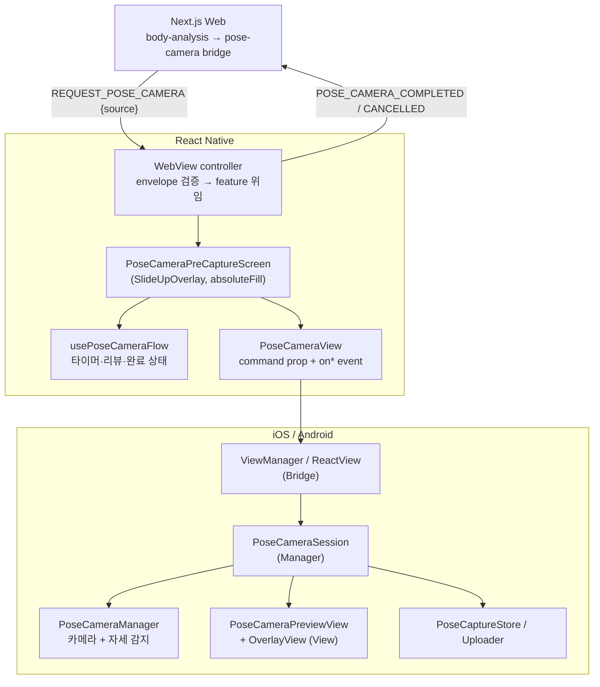
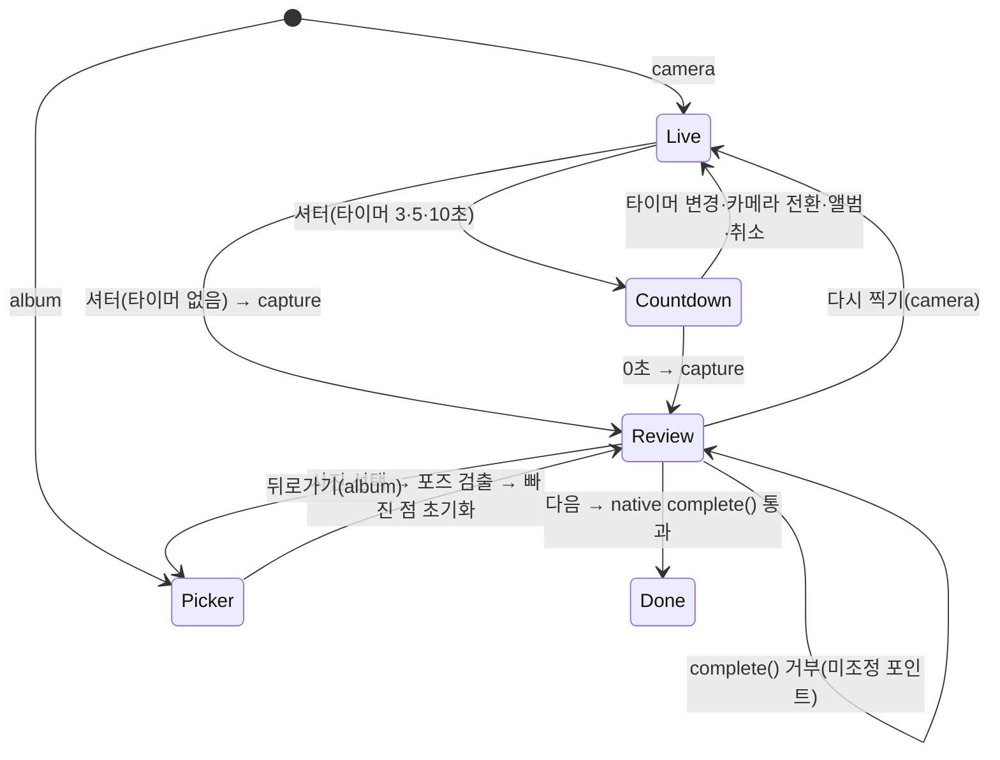
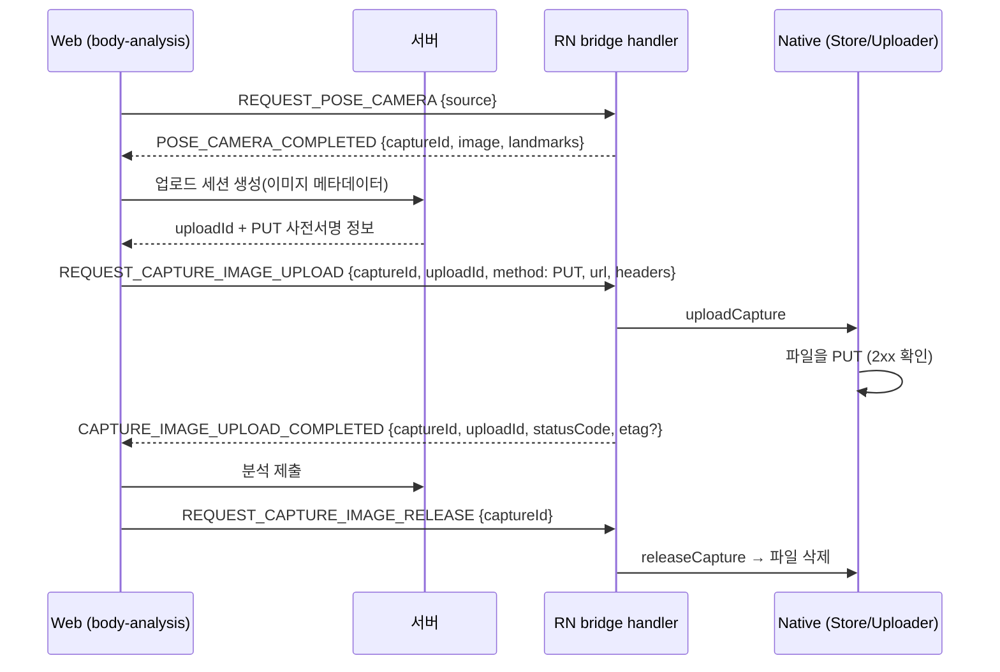

> 표기: 프로젝트 고유 접두사는 ` {prefix} `, 패키지 scope는 ` @scope `로 바꿔 적었다\.

### 문서 목적

체형 분석용 전신 사진과 관절 좌표를 얻는 포즈 카메라를 WebView가 아니라 네이티브로 구현한 배경과 설계를 정리한다\. RN overlay UI와 네이티브 preview의 책임 분리, iOS·Android의 레이어 배치, 단일 JSON 계약과 코드 생성, landmark 계약, overlay 좌표 계산, 리뷰·포인트 조정, 앨범 전용 진입, 세션 수명, 업로드·해제 브리지, Android hardware back 처리를 다룬다\.

### 1\. 웹 카메라 대신 네이티브 카메라를 쓴 배경

초기 작업 지시서에는 다음 결정이 기록돼 있다\.

- 카메라 화면 전체를 네이티브로 구현하고, 웹은 브리지 메시지만 보낸다\.
- 로컬 웹은 HTTP로 로드되므로 브라우저 ` getUserMedia `에 의존하지 않는다\.
- 좌표는 사진 기준 정규화 좌표\(` x `, ` y `: 0~1\)로 보관한다\. 화면 회전·크기와 무관하게 서버 전송과 재표시가 가능해야 한다\.

플랫폼별 엔진 선택 이유도 같은 문서에 남아 있다\.

<div class="notion-table-wrap">
<table>
<thead><tr><th scope="col">플랫폼</th><th scope="col">카메라</th><th scope="col">자세 감지</th><th scope="col">기록된 이유</th></tr></thead>
<tbody><tr><td>iOS</td><td>AVFoundation (<code>AVCaptureSession</code>)</td><td>Vision <code>VNDetectHumanBodyPoseRequest</code></td><td>OS 내장 온디바이스 추론이라 별도 모델·Pod가 필요 없고, 카메라 프레임과 정지 이미지에 같은 API를 쓸 수 있다</td></tr><tr><td>Android</td><td>CameraX Preview + ImageAnalysis + ImageCapture</td><td>ML Kit Pose Detection, <code>STREAM_MODE</code></td><td>랜드마크와 confidence를 제공하고 CameraX의 최신 프레임 유지 backpressure와 결합해 실시간 처리에 맞다</td></tr></tbody>
</table>
</div>

같은 문서의 성능 기준은 &quot;분석 중 새 프레임은 큐에 쌓지 않고 폐기&quot;, &quot;종료 시 카메라 세션과 detector를 반드시 해제&quot;, &quot;ML Kit Pose API는 beta이므로 의존성 버전 고정&quot;이다\. 현재 코드도 iOS는 ` alwaysDiscardsLateVideoFrames = true `, Android는 ML Kit pose\-detection 버전을 고정해 쓴다\.

초기 구현은 네이티브 모달\(Activity·ViewController\)이 화면 전체를 소유했다\. 이후 legacy 클래스와 XML 레이아웃을 지우고, 화면 컨트롤은 RN overlay가, preview와 landmark는 네이티브 view가 맡는 구조로 바꿨다\. 현재 네이티브 모듈은 캡처 파일 upload/release만 제공하고 modal/activity 진입은 제공하지 않는다\.

### 2\. 전체 구조



<div class="notion-table-wrap">
<table>
<thead><tr><th scope="col">영역</th><th scope="col">소유</th><th scope="col">소유하지 않는 것</th></tr></thead>
<tbody><tr><td>RN overlay (<code>components/*</code>)</td><td>상·하단 컨트롤, 셔터, 타이머 버튼, 카운트다운, 안내 알약, 프레임 모서리 브래킷, 리뷰 컨트롤</td><td>preview, landmark 좌표</td></tr><tr><td><code>hooks/use-pose-camera-flow.ts</code></td><td>촬영·카운트다운·리뷰·완료 상태 전환, 완료 payload 검증</td><td>완료 가능 판정</td></tr><tr><td><code>constants/pose-camera-timer.constant.ts</code></td><td>타이머 초·아이콘·카운트다운 간격</td><td></td></tr><tr><td>네이티브 preview</td><td>camera preview, 정지 이미지, landmark overlay, 탭 focus, 포인트 드래그</td><td>화면 컨트롤</td></tr><tr><td>네이티브 Session</td><td>세션 lifecycle, 권한, picker, capture/review/complete/cancel, 정리</td><td></td></tr></tbody>
</table>
</div>

프레임 모서리 브래킷은 RN overlay가 그리는 장식이라 landmark·crop 좌표와 무관하다\. overlay는 WebView 위 ` absoluteFill `이므로 상·하단 컨트롤 위치는 ` useSafeAreaInsets() ` 값을 더해 계산한다\. 초기에는 inset이 하드코딩돼 있었고, 노치·제스처 바를 직접 피해야 한다는 리뷰 이후 바꿨다\.

### 3\. 네이티브 레이어 배치

네이티브 소스는 기능 폴더가 아니라 레이어 우선 디렉터리에 둔다\. iOS는 ` <App>/{Bridge,Manager,Helper,Model,View}/PoseCamera `, Android는 ` com/<app>/{bridge,manager,helper,model,view}/posecamera `다\. ` Features/ `·` features/ `·` Platform/ ` 디렉터리는 구조 검사가 차단한다\.

<div class="notion-table-wrap">
<table>
<thead><tr><th scope="col">레이어</th><th scope="col">iOS</th><th scope="col">Android</th><th scope="col">책임</th></tr></thead>
<tbody><tr><td>Bridge</td><td><code>PoseCameraModule</code>, <code>PoseCameraViewManager</code>, <code>PoseCameraEventMapper</code>, <code>PoseCameraContract</code>(생성물), <code>.m</code> 브리지</td><td><code>PoseCameraModule</code>, <code>PoseCameraViewManager</code>, <code>PoseCameraEventMapper</code>, <code>PoseCameraContract</code>(생성물), <code>PoseCameraPackage</code></td><td>RN 명령 수신, 이벤트 payload 직렬화, upload/release 모듈</td></tr><tr><td>Manager</td><td><code>PoseCameraSession</code>, <code>PoseCameraManager</code>, <code>PoseCameraSessionOutput</code>, <code>PoseCaptureStore</code>, <code>PoseCaptureUploader</code></td><td>같은 구성 + <code>PoseImagePickerHost</code></td><td>세션 수명, 카메라·감지 엔진, 캡처 파일 수명, PUT 전송</td></tr><tr><td>Helper</td><td><code>PoseCameraHelper</code>, <code>PoseCameraOverlayGeometry</code>, <code>PoseCameraPolicy</code></td><td>같음</td><td>landmark 파생·정렬, 좌표 계산, 임계값·비율 정책</td></tr><tr><td>Model</td><td><code>PoseLandmark</code>, <code>PoseCameraResult</code></td><td>같음</td><td>데이터 타입</td></tr><tr><td>View</td><td><code>PoseCameraPreviewView</code>, <code>PoseCameraOverlayView</code></td><td>같음 + <code>PoseCameraReactView</code></td><td>preview·정지 이미지·overlay 그리기와 드래그</td></tr></tbody>
</table>
</div>

정리 과정에서 생긴 규칙은 다음과 같다\. Session은 여러 callback 대신 ` PoseCameraSessionOutput ` sink 하나로 View adapter에 이벤트를 전달한다\. ViewManager/ReactView는 ` command ` prop 하나로 RN 명령을 받고 이벤트 연결만 하며, payload 직렬화는 ` PoseCameraEventMapper `가 맡는다\. Android picker는 ` PoseImagePickerHost ` 한 경로로 실행하고 ` MainActivity `는 Activity Result launcher lifecycle만 제공한다\. 파일 수명은 ` PoseCaptureStore `, 네트워크 전송은 ` PoseCaptureUploader `가 나눠 가진다\.

confidence 임계값과 waist·headTop 파생 비율은 ` PoseCameraPolicy `가 단일 소유한다\. 현재 값은 감지 confidence 0\.35, waist 세로 비율 0\.60, hip 너비 비율 2\.0, headTop 연장 비율 0\.55\(최대 0\.06\)다\.

### 4\. 명령·이벤트 단일 JSON 계약

RN native view의 명령·이벤트 문자열은 ` packages/shared/src/pose-camera-contract.json ` 하나가 원본이다\.

```json
{
  "version": 1,
  "commands": { "capture": "capture", "pickImage": "pickImage", "complete": "complete", "...": "..." },
  "events": { "landmarksChanged": "topLandmarksChanged", "completed": "topCompleted", "...": "..." }
}
```

command는 ` switchCamera `·` retake `·` capture `·` pickImage `·` complete `·` cancel ` 6개, event는 landmark 변경·촬영 가능 여부·카메라 오류·촬영 리뷰·앨범 준비 시작/완료/실패·picker 취소·완료·취소 10개다\.

` scripts/generate-pose-camera-contract.mjs `가 이 JSON으로 세 런타임의 상수 파일을 만든다\.

<div class="notion-table-wrap">
<table>
<thead><tr><th scope="col">생성물</th><th scope="col">내용</th></tr></thead>
<tbody><tr><td><code>app/src/features/pose-camera/constants/pose-camera-contract.generated.ts</code></td><td><code>POSE_CAMERA_COMMAND</code> 객체와 <code>PoseCameraCommand</code> 타입</td></tr><tr><td>Android <code>bridge/posecamera/PoseCameraContract.kt</code></td><td>command 상수, <code>*_EVENT</code> 상수, <code>EVENT_NAMES</code> 목록</td></tr><tr><td>iOS <code>Bridge/PoseCamera/PoseCameraContract.swift</code></td><td>command 상수</td></tr></tbody>
</table>
</div>

이벤트 이름 상수는 Android만 생성한다\. RN은 ` on* ` prop 규약으로, iOS는 ` RCTDirectEventBlock ` prop으로 이벤트를 연결하므로 TS·Swift에는 command만 필요하다\. 플랫폼 코드에는 문자열 리터럴을 직접 추가하지 않는다\.

드리프트는 ` scripts/check-structure.sh `가 막는다\. 생성물을 백업하고 생성기를 다시 돌린 뒤 diff가 있으면 원래 파일로 되돌리고 실패한다\.

```bash
node scripts/generate-pose-camera-contract.mjs > /dev/null
if ! diff -q "$contract_backup_dir/$index" "$path" > /dev/null; then
  stale_contract_files+=("$path"); cp "$contract_backup_dir/$index" "$path"
fi   # → "Pose camera contract output is stale. Run: pnpm run pose-camera:contract"
```

JSON만 고치고 생성을 건너뛰거나 ` .kt `/` .swift `를 직접 고치면 이 검사가 실패한다\. 검사가 생기면서 상수 값을 하드코딩으로 assert하던 테스트는 지웠다\.

이 계약은 RN ↔ 네이티브 view 경계 전용이다\. Web ↔ App 브리지 토큰과 payload schema는 별도로 ` @scope/shared/pose `가 소유한다\.

### 5\. Landmark 계약

결과에는 9개 landmark가 고정 순서로 들어간다\.

```typescript
export const POSE_LANDMARK_IDS = ['headTop', 'leftShoulder', 'rightShoulder', 'leftWaist', 'rightWaist',
  'leftHip', 'rightHip', 'leftAnkle', 'rightAnkle'] as const;
```

초기 작업 지시서는 17개 관절을 공통 스키마로 잡았고, 이후 12포인트 리뷰를 거쳐 지금의 9개로 줄었다\. ID는 한 곳에 정의하도록 정리했다\.

` poseCameraResultSchema `는 개수뿐 아니라 순서까지 검증한다\.

```typescript
landmarks: z.array(poseLandmarkSchema).length(POSE_LANDMARK_COUNT)
  .superRefine((landmarks, context) => {
    landmarks.forEach((landmark, index) => {
      if (landmark.id === POSE_LANDMARK_IDS[index]) return;
      context.addIssue({ code: 'custom', path: [index, 'id'], message: `Expected ...` });
    });
  }),
```

<div class="notion-table-wrap">
<table>
<thead><tr><th scope="col">필드</th><th scope="col">규칙</th></tr></thead>
<tbody><tr><td><code>captureId</code></td><td><code>capture_</code> prefix 필수</td></tr><tr><td>landmark <code>x</code>, <code>y</code>, <code>confidence</code></td><td>0~1</td></tr><tr><td>landmark <code>source</code></td><td><code>detected</code> · <code>adjusted</code> · <code>derived</code> · <code>initialized</code></td></tr><tr><td><code>image.contentType</code></td><td><code>image/jpeg</code> 리터럴</td></tr><tr><td><code>image.orientation</code></td><td><code>up</code> 리터럴</td></tr><tr><td><code>image</code> 기타</td><td><code>sizeBytes</code>, <code>checksumSha256</code>, <code>widthPx</code>, <code>heightPx</code>, <code>mirrored</code></td></tr><tr><td><code>previewDataUrl</code></td><td>선택, <code>data:image/</code>로 시작</td></tr></tbody>
</table>
</div>

감지 엔진이 직접 주는 점은 어깨·골반·발목과 코다\. 나머지는 파생한다\.

- ` leftWaist `/` rightWaist `: 어깨 중심과 골반 중심 사이 ` waistVerticalRatio `\(0\.60\) 지점, ` source: "derived" `
- ` headTop `: 어깨 중심 → 코 방향으로 ` headTopOffsetRatio `만큼 연장하되 ` maximumHeadTopOffset `으로 제한
- 촬영 가능 판정: 양 어깨·양 골반이 있고 발목이 하나 이상 있을 때\. 아니면 &quot;양쪽 어깨·골반과 발목이 인식된 뒤 촬영해 주세요&quot;를 돌려준다\.

#### 골반 너비 보정

ML Kit·Vision의 hip 점은 관절 중심이다\. 체형 분석에는 골반 폭 anchor가 필요해, 두 점의 중심은 그대로 두고 중심으로부터의 거리를 2배로 넓힌다\.

```kotlin
private fun widenHipPoint(point: {prefix}PoseLandmark, centerX: Float) = point.copy(
  x = (centerX + ((point.x - centerX) * PoseCameraPolicy.HIP_WIDTH_RATIO)).coerceIn(0f, 1f),
)
```

` HIP_WIDTH_RATIO = 2.0 `/` hipWidthRatio = 2.0 `은 양 플랫폼 공통값이다\. 바꾸면 분석 결과와 함께 다시 검증하기로 했다\.

### 6\. Overlay 좌표 계산 공통 로직

preview, 촬영 리뷰, 앨범 리뷰는 이미지와 view의 비율이 다르다\. landmark를 그리고, 터치로 잡고, 드래그 결과를 정규화 좌표로 되돌리는 계산을 양 플랫폼 모두 ` PoseCameraOverlayGeometry `라는 순수 타입으로 분리했다\.

` contentRect `는 두 content mode 모두 이미지 비율을 유지한다\. aspect\-fill은 ` max(view/image) ` scale로 넘치는 부분을 crop하고, aspect\-fit은 ` min(view/image) ` scale로 이미지 전체를 view 안에 둔 뒤 가운데 정렬한다\.

그 위에 ` displayPoint `\(정규화 → 화면 좌표\), ` normalizedPoint `\(터치 → 0~1 clamp 정규화 좌표\), ` distance `\(드래그 hit\-test\), ` connections `\(9개 점 연결선\)를 둔다\. Android의 ` sampleSize `는 view 긴 변 기준 2의 거듭제곱 decoder sample을 돌려줘, aspect\-fill crop 영역이 view보다 커도 원본 해상도로 디코딩하지 않게 한다\.

content mode는 화면별로 고정한다\.

<div class="notion-table-wrap">
<table>
<thead><tr><th scope="col">화면</th><th scope="col">content mode</th><th scope="col">이유(README 기록)</th></tr></thead>
<tbody><tr><td>실시간 preview</td><td>aspect-fill</td><td>촬영 리뷰와 같은 이미지 영역·crop을 써서 전환 시 landmark가 이동하지 않게</td></tr><tr><td>촬영 리뷰</td><td>aspect-fill</td><td>위와 같음</td></tr><tr><td>앨범 리뷰</td><td>aspect-fit</td><td>사진 전체를 보여주고 남는 영역은 preview 배경으로 둔다</td></tr></tbody>
</table>
</div>

카메라 해상도도 같은 비율로 맞췄다\. Android는 Preview·Analysis·Capture에 같은 16:9 ` ResolutionSelector `를, iOS는 ` hd1280x720 ` preset과 ` resizeAspectFill ` preview layer를 쓴다\. 양 플랫폼 모두 후면 카메라로 시작한다\. 드래그 hit 반경은 iOS 16pt, Android ` density × 16 `이다\.

이 순수 로직은 Android ` PoseCameraOverlayGeometryTest.kt `와 iOS ` PoseCameraOverlayGeometryTests.swift `로 고정했다\. 두 테스트 모두 aspect\-fit 가운데 정렬, 세로 preview의 aspect\-fill crop, 화면 좌표 ↔ 정규화 좌표 왕복, 리뷰의 waist 보존·파생, 실시간 waist·hip 너비 정책, 전면 카메라 반전을 검사한다\. Android는 리뷰 디코딩 sample size가 viewport 안에 머무는지도 본다\.

### 7\. 이미지 방향과 정규화

계약은 ` orientation: "up" `만 허용한다\. 결과 이미지는 이미 회전이 픽셀에 반영된 상태여야 한다는 뜻이다\.

- Android: CameraX ` ImageCapture `는 회전·전면 반전을 EXIF로 기록한다\(전면 카메라는 ` isReversedHorizontal `\)\. ` ImageDecoder `가 디코딩할 때 EXIF 방향을 픽셀에 적용하므로, 리뷰 표시와 완료 시 ` normalizedJpeg `\(긴 변 최대 2048, JPEG 90\) 모두 이 경로를 쓴다\.
- iOS: 촬영은 Vision을 돌린 최신 프레임 이미지를 그대로 쓰고, 연결은 ` videoOrientation = .portrait `로 고정한다\. 앨범 이미지는 ` UIGraphicsImageRenderer `로 다시 그려 정규화한다\(긴 변 최대 2048\)\.
- 양 플랫폼 모두 ` previewDataUrl `은 긴 변 720, 품질 0\.7\(70\) JPEG로 만든다\.
- 메타데이터의 ` checksumSha256 `은 최종 파일 바이트로 계산한다\.

Android 리뷰 이미지는 처음에 UI 스레드에서 원본 해상도로 두 번 디코딩했다\. 저사양 기기 OOM 위험이 있어 view 크기 기준 다운샘플 \+ 전용 executor 백그라운드 디코딩으로 바꾸고, generation 카운터로 늦게 도착한 결과를 버린다\. 결과 bitmap은 landmark rect와 같은 좌표계를 쓰는 overlay가 단독 소유하고, ` frozenImageView `는 디코딩 실패 fallback으로만 쓴다\.

### 8\. 촬영·리뷰·포인트 조정 흐름



#### 타이머

` POSE_CAMERA_TIMER_OPTIONS `는 ` null → 3 → 5 → 10 `초를 아이콘과 함께 선언하고, 버튼을 누를 때마다 순환한다\. 카운트다운 간격은 ` POSE_CAMERA_COUNTDOWN_INTERVAL_MS = 1_000 `이다\. 카운트다운은 RN 중앙 overlay에 표시하고 0이 되면 ` capture ` 명령을 보낸다\.

타이머 변경, 카메라 전환, 앨범, 취소는 진행 중인 카운트다운과 캡처 상태를 함께 지운다\. 카운트다운 중 앨범·취소를 눌러도 몇 초 뒤 유령 촬영이 실행되던 문제를 고친 결과다\.

#### 리뷰와 포인트 편집

- 촬영 리뷰는 감지 결과로 시작하고, 빠진 점은 초기 템플릿 좌표\(` source: "initialized" `\)로 채운다\.
- 앨범 리뷰도 iOS Vision·Android ML Kit로 사진의 포즈를 자동 검출한다\(` 21a4a76 `\)\. 감지·파생 가능한 점은 유지하고 못 찾은 점만 초기 템플릿\(` initialized `\)으로 채운다\. 이전에 모든 점을 템플릿으로 시작하던 정책에서 바뀌었다\. 감지에 성공한 점도 직접 조정할 수 있다\.
- 포인트 드래그는 네이티브 overlay가 처리하고 ` source: "adjusted" `로 바꾼 뒤 ` onLandmarksChanged `로 RN에 알린다\. ` initialized `는 노란색\(` #FFE06F `\), ` adjusted `는 보라색으로 그린다\.
- 리뷰 편집 중에는 탭 focus를 막는다\.

완료 가능 판정은 RN이 아니라 네이티브 Session의 ` complete() `가 소유한다\.

Android 기준으로 ` complete() `는 landmark가 9개가 아니거나 ` initialized `가 남아 있으면 ` onCameraError("9개 포인트의 위치를 모두 확인해 주세요") `로 거부한다\. 통과하면 JPEG 정규화 → ` capture_ ` \+ UUID 발급 → ` PoseCaptureStore.register ` → ` onCompleted ` 순서로 진행한다\.

&quot;다음&quot; 버튼은 미조정 포인트가 있어도 활성이다\. 누르면 ` complete() `가 거부하고, RN은 그 문구를 리뷰 화면에 표시한다\. 서버의 landmark source 값에 ` initialized `가 없어 템플릿 좌표는 제출하지 않는다\. 연타는 ` isCompleting ` 상태로 잠근다\.

#### 완료 payload 검증과 캡처 누수 방지

RN ` usePoseCameraFlow `는 네이티브 완료 payload를 ` poseCameraResultSchema `로 다시 검증한다\. 실패하면 네이티브가 이미 등록한 캡처 파일을 해제하고 리뷰 화면에 오류를 띄운다\.

```typescript
const captureId = (value as { captureId?: unknown } | null)?.captureId;
if (typeof captureId === 'string' && captureId.startsWith('capture_')) {
  releasePoseCapture(captureId).catch(() => undefined);
}
setCompleting(false);
setError('카메라 촬영 결과가 올바르지 않습니다.');
```

` isCompleting `을 풀어 재시도할 수 있게 했다\. 이전에는 오류를 렌더하는 곳이 촬영 화면에만 있어 파싱 실패 시 &quot;다음&quot;을 눌러도 아무 반응이 없는 화면이 남았다\.

### 9\. 앨범 전용 진입

` REQUEST_POSE_CAMERA ` payload는 ` { source: 'camera' | 'album' } `이다\. 없거나 잘못된 payload는 ` camera `로 연다\. 구버전 Web 호환을 위해서다\.

처음에는 앨범 버튼도 카메라 화면을 띄우고 카메라를 켠 뒤 picker를 열어, 앨범을 눌렀는데 카메라가 열린 것처럼 보였다\. 지금은 다음처럼 동작한다\.

- ` initialSource="album" `이면 ` cameraEnabled={false} `로 마운트해 카메라 세션을 시작하지 않는다\.
- overlay를 화면 밖에 둔 채 picker만 연다\. 사진을 고르면\(` onAlbumAnalysisStarted `, 실패 포함\) overlay를 올린다\.
- 고르기 전에 picker를 닫거나\(` onAlbumPickerCancelled `\) 앨범을 열 수 없으면\(` onCameraError `\) 흐름을 취소한다\. picker 취소는 에러가 아니며 양 플랫폼이 같은 이벤트만 보낸다\.
- 리뷰의 뒤로가기는 picker를 다시 연다\. 그 picker를 닫으면 고른 사진의 리뷰에 남는다\.
- Android는 picker에서 돌아올 때 ` onHostResume `이 카메라를 켜던 문제가 있었다\. 막는 지점을 ` PoseCameraSession.startIfPermitted ` 하나로 옮겼다\(` if (isDisposed || !cameraEnabled) return `\)\.
- iOS는 view가 window에 붙기 전에 온 ` pickImage `를 ` didMoveToWindow `까지 미루고, 이미 떠 있는 화면이 있으면 그 위에 picker를 띄운다\. 전환 중 present가 무시돼 카메라만 남던 문제 때문이다\.
- iOS picker는 out\-of\-process ` PHPickerConfiguration() ` 기본 이니셜라이저를 쓴다\. 사진 라이브러리 권한과 ` NSPhotoLibraryUsageDescription `이 필요 없다\.

### 10\. 세션 수명

양 플랫폼 Session은 같은 모양의 수명 규칙을 따른다\.

- 모든 공개 메서드는 ` isDisposed `를 먼저 확인한다\.
- ` cancel() `은 ` dispose() ` 후 ` onCancelled `를 보낸다\. ` dispose() `는 lifecycle listener 해제, 세션 중지, preview 정리, output 해제를 한 번만 수행한다\.
- review 상태 해제와 세션 종료는 공통 cleanup 경로\(` clearReviewState `, ` stopSession `\)를 쓴다\.
- Android는 ` onHostDestroy `에서 ` dispose() `한다\.

RN 쪽 화면 수명은 두 가지를 더 둔다\.

<div class="notion-table-wrap">
<table>
<thead><tr><th scope="col">장치</th><th scope="col">동작</th><th scope="col">기록된 이유</th></tr></thead>
<tbody><tr><td><code>POSE_CAMERA_CLOSE_DELAY_MS = 400</code></td><td>완료 결과를 Web에 보낸 뒤 400ms 후 overlay를 닫는다</td><td>결과 dispatch와 같은 frame에 native view를 내리면 WebView가 해체 중인 preview 위에 다시 그려졌다</td></tr><tr><td><code>key={poseCameraRequestId}</code></td><td>요청마다 화면을 새로 마운트한다</td><td>닫히는 300ms 전환 중 다시 열면 dispose된 native session을 재사용해 화면이 검게 멈추거나 picker가 열리지 않았다</td></tr></tbody>
</table>
</div>

overlay는 ` Animated ` translateY로 300ms 동안 시트처럼 올라오고, 닫을 때 내려간 뒤 unmount한다\. 앨범 전용 진입은 올라오는 전환이 끝난 뒤 한 번만 ` pickImage `한다\. 재마운트는 key를 빼면 실패하는 테스트로 고정했다\.

### 11\. 업로드와 해제

캡처 파일은 Web으로 넘기지 않는다\. 네이티브가 ` captureId `로 파일을 보유하고, Web은 ID와 메타데이터만 받는다\.



<div class="notion-table-wrap">
<table>
<thead><tr><th scope="col">지점</th><th scope="col">규칙</th></tr></thead>
<tbody><tr><td>업로드 요청 schema</td><td><code>method</code>는 <code>&#39;PUT&#39;</code> 리터럴, <code>url</code>은 URL, <code>headers</code>는 문자열 record</td></tr><tr><td>App 수신</td><td><code>safeParse</code> 실패 시 <code>CAPTURE_IMAGE_UPLOAD_FAILED { code: &#39;INVALID_UPLOAD_REQUEST&#39; }</code>, 실행 실패 시 <code>CAPTURE_UPLOAD_FAILED</code></td></tr><tr><td>Native 전송</td><td>PUT 외 method 거부, 고정 길이 스트리밍, 2xx가 아니면 실패</td></tr><tr><td>Web 대기</td><td>완료·실패 payload를 shared schema로 검증하고, <code>captureId</code>·<code>uploadId</code>가 현재 요청과 모두 같을 때만 수락. 60초 후 실패</td></tr><tr><td>해제</td><td>분석 제출 후, 또는 새 촬영을 시작할 때 이전 <code>captureId</code> 해제. App은 <code>captureImageReleaseRequestSchema.safeParse</code> 후 처리</td></tr><tr><td>자동 만료</td><td><code>PoseCaptureStore</code>는 24시간 지난 기록을 다음 등록 때 지운다</td></tr><tr><td>모듈 부재</td><td>upload는 rebuild 안내 메시지로 throw, release는 조용히 no-op</td></tr></tbody>
</table>
</div>

App 안에서는 Web pose\-camera feature가 브리지 발신과 결과 구독을 맡는다\. App 밖에서는 사진 선택·검출·포인트 조정 UI와 캡처 메모리도 소유한다\. ` POSE_CAMERA_COMPLETED ` payload 검증 실패는 무시하지 않고 ` onError `로 올린다\.

#### App 밖 브라우저의 사진 경로

` requestNativePoseCamera `가 실제 App 브리지를 사용할 수 없으면 안내 화면이 사용자 클릭 안에서 파일 입력을 연다\. ` 사진 촬영 `은 ` capture="environment" `, ` 앨범 `은 일반 사진 선택이다\. 운영 Web에서도 동작한다\.

` pose-camera-web.request.ts `는 `  `로 EXIF 방향을 반영해 디코드하고, 긴 변 최대 2048px·품질 0\.9 JPEG를 만든다\. MediaPipe Pose Landmarker lite\(IMAGE·CPU·1명\)로 검출한다\. 로더와 WASM은 같은 origin의 빌드 자산을 쓰고 모델만 최초 검출 때 외부 저장소에서 받는다\. 로딩 실패·20초 제한·미검출이면 못 찾은 점을 템플릿으로 채운다\.

9개 점은 Pointer Events와 방향키로 조정한다\(기본 1%, Shift 5%\)\. Escape는 닫기이며 열리면 포커스를 받는다\. ` initialized `가 남으면 완료를 거부한다\. 어깨·골반·발목 6점이 모두 있을 때 골반 폭 보정과 코 기반 머리 끝 파생을 적용한다\. 닫은 뒤 도착한 비동기 처리 결과는 버리고 사진을 해제한다\.

완료는 같은 ` poseCameraResultSchema `를 따르며 ` capture_web-<uuid> ` 사진은 페이지 메모리에만 보관한다\. 업로드 함수가 이 ID를 구분해 브리지 대신 사전서명 URL로 직접 PUT한다\. 응답 제한은 60초이고 저장소의 origin·PUT·Content\-Type CORS 허용이 필요하다\. SHA\-256 checksum에 ` crypto.subtle `이 필요하므로 HTTPS 또는 [localhost](<http://localhost/>)에서만 완료할 수 있다\. HTTP LAN에서는 안내와 함께 완료를 막는다\. ID 생성의 UUID fallback만으로 checksum 제약이 해결되지는 않는다\.

이 경로는 정지 사진 검출이다\. 네이티브 실시간 preview·촬영 가이드·카운트다운까지 재현하지 않으며, HEIC 등 브라우저가 디코드하지 못하는 형식은 안내를 표시한다\.

### 12\. Android hardware back

카메라 overlay가 떠 있으면 hardware back은 Web으로 위임하지 않고 촬영 흐름을 취소한다\.

` useWebViewController `의 ` hardwareBackPress ` handler는 ` isPoseCameraVisible `이면 overlay를 닫고 ` POSE_CAMERA_CANCELLED `를 보낸 뒤 ` true `를 반환한다\.

overlay가 없을 때는 ` history.back() `을 주입하지 않고 ` NATIVE_BACK_PRESS `를 보내 Web의 pop 경로\(navigation lock 포함\)가 처리한다\. Web은 취소를 받아도 아무 동작 없이 호출 화면에 머문다\.

### 13\. 검증 방식

RN 쪽은 ` app/tests/unit/features/pose-camera `\(shared schema 계약, 타이머 옵션, 카운트다운 취소, 완료 payload 검증 실패 시 캡처 해제·재시도\)와 ` app/tests/integration/features/pose-camera `\(촬영 전 화면, 리뷰 컨트롤, release payload 검증, legacy 화면 미호출, ` source ` 파싱\)에 둔다\. 네이티브 좌표 로직은 Gradle unit test와 XCTest, 계약 생성물은 ` structure:check `가 맡는다\.

카메라 흐름은 Android 에뮬레이터에서 gfxstream 오류로 크래시할 수 있다\. 그래서 카메라·권한·picker의 실제 동작은 실기기에서 확인하고, 권한 거부 상태까지 본다\. 테스트 double만으로 네이티브 SDK 동작을 완료로 판정하지 않는다\.

### 현재 제약

- 감지 엔진이 플랫폼마다 달라\(Vision, ML Kit\) 같은 사진이라도 원시 좌표가 같다는 보장은 없다\. 공통으로 맞춘 것은 출력 계약, 파생 비율, 좌표 계산이다\.
- 골반 너비 2배 보정은 서버 분석 입력에 맞춘 고정값이다\. 바꾸려면 분석 결과와 함께 다시 검증해야 한다\.
- 앨범 사진 자동 검출에서 못 찾은 점은 템플릿으로 남으므로 직접 확인·조정해야 완료할 수 있다\.
- 명령·이벤트 이름은 생성기로 맞추지만 payload shape은 양 플랫폼 ` PoseCameraEventMapper `가 각각 직렬화한다\. 최종 완료 payload만 RN이 schema로 검증한다\.

### 참고

- 관련 글: Native\-Web 브리지 계약과 보안 설계
- 관련 글: 체형 분석 비동기 흐름 설계
- 관련 글: WebView 하이브리드 앱의 프론트엔드 아키텍처 전략
- 코드: ` packages/shared/src/pose.ts `, ` packages/shared/src/pose-camera-contract.json `, ` scripts/generate-pose-camera-contract.mjs `, ` scripts/check-structure.sh `, ` app/src/features/pose-camera/ `, ` web/src/features/pose-camera/ `

### 구현 근거와 검토 범위

2026\-11\-11, FE commit ` 645a584 ` 기준으로 코드·설정과 관련 변경 이력을 대조했다\. 근거: ` packages/shared/src/pose.ts `, ` web/src/features/pose-camera/README.md `, ` app/src/features/pose-camera/README.md `\. 문서에 인용한 이전 검증 기록과 이번 검토를 구분하며, 이번 작업에서 앱·브라우저 런타임 테스트를 재실행하지 않았다\.

### 관련 구현 문서

[체형 분석 비동기 흐름 설계](<https://app.notion.com/p/4150d0f75cd681878d65e741f18e2b83>)

[Native\-Web 브리지 계약과 보안 설계](<https://app.notion.com/p/4150d0f75cd681acb3bffe3589d97679>)
