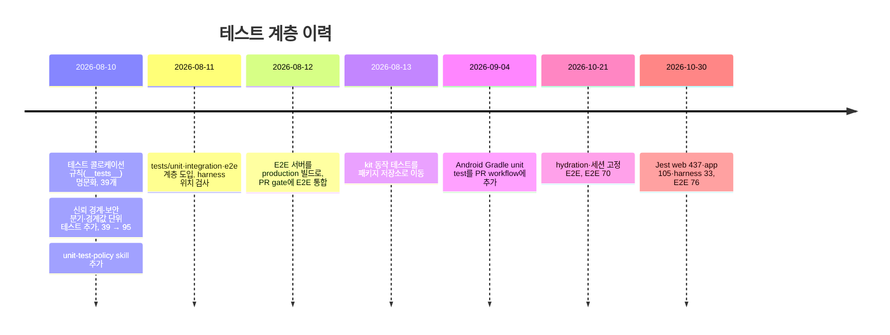

> 표기: 프로젝트 고유 접두사는 ` {prefix} `, workspace 패키지 이름은 ` <web 패키지> `·` <app 패키지> `로 바꿔 적었다\.

### 문서 목적

React Native WebView shell\(App\), Next\.js 콘텐츠\(Web\), 공통 패키지로 나뉜 mono\-repo에서 테스트를 어떤 기준으로 나누고, 어디에 두고, 어떻게 강제하는지를 현재 코드 기준으로 정리한다\. 계층 선택 규칙, workspace별 Jest 구성과 Native SDK mock, Playwright E2E 구성, 브라우저가 재현하지 못하는 영역의 수동 검증, 커밋·CI에서 테스트를 강제하는 장치, 그리고 테스트 계층이 자라 온 과정을 다룬다\.

CI 파이프라인 전체와 commit hook의 Agent 관점 설명은 「Mono\-repo에 AI Agent 작업 지원 체계 구축하기」에서 다뤘다\. 이 글은 테스트 자체에 초점을 둔다\.

### 1\. 기본 원칙: 위치가 아니라 실패 범위로 나눈다

테스트 규칙은 ` .codex/skills/unit-test-policy/SKILL.md ` 하나가 소유한다\. 이 skill은 코드를 바꾸는 모든 작업\(기능 구현, 수정, 리팩터링, 버그 수정\)에 적용되고, 첫 문단에서 기준을 정한다\.

> 테스트는 파일 위치가 아니라 실패가 의미하는 범위에 따라 unit, integration, E2E로 나눈다\.

<div class="notion-table-wrap">
<table>
<thead><tr><th scope="col">계층</th><th scope="col">사용 조건</th><th scope="col">대표 예시</th></tr></thead>
<tbody><tr><td>Unit</td><td>한 모듈의 입력·출력, 분기, schema, 상태 전이</td><td>온도 매핑, request builder, Zod schema, Zustand store</td></tr><tr><td>Integration</td><td>둘 이상의 모듈 또는 browser/native boundary가 함께 동작</td><td>storage 복원, fetch parsing, bridge 구독, platform URL</td></tr><tr><td>E2E</td><td>실제 서버와 브라우저에서 화면·라우팅·접근성 계약</td><td>진입 → 분석 안내 → 예시 modal</td></tr><tr><td>수동</td><td>실기기 권한·SDK·WebView lifecycle처럼 자동화 기반이 불안정</td><td>Native 로그인, 위치 권한 거부, 카메라 촬영·hardware back</td></tr></tbody>
</table>
</div>

같은 동작을 여러 계층에서 반복하지 않는다\. 낮은 계층에서 고정되는 분기와 변환은 E2E에서 조합별로 다시 검증하지 않고, E2E는 핵심 연결 흐름만 확인한다\.

#### 테스트가 필요한 코드인가

판정 문장은 하나다\. <strong>&quot;이 코드가 깨지면 조용히 틀린 값이 나가는가?&quot;</strong> 그렇다면 테스트가 필수다\.

<div class="notion-table-wrap">
<table>
<thead><tr><th scope="col">대상</th><th scope="col">판정</th></tr></thead>
<tbody><tr><td>순수 로직(분기·변환·경계값)</td><td>필수</td></tr><tr><td>신뢰 경계(브리지 수신, storage 복원, API 응답 파싱)</td><td>필수. 손상 입력이 null·거부로 처리되는 케이스 포함</td></tr><tr><td>보안 분기(화이트리스트, 권한, 토큰 처리)</td><td>필수. 차단 케이스를 반드시 포함</td></tr><tr><td>계약(Zod schema, payload builder)</td><td>필수</td></tr><tr><td>상태 머신 전이(store)</td><td>필수</td></tr><tr><td>환경·플랫폼 분기</td><td>권장</td></tr><tr><td>Web 화면 흐름·내비게이션</td><td>핵심 경로는 E2E, 세부 분기는 unit·integration</td></tr><tr><td>네이티브 SDK·권한·WebView 실동작</td><td>수동(device E2E 도입 전까지)</td></tr><tr><td>분기 없는 컴포넌트·상수·단순 위임</td><td>제외. 테스트가 코드 복사에 불과</td></tr></tbody>
</table>
</div>

skill은 &quot;mock이 검증 대상보다 커지면 잘못된 층을 테스트하는 신호&quot;라고 적는다\. 이때는 한 층 아래의 순수 로직을 분리해 그쪽을 테스트한다\.

#### 케이스와 수정 규칙

- 케이스는 정상 경로 1개 \+ 경계값 \+ 실패·손상 입력\. 모든 조합을 나열하지 않고 깨지면 아픈 지점만 고른다\.
- 기존 기능을 고치기 전에 대상의 기존 테스트가 녹색인지 먼저 확인한다\.
- 의도한 동작 변경이면 기대값을 갱신하고 커밋 본문에 동작 변경임을 남긴다\. 의도치 않은 빨간불은 테스트가 잡은 회귀이므로 기대값이 아니라 코드를 의심한다\.
- 코드를 삭제·이동하면 테스트도 같이 삭제·이동하고, 계층이 바뀌면 폴더도 바꾼다\.

### 2\. 계층별 위치

```text
tests/unit/                 # 저장소 harness의 Node 단위 테스트 (*.test.mjs)
app/tests/
├─ unit/                    # 순수 로직·schema·store
└─ integration/             # RN render·platform adapter·native boundary
web/tests/
├─ unit/                    # 순수 로직·schema·store·단일 컴포넌트
├─ integration/             # storage·API·bridge·hook 간 연동
└─ e2e/                     # Playwright 브라우저 시나리오 (*.spec.ts)
```

테스트 경로에는 대상의 FSD 책임을 찾을 수 있을 만큼만 반영하고 소스 트리를 기계적으로 복제하지 않는다\. 현재 파일 수는 다음과 같다\.

<div class="notion-table-wrap">
<table>
<thead><tr><th scope="col">위치</th><th scope="col">파일 수</th><th scope="col">러너</th></tr></thead>
<tbody><tr><td><code>tests/unit</code></td><td>4</td><td>Node test runner (<code>node --test tests/unit/*.test.mjs</code>)</td></tr><tr><td><code>app/tests/unit</code></td><td>6</td><td>Jest (<code>@react-native/jest-preset</code>)</td></tr><tr><td><code>app/tests/integration</code></td><td>13</td><td>Jest</td></tr><tr><td><code>web/tests/unit</code></td><td>41</td><td>Jest (<code>next/jest</code>)</td></tr><tr><td><code>web/tests/integration</code></td><td>57</td><td>Jest</td></tr><tr><td><code>web/tests/e2e</code></td><td>6 spec</td><td>Playwright</td></tr></tbody>
</table>
</div>

루트 harness 테스트는 의존성 없이 Node 내장 test runner로 돈다\. 대상은 버전 검사\(` app-version `\), commit\-msg 규칙\(` commit-check `\), 구조·문서 계약 검사\(` repository-harness `\), Claude Code skill 관문\(` skill-guard `\)이다\. 루트 ` pnpm run test `는 ` test:harness `를 먼저 돌린 뒤 turbo로 workspace Jest를 실행한다\.

### 3\. Jest 구성

#### App: Native 모듈은 전부 ` __mocks__ `로 바꾼다

```javascript
module.exports = {
  preset: '@react-native/jest-preset',
  testMatch: ['<rootDir>/tests/{unit,integration}/**/*.test.{ts,tsx}'],
  moduleNameMapper: {
    '^@react-native-async-storage/async-storage$': '<rootDir>/__mocks__/asyncStorageMock.js',
    '^react-native-config$': '<rootDir>/__mocks__/reactNativeConfigMock.js',
    '^react-native-permissions$': '<rootDir>/__mocks__/reactNativePermissionsMock.js',
    '^react-native-webview$': '<rootDir>/__mocks__/reactNativeWebViewMock.js',
    // 소셜 로그인 SDK 4종, geolocation, svg, css ...
  },
  // pnpm은 실제 파일을 node_modules/.pnpm/<pkg>@<ver>/node_modules/<pkg>에 두므로 .pnpm 단계는 통과시킨다.
  transformIgnorePatterns: ['node_modules/(?!(\\.pnpm|(jest-)?react-native|@react-native(-community)?|...)/)'],
};
```

` app/__mocks__ `는 11개 파일로, 저장소·환경 변수·권한·위치·WebView와 Apple·Google·Kakao·Naver 로그인 SDK, SVG·CSS를 대신한다\. 공용 module mock은 workspace의 ` __mocks__ `가 소유한다는 것이 skill 규칙이다\. 이 mock 덕분에 App의 integration 테스트는 &quot;SDK가 실제로 동작하는가&quot;가 아니라 &quot;SDK 결과를 받은 뒤 우리 코드가 무엇을 하는가&quot;를 검증한다\. SDK 실동작은 수동 계층으로 넘긴다\.

#### Web: ` next/jest ` \+ node 환경

```javascript
export default createJestConfig({
  modulePathIgnorePatterns: ['<rootDir>/.open-next/', '<rootDir>/.next-e2e/'],
  moduleNameMapper: {
    '^.+\\.svg\\?url$': '<rootDir>/__mocks__/file-url.mock.ts',
    '^@/(.*)$': '<rootDir>/src/$1',
    // design-system은 소스를 직접 매핑
  },
  testEnvironment: 'node',
  testMatch: ['<rootDir>/tests/{unit,integration}/**/*.test.{ts,tsx}'],
});
```

OpenNext 산출물\(` .open-next `\)과 E2E 전용 빌드\(` .next-e2e `\)를 module path에서 뺀다\. 두 workspace 모두 ` testMatch `가 이미 ` tests/{unit,integration} `으로 범위를 좁히므로 ` test `는 Jest를 한 번만 부팅하고, 계층별 개별 실행용 ` test:unit `·` test:integration ` script만 따로 둔다\.

Jest 전역 setup은 두지 않는다\. 한때 ` @testing-library/jest-dom `과 ` tests/setup `이 있었지만 matcher를 쓰는 테스트가 없어 지웠고, 실제로 필요해지면 workspace의 ` tests/setup `에 다시 만든다\.

#### Integration 예: 서버 경계 배선

Web integration은 middleware와 page 사이처럼 Next 서버 쪽 경계도 다룬다\. ` middleware.test.ts `는 세션 cookie 없는 보호 API 401, 화면 deep link의 홈 redirect, refresh cookie만 있을 때 통과, 쿼리까지 포함한 요청 경로 header 전달을 검증한다\. ` stack-page.test.tsx `는 그 header가 StackFlow ` initialContext `로 들어가는지를 확인한다\.

### 4\. 소스 밖 테스트와 suffix를 harness가 강제한다

테스트 위치는 문서 규칙에 그치지 않는다\. ` scripts/check-repository-harness.mjs `의 ` findTestStructureErrors `가 기계적으로 검사한다\.

<div class="notion-table-wrap">
<table>
<thead><tr><th scope="col">검사</th><th scope="col">실패 메시지</th></tr></thead>
<tbody><tr><td>필수 테스트 폴더 6개(<code>tests/unit</code>, app·web의 unit·integration, <code>web/tests/e2e</code>) 존재</td><td><code>Missing required test path</code></td></tr><tr><td><code>app/src</code>, <code>web/src</code>, <code>scripts</code>, <code>packages</code> 아래에 <code>.test.*</code>·<code>.spec.*</code> 파일이 없음</td><td><code>Test file must live under a tests/ layer</code></td></tr><tr><td>unit·integration 폴더에는 <code>.spec</code> suffix 금지</td><td><code>must use the .test suffix</code></td></tr><tr><td><code>web/tests/e2e</code>에는 <code>.test</code> suffix 금지</td><td><code>must use the .spec suffix</code></td></tr></tbody>
</table>
</div>

suffix가 계층을 구분하므로 Jest의 ` testMatch `와 Playwright의 ` testDir `가 서로의 파일을 잡지 않는다\. 이 검사는 ` structure:check `에 포함되어 pre\-commit hook, PR workflow, dev push workflow에서 모두 돈다\.

### 5\. Playwright E2E 구성

```typescript
const port = 3100;

export default defineConfig({
  testDir: './tests/e2e',
  fullyParallel: true,
  forbidOnly: Boolean(process.env.CI),
  retries: process.env.CI ? 1 : 0,
  reporter: [['list'], ['html', { open: 'never', outputFolder: 'playwright-report' }]],
  use: { baseURL: `http://127.0.0.1:${port}`, screenshot: 'only-on-failure', trace: 'on-first-retry' },
  projects: [
    { name: 'chromium', use: { ...devices['Desktop Chrome'] } },
    { name: 'webkit', use: { ...devices['Desktop Safari'] } },
  ],
  webServer: { command: 'pnpm run serve:e2e', reuseExistingServer: !process.env.CI, timeout: 120_000, url: `http://127.0.0.1:${port}` },
});
```

<div class="notion-table-wrap">
<table>
<thead><tr><th scope="col">설정</th><th scope="col">이유·동작</th></tr></thead>
<tbody><tr><td>Chromium + WebKit</td><td>Android WebView(Chromium 계열)와 iOS WKWebView(WebKit) 양쪽 엔진을 데스크톱 브라우저로 근사</td></tr><tr><td>production 빌드 서버</td><td>처음에는 <code>next dev</code>였다. expect 기본 5초 안에 on-demand 컴파일이 끝나지 않으면 flaky해져 <code>next build &amp;&amp; next start</code>로 바꿨다</td></tr><tr><td><code>{PREFIX}_E2E=1</code> → <code>.next-e2e</code>, 3100 포트</td><td><code>next.config.ts</code>의 <code>distDir</code>이 이 값을 보고 바뀐다. 실행 중인 개발 서버의 <code>.next</code>·3001 포트와 충돌하지 않는다</td></tr><tr><td>CI <code>forbidOnly</code>, <code>retries: 1</code></td><td><code>test.only</code>가 남은 채 merge되는 것을 막고, 재시도 때만 trace를 남긴다</td></tr><tr><td>env 파일 없이 실행</td><td>CI에는 <code>.env.*</code>가 없다. 외부 API를 부르지 않는 화면만 다루고 필요한 응답은 <code>page.route</code>로 고정한다</td></tr></tbody>
</table>
</div>

```json
"serve:e2e": "{PREFIX}_E2E=1 next build && {PREFIX}_E2E=1 next start --hostname 127.0.0.1 --port 3100"
```

#### 시나리오

<div class="notion-table-wrap">
<table>
<thead><tr><th scope="col">spec</th><th scope="col">시나리오 수</th><th scope="col">주요 흐름</th></tr></thead>
<tbody><tr><td><code>auth-entry</code></td><td>4</td><td>비로그인 시작 화면, 보호 화면 deep link의 홈 복귀, 약관 화면의 401 이후 입력 유지</td></tr><tr><td><code>body-analysis</code></td><td>2</td><td>분석 안내 화면 레이아웃, 하위 화면 직접 진입 시 hydration 오류 없음</td></tr><tr><td><code>closet</code></td><td>8</td><td>옷 상세·삭제, 상세 deep link, 사진 인식 결과 확인, 코디 콜라주 저장, 루트 탭 오버레이와 hardware back</td></tr><tr><td><code>cutout-test</code></td><td>6</td><td>자동 누끼, AI 지우개(기기 내·모델)</td></tr><tr><td><code>my-page</code></td><td>18</td><td>프로필·정보 수정, 문의·FAQ·공지, 알림, 배포 빌드에서 개발용 버튼 숨김</td></tr></tbody>
</table>
</div>

합계 38개 시나리오를 두 브라우저에서 돌려 76개가 실행된다\. production 빌드로 돌기 때문에 &quot;배포 빌드의 홈에는 개발용 누끼 테스트 버튼이 없다&quot;처럼 ` NODE_ENV ` 분기도 E2E에서 확인된다\.

#### 세션 고정과 deep link

하위 화면을 바로 열면 route의 ` defaultHistory `가 홈을 아래에 깔고, 홈은 세션이 없으면 로그인 화면으로 stack을 정리한다\. 로컬에 ` .env `와 BE가 있으면 ` /api/auth/session `이 실제 BE로 가서 mock 토큰이 거부되고, deep link E2E가 로그인 화면으로 끝났다\. 그래서 spec마다 ` beforeEach `에서 세션 응답과 cookie를 고정해 CI\(\.env 없음\)와 같은 조건을 만든다\.

```typescript
test.beforeEach(async ({ context, page }) => {
  await page.route('**/api/auth/session', (route) => route.fulfill({ json: { userId: 1 } }));
  await context.addCookies([{ name: '{prefix}-access-token', value: 'mock-session', domain: '127.0.0.1', path: '/' }]);
});
```

비로그인 시나리오는 반대로 401을 고정한다\. hydration 시나리오는 ` pageerror `와 console error를 모으고, React production 빌드가 minified로 남기는 ` #418 `·` #423 `·` #425 `까지 정규식으로 걸러 빈 배열인지 본다\. 이 테스트는 ` skipDefaultHistorySetupTransition ` 옵션을 끄면 실패하는 것을 확인하고 넣었다\.

#### 브리지를 흉내 내는 E2E

브라우저에는 Native가 없지만 브리지 계약의 Web 쪽은 검증할 수 있다\. ` addInitScript `로 ` window.ReactNativeWebView.postMessage `를 기록용 함수로 바꾸고, Native 메시지는 ` {prefix}:native-message ` CustomEvent로 흘려 넣는다\.

```typescript
await page.addInitScript(() => {
  const sent = [];
  Object.assign(window, { __sent: sent, ReactNativeWebView: { postMessage: (raw) => sent.push(JSON.parse(raw)) } });
});
// 메뉴가 열리면 web:stack-state의 canGoBack이 true, native:back-press를 보내면 메뉴만 닫힌다.
```

이 방식으로 루트 탭에서 메뉴·시트가 열려 있을 때 ` canGoBack: true `를 발행하고 hardware back 이벤트로 오버레이만 닫히는지, AI 지우개가 모델 다운로드 진행률과 추론 결과를 받는지를 확인한다\. 실제 Native가 이 메시지를 보내는지는 여전히 수동 계층의 몫이다\.

#### Playwright 버전 고정

` @playwright/test `는 ` 1.62.1 `에 정확히 고정했다\. README 기록에 따르면 1\.64\.1\(새 Chromium\)에서 ` closet.spec.ts `의 사진 결과 상세 replace 전환 중 버튼이 계속 다시 붙어 timeout이 났다\. 이후 같은 timeout이 1\.62\.1에서도 병렬 부하 때 재현되어, 테스트가 이전 상세가 빠질 때까지 기다리도록 고쳤다\. 그래서 1\.64\.1에서 다시 확인한 뒤 올리기로 하고 고정을 유지한다\. 버전을 바꾸면 ` test:e2e:install `로 브라우저를 다시 설치한다\.

### 6\. 브라우저 E2E가 닿지 않는 곳

<div class="notion-table-wrap">
<table>
<thead><tr><th scope="col">영역</th><th scope="col">브라우저 E2E로 안 되는 이유</th><th scope="col">현재 검증</th></tr></thead>
<tbody><tr><td>소셜 로그인 SDK</td><td>Native SDK 호출</td><td>수동</td></tr><tr><td>위치·카메라 권한</td><td>OS 권한 다이얼로그</td><td>수동</td></tr><tr><td>Android hardware back</td><td>실제 키 이벤트와 WebView 컨트롤러</td><td>브리지 흉내 E2E + 수동</td></tr><tr><td>포즈 카메라 촬영</td><td>카메라 하드웨어. Android 에뮬레이터는 카메라 활성화 시 크래시할 수 있다</td><td>실기기 수동</td></tr><tr><td>WebView lifecycle·swipe-back 체감</td><td>WebView 엔진과 기기</td><td>수동</td></tr></tbody>
</table>
</div>

그래서 PR 템플릿의 검증 항목에 &quot;런타임 동작이 바뀐 경우만&quot; 채우는 수동 테스트 표를 둔다\.

```markdown
| 플랫폼 | 시나리오 | 결과 |
| ------ | -------- | ---- |
```

skill의 완료 조건도 같다\. Native 동작을 바꿨다면 자동 테스트와 별도로 플랫폼 × 시나리오 × 결과 매트릭스를 남기고, 카메라 흐름은 실기기로 확인한다\.

#### Native 코드의 단위 테스트

Native에서도 순수 계산은 단위 테스트로 뺐다\. 포즈 카메라의 화면·이미지 좌표 변환을 순수 타입으로 분리한 뒤 플랫폼별로 같은 성격의 테스트를 둔다\.

<div class="notion-table-wrap">
<table>
<thead><tr><th scope="col">위치</th><th scope="col">대상</th><th scope="col">케이스</th><th scope="col">CI</th></tr></thead>
<tbody><tr><td><code>app/android/.../PoseCameraOverlayGeometryTest.kt</code></td><td>aspect fit·fill 콘텐츠 영역, 좌표 변환</td><td>8</td><td>PR workflow <code>./gradlew :app:testDebugUnitTest</code></td></tr><tr><td><code>app/android/.../InpaintEngineTensorTest.kt</code></td><td>지우개 모델 입출력 변환(NCHW 텐서, 마스크, ARGB clamp)</td><td>4</td><td>같은 단계</td></tr><tr><td><code>app/ios/...Tests/PoseCameraOverlayGeometryTests.swift</code></td><td>같은 좌표 계산의 iOS 구현</td><td>7</td><td>없음(simulator에서 수동 실행)</td></tr></tbody>
</table>
</div>

```kotlin
@Test
fun `aspect fit keeps the whole image centered`() {
  val rect = PoseCameraOverlayGeometry.contentRect(
    viewWidth = 1080, viewHeight = 1920, imageWidth = 4000, imageHeight = 3000,
    contentMode = PoseCameraContentMode.ASPECT_FIT,
  )
  assertRect(rect.left, rect.top, rect.right, rect.bottom, 0f, 555f, 1080f, 1365f)
}
```

Android Gradle unit test는 좌표 정합성 수정과 함께 PR workflow에 들어갔다\. 그 커밋의 검증 기록에는 iOS simulator test도 통과했다고 적혀 있지만, iOS 테스트를 실행하는 CI 단계는 없다\.

### 7\. 커밋과 CI에서 테스트를 강제하는 장치

#### commit\-msg: 테스트 또는 사유

` .githooks/commit-msg `가 ` scripts/commit-check.mjs `를 실행한다\. 판정은 경로 기반이다\.

```javascript
const SOURCE_PATTERN = /^(?:(?:app|web)\/src\/|packages\/[^/]+\/src\/).+\.(?:ts|tsx|js|jsx)$/;
const NON_LOGIC_PATTERN = /\.(?:stories|d)\.(?:ts|tsx)$/;
const TEST_PATTERN = /(?:^|\/)tests\/|\.(?:test|spec)\.(?:ts|tsx|js|jsx|mjs)$/;
const TEST_EXEMPTION_PATTERN = /^테스트 제외:\s*\S/m;
```

app·web·packages 소스\(story·타입 선언 제외\)를 stage했는데 테스트 파일이 없으면, 본문에 ` 테스트 제외: <사유> ` 한 줄이 있어야 커밋된다\. 이력에는 &quot;개발 서버 설정만 바꿨고 배포 동작은 같다&quot;, &quot;동작 코드 변경 없이 빌드·lint 설정만 바뀌어 기존 테스트와 E2E로 회귀를 확인했다&quot; 같은 사유가 남는다\. 사유가 타당한지는 기계가 판정하지 않고 리뷰가 본다\. pre\-commit은 harness 테스트와 ` structure:check `를 돌린다\.

#### CI에서 도는 테스트

<div class="notion-table-wrap">
<table>
<thead><tr><th scope="col">Workflow</th><th scope="col">트리거</th><th scope="col">테스트 단계</th></tr></thead>
<tbody><tr><td><code>validate-pr.yml</code></td><td>모든 PR</td><td><code>test</code>(harness + App·Web Jest), Android Gradle unit test, <code>structure:check</code>, Chromium·WebKit E2E, Playwright HTML report artifact(14일)</td></tr><tr><td><code>validate-app-shared.yml</code></td><td>dev push, App·shared 경로</td><td><code>structure:check</code>, <code>test</code></td></tr><tr><td><code>deploy-web.yml</code></td><td>dev push, Web 경로</td><td><code>structure:check</code>, Web Jest, Web E2E, 그 뒤 배포</td></tr></tbody>
</table>
</div>

PR workflow가 merge를 기계적으로 막지 못하는 저장소 조건 때문에 배포 workflow가 E2E를 다시 돈다\. 이 중복의 배경은 「Mono\-repo에 AI Agent 작업 지원 체계 구축하기」에 정리했다\.

### 8\. 테스트 계층이 자라 온 과정



- <strong>콜로케이션에서 출발했다\.</strong> 처음에는 대상 파일의 책임 폴더 안 ` __tests__/ `에 두는 규칙을 명문화했다\. 이 시점 테스트는 39개였다\.
- <strong>&quot;조용히 틀린 값&quot; 기준으로 고가치 대상을 채웠다\.</strong> 같은 날 fetch 유틸\(직렬화·에러 매핑·스키마 불일치·204\), 브리지 수신\(source 위조·깨진 JSON 폐기\), storage 복원, 상태 머신, 외부 URL 프로토콜 화이트리스트\(` javascript: `·` file: `·` intent: ` 차단\), 환경별 Web URL 해석을 추가해 95개가 됐다\. 작성 중 5xx 응답이 이중 로깅되는 동작을 발견했지만 코드는 바꾸지 않고 테스트 주석으로 현재 동작을 기록했다\.
- <strong>계층 폴더로 옮겼다\.</strong> 다음 날 소스 안의 테스트를 workspace별 ` tests/unit `·` tests/integration `으로 재배치하고, 위치·suffix를 harness가 검사하게 했다\. 핵심 흐름 Playwright E2E를 Chromium·WebKit에 붙였다\. 콜로케이션 규칙은 이때 계층 폴더 규칙으로 대체됐다\.
- <strong>소유자를 정정했다\.</strong> navigation lock·swipe·kit ` StackScreen `의 동작 테스트는 별도 패키지 저장소로 옮겼다\. 구현은 패키지가 소유하는데 그 동작 지식만 소비자에 있어, 상류 회귀가 SHA를 올릴 때까지 드러나지 않았기 때문이다\. Web에는 adapter 배선 테스트만 남겼다\.
- <strong>E2E는 화면이 늘며 자랐다\.</strong> 처음 게스트 흐름 1개\(두 브라우저 2개\)에서 시작해, middleware 인증 가드 도입 때 비인증 진입·deep link 가드로 교체됐고, 옷장·누끼·마이페이지 흐름이 붙으며 70개를 거쳐 76개가 됐다\.

### 최근 추가된 회귀 검증과 수동 검증의 경계

브라우저 포즈 경로는 landmark 파생·완료 조건 unit, 사진 디코드·요청과 리뷰·안내 화면 integration으로 나눈다\. 일반 브라우저의 ` animate: false `와 AppBar back 연결, 대표 분석을 모를 때의 삭제 차단, 일부 삭제 실패와 응답 유실 후 목록 대조도 관련 테스트가 소유한다\. 파일 수는 아래 기록 시점에만 유효하다\.

` 0fbdc4e `·` e84fe2a `·` 222a9fb ` 커밋에는 web 595·app 109·harness 35, 브라우저 E2E 106 등의 실행 기록이 있다\. 이는 해당 변경 당시 결과이며 이번 문서 작업의 재실행 결과는 아니다\. 0\.2\.2의 CSS 마무리 테스트는 kit 저장소가 소유한다\. 60Hz iPhone의 30fps 회귀는 실기기 화면 녹화로 확인했고, 변경 후 ProMotion 120Hz와 Android 전체 시나리오는 미확인으로 남아 있다\.

### 현재 제약

- E2E는 env 파일 없이 돌므로 실제 BE와 연결한 인증 API나 모든 실패 복구를 보장하지 않는다\. 인증 API 시나리오를 추가하려면 env 주입 방식부터 정해야 한다\.
- 브라우저 E2E는 Native SDK, 권한, WebView lifecycle, 실제 hardware back과 카메라를 재현하지 못한다\. 수동 매트릭스는 PR 작성자의 기록에 의존한다\.
- iOS Swift 단위 테스트는 CI에서 돌지 않는다\.
- ` commit-msg `의 테스트 동반 판정은 경로 기준이라 대상과 무관한 ` tests/ ` 파일만 바꿔도 통과한다\. hook은 ` --no-verify `나 ` F=1 `로 우회할 수 있다\.
- coverage 수치나 threshold는 두지 않는다\.
- Playwright는 1\.62\.1에 고정되어 있고, 새 Chromium에서의 회귀를 다시 확인하기 전까지 올리지 않는다\.

### 참고

- Playwright ` webServer `·` projects ` 공식 문서
- Next\.js Jest 설정 공식 문서\(` next/jest `\)
- 관련 글: Mono\-repo에 AI Agent 작업 지원 체계 구축하기, StackFlow 기반 WebView 내비게이션 설계, Next\.js 16과 OpenNext로 Cloudflare Workers 운영하기

### 구현 근거와 검토 범위

2026\-11\-11, FE commit ` 645a584 ` 기준으로 코드·설정과 관련 변경 이력을 대조했다\. 근거: ` web/tests `, ` app/tests `, ` tests/unit `, ` docs/specs/stackflow-kit-extraction.md `\. 문서에 인용한 이전 검증 기록과 이번 검토를 구분하며, 이번 작업에서 앱·브라우저 런타임 테스트를 재실행하지 않았다\.

### 관련 구현 문서

[체형 분석 비동기 흐름 설계](<https://app.notion.com/p/4150d0f75cd681878d65e741f18e2b83>)

[Next\.js 16과 OpenNext로 Cloudflare Workers 운영하기](<https://app.notion.com/p/4150d0f75cd681b6ae34e3687ccbdd06>)
