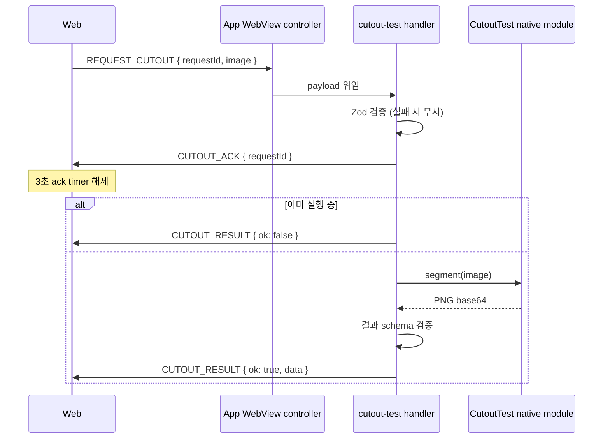
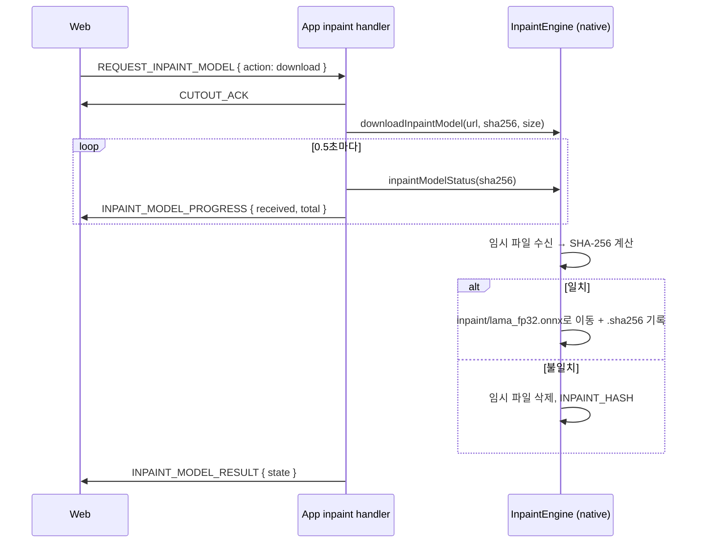

> 표기: 프로젝트 고유 접두사는 ` {prefix} `, 패키지 scope는 ` @scope `로 바꿔 적었다\.

### 문서 목적

React Native WebView 앱 안에서 의상 사진의 배경을 지우는 자동 누끼\(subject segmentation\)와, 칠한 물체를 지우고 배경으로 채우는 AI 지우개\(inpainting\)를 구현한 방식을 정리한다\. Web과 App의 책임 분리, 브리지 계약과 요청 상관관계, 구버전 App 감지, 두 인페인팅 엔진\(PatchMatch·LaMa\)의 구성, 라이브러리 채택·제외 근거, 작업 중 화면 잠금을 다룬다\.

이 기능은 실제 서비스 흐름에 붙기 전의 테스트 화면이다\. 개발 서버에서만 진입 버튼이 보이고, 지우개는 두 엔진을 실기기에서 비교해 하나를 고르기 위해 두 버전을 함께 두고 있다\.

### 1\. 기능 구성

하나의 화면\(` CutoutTestActivity `\)이 ` mode ` 파라미터로 세 모드를 나눈다\. 잘못된 값이나 생략은 ` auto `로 처리한다\.

<div class="notion-table-wrap">
<table>
<thead><tr><th scope="col">모드</th><th scope="col">흐름</th><th scope="col">채우는 방식</th></tr></thead>
<tbody><tr><td><code>auto</code> 누끼</td><td>누끼 실행 → PNG 저장 또는 콜라주에 담기</td><td>네이티브 중앙 객체 분할(배경을 투명하게)</td></tr><tr><td><code>erase-patch</code> AI 지우개 ①</td><td>칠하기 → 지우기 → (반복) → PNG 저장</td><td>사진 안의 비슷한 조각(PatchMatch, Web)</td></tr><tr><td><code>erase-lama</code> AI 지우개 ②</td><td>처음 한 번 모델 받기 → 칠하기 → 지우기 → PNG 저장</td><td>LaMa 모델이 새로 그림(App 네이티브)</td></tr></tbody>
</table>
</div>

두 지우개는 같은 화면·같은 조작이고 채우는 엔진만 다르다\. 조작은 칠하기, 브러시 크기, ` 지우기 `, ` 원본으로 `뿐이며 실행 취소·보호 영역·확대는 두지 않았다\.

초기에는 Native·React Native JS·Web AI 등 6가지 처리 방식을 한 화면에서 비교했다\. 비교를 마친 뒤 채택한 경로만 남겼고, &quot;칠한 영역만 남기기&quot; 방식의 손 지정 편집기와 누끼\+지우개 혼합 모드도 이후 제거했다\. 요구가 &quot;칠한 물체를 지우고 배경으로 채우는 인페인팅&quot;이었기 때문이다\.

### 2\. Web·App 책임 분리

원칙은 &quot;Web은 픽셀을 다루고, App은 OS·모델이 필요한 일만 한다&quot;이다\.

<div class="notion-table-wrap">
<table>
<thead><tr><th scope="col">영역</th><th scope="col">Web (Next.js)</th><th scope="col">App (React Native + Native)</th></tr></thead>
<tbody><tr><td>사진 입력</td><td>선택 UI, 브라우저 파일 입력, 1024px PNG 정규화</td><td>시스템 앨범 단일 선택, 방향 반영 1024px PNG 생성</td></tr><tr><td>결과 저장</td><td>브라우저 다운로드 분기</td><td>iOS 공유 시트, Android 저장 위치 선택기로 PNG 내보내기</td></tr><tr><td>자동 누끼</td><td>결과 alpha를 원본 alpha 이하로 제한, PNG 합성</td><td>iOS Vision / Android ML Kit 중앙 객체 분할</td></tr><tr><td>지우개 ①</td><td>칠하기, 영역 계산, PatchMatch, 합성 전부</td><td>관여하지 않음</td></tr><tr><td>지우개 ②</td><td>칠하기, 영역 계산, 512px 자르기·되돌리기, 합성</td><td>모델 다운로드·검증, ONNX Runtime 추론</td></tr><tr><td>콜라주</td><td>스티커 생성, 보드 배치, 저장용 canvas</td><td>PNG 저장만</td></tr></tbody>
</table>
</div>

PatchMatch 지우개는 Web 안에서 끝나며 브리지를 쓰지 않는다\. LaMa는 512×512 입력·출력만 App에 맡기고, 어디를 자르고 어떻게 합성할지는 Web이 결정한다\. 그래서 App의 추론 코드는 &quot;PNG 두 장을 받아 PNG 한 장을 돌려준다&quot;는 단일 책임만 가진다\.

App 쪽 WebView 메시지 수신·라우팅은 기존 WebView controller 한 곳에서 처리한다\. 네 개의 요청 토큰을 ` cutout-test ` feature의 핸들러로 위임하는 구조다\.

### 3\. 브리지 계약

토큰과 payload schema는 ` packages/shared/src/cutout.ts ` 한 파일이 소유한다\. App과 Web이 같은 Zod schema로 검증한다\.

<div class="notion-table-wrap">
<table>
<thead><tr><th scope="col">토큰</th><th scope="col">방향</th><th scope="col">payload</th></tr></thead>
<tbody><tr><td><code>REQUEST_CUTOUT</code></td><td>web→native</td><td>requestId, PNG base64, width·height(1~1024)</td></tr><tr><td><code>CUTOUT_RESULT</code></td><td>native→web</td><td>성공: PNG·해상도·소요 시간·엔진 / 실패: 메시지</td></tr><tr><td><code>CUTOUT_ACK</code></td><td>native→web</td><td>requestId</td></tr><tr><td><code>REQUEST_CUTOUT_MEDIA</code></td><td>web→native</td><td><code>pick</code> 또는 PNG <code>save</code></td></tr><tr><td><code>CUTOUT_MEDIA_RESULT</code></td><td>native→web</td><td><code>picked</code> PNG / <code>saved</code> / <code>cancelled</code> / <code>error</code></td></tr><tr><td><code>REQUEST_INPAINT</code></td><td>web→native</td><td>512px 사진 PNG, 512px 마스크 PNG(흰색 = 지울 곳)</td></tr><tr><td><code>INPAINT_RESULT</code></td><td>native→web</td><td>성공: 512px PNG·소요 시간·엔진 / 실패: 메시지</td></tr><tr><td><code>REQUEST_INPAINT_MODEL</code></td><td>web→native</td><td><code>status</code> 또는 <code>download</code></td></tr><tr><td><code>INPAINT_MODEL_PROGRESS</code></td><td>native→web</td><td>받은 바이트, 전체 바이트</td></tr><tr><td><code>INPAINT_MODEL_RESULT</code></td><td>native→web</td><td><code>missing</code>·<code>downloading</code>·<code>ready</code>와 바이트 / 실패 메시지</td></tr></tbody>
</table>
</div>

이미지는 모두 base64 문자열이며 schema에서 길이\(최대 8,000,000자\)와 문자 집합을 정규식으로 제한한다\.

파일 경로나 외부 이미지 URL은 Native로 보내지 않는다\. 앨범도 경로 대신 최대 1024px PNG base64를 돌려준다\. 모델 주소·sha256·크기는 App 상수가 소유하고 Web은 알지 못한다\.

### 4\. 요청 상관관계와 구버전 App 감지

#### UUID request ID

모든 요청은 ` shared/lib/random-uuid.ts `의 ` createRandomUuid `로 UUID를 만들고, 결과는 같은 ID일 때만 받아들인다\. LAN HTTP로 띄운 개발용 WebView에서는 secure context가 아니어서 ` crypto.randomUUID `가 없으므로, ` getRandomValues `로 UUID v4를 직접 만든다\(version·variant 비트를 맞춘 뒤 8\-4\-4\-4\-12 형식으로 이어 붙인다\)\.

#### ACK \+ 3초 timeout

누끼 핸들러가 없는 구버전 App은 모르는 메시지를 조용히 버린다\. ack가 없던 때는 이 경우 busy 오버레이가 긴 timeout\(최대 4~5분\) 동안 화면을 잠갔다\. 그래서 App은 요청을 검증한 직후 ` CUTOUT_ACK `를 먼저 보내고, Web은 3초 안에 ack나 결과가 없으면 업데이트 안내로 바로 실패시킨다\. 네 종류의 요청이 모두 같은 ` CUTOUT_ACK `를 공유한다\.

```typescript
const ACK_TIMEOUT_MS = 3_000;

const ackTimer = setTimeout(() => fail('앱이 요청을 받지 못했습니다. 앱을 최신 버전으로 업데이트해 주세요.'), ACK_TIMEOUT_MS);
const timer = setTimeout(() => fail(request.timeoutMessage), request.timeoutMs);
const unsubscribe = subscribeNativeMessages((message) => {
  if (message.type === CUTOUT_ACK) {
    if (cutoutAckSchema.safeParse(message.payload).data?.requestId === requestId) clearTimeout(ackTimer);
    return;
  }
  if (message.type !== request.resultType) return;
  const parsed = request.resultSchema.safeParse(message.payload);
  if (!parsed.success || parsed.data.requestId !== requestId) return;
  cleanup();
  resolve(parsed.data);
});
if (!postMessageToNative(request.type, request.payload)) fail(request.unavailableMessage);
```

` postMessageToNative `가 실패하면\(일반 브라우저\) 바로 &quot;앱에서 실행해 주세요&quot; 안내로 끝난다\. 전체 timeout은 요청마다 다르다\.

<div class="notion-table-wrap">
<table>
<thead><tr><th scope="col">요청</th><th scope="col">전체 timeout</th><th scope="col">기준</th></tr></thead>
<tbody><tr><td>누끼</td><td>240초</td><td>Android 최악 대기(모델 대기·설치·다운로드·추론 합 약 190초)보다 길게</td></tr><tr><td>앨범 선택·저장</td><td>300초</td><td>사용자가 시스템 화면을 조작하는 시간</td></tr><tr><td>LaMa 추론</td><td>180초</td><td>—</td></tr><tr><td>모델 상태 / 다운로드</td><td>15초 / 1시간</td><td>약 208MB를 느린 셀룰러로 받아도 끝나도록</td></tr></tbody>
</table>
</div>

누끼 timeout은 처음 180초였는데, Android 최악 대기보다 짧아 timeout 직후 재시도가 busy로 거부되는 문제가 있어 240초로 늘렸다\. JavaScript timeout은 네이티브 연산의 취소를 뜻하지 않으므로, App 핸들러는 모듈 단위 ` busy ` 플래그로 진행 중 중복 작업을 거부한다\.



### 5\. 자동 누끼

App은 사진 중앙의 객체 하나만 남긴 PNG를 돌려준다\.

<div class="notion-table-wrap">
<table>
<thead><tr><th scope="col">플랫폼</th><th scope="col">구현</th></tr></thead>
<tbody><tr><td>iOS</td><td>Apple Vision <code>VNGenerateForegroundInstanceMaskRequest</code>(iOS 17 이상). instance mask에서 중앙 픽셀의 label을 골라 해당 instance만 원본 크기로 그린다. 중앙이 배경 label이면 오류</td></tr><tr><td>Android</td><td>ML Kit <code>play-services-mlkit-subject-segmentation:16.0.0-beta1</code>. Google Play 서비스에 모델 설치를 명시적으로 요청하고 준비를 기다린다(최대 120초). 중앙 픽셀을 포함하는 subject 중 그 픽셀 alpha가 가장 높은 객체를 고르고, 원래 offset을 적용해 원본 크기 PNG로 반환</td></tr></tbody>
</table>
</div>

OS 내장 모델을 쓴 이유는 다운로드·라이선스 부담이 없고 사진이 기기를 떠나지 않기 때문이다\. 비교 당시 저장했던 참고 결과에서 옷걸이를 제거하고 경계가 가장 매끈했던 것도 근거로 기록돼 있다\. 다만 이 근거는 macOS에서 실행한 Vision 참고 결과 한 장이다\.

Web은 결과 크기가 요청과 같은지 확인하고, 원본에서 이미 투명했던 픽셀은 결과가 되살리지 못하도록 alpha를 원본 이하로 제한한다\.

```typescript
for (let i = 0; i < pixels.alpha.length; i++) pixels.alpha[i] = Math.min(pixels.alpha[i], base.alpha[i]);
```

모델 실행이 실패했을 때 다른 알고리즘의 성공 결과로 대체하지 않는다\. 결과 없는 방식을 임의 이미지로 채우지 않는 것도 같은 원칙이다\.

### 6\. AI 지우개 공통: 칠한 영역 계산과 합성

두 엔진은 영역 계산과 합성을 공유하고 &quot;구멍을 채우는 함수&quot;만 바꾼다\. 계산은 모두 Canvas ` ImageData `와 TypedArray\(` Uint8Array `, ` Uint8ClampedArray `, ` Float32Array `\)로 한다\.

1. 칠한 마스크를 3px 넓혀\(` dilateMask `\) 그림자·윤곽까지 구멍으로 삼는다\.
1. 구멍을 감싸는 최소 사각형\(` maskBounds `\)을 구한다\.
1. 사각형을 칠한 크기의 절반\(최소 24px\)만큼 사방으로 넓혀 참고 영역\(` contextRect `\)을 정한다\. 주변이 넓을수록 배경 무늬를 잘 찾지만 계산이 늘어난다\.
1. 참고 영역만 잘라 엔진에 넘긴다\.
1. 채운 결과를 구멍 픽셀에만 덮어쓴다\(` compositeMasked `\)\.

```typescript
export function compositeMasked(rgba, width, patch, rect, mask) {
  const out = new Uint8ClampedArray(rgba);
  for (let y = 0; y < rect.height; y++) {
    for (let x = 0; x < rect.width; x++) {
      const target = (rect.y + y) * width + rect.x + x;
      if (!mask[target]) continue;          // 칠하지 않은 픽셀은 그대로
      const from = (y * rect.width + x) * 4;
      out[target * 4] = patch[from];
      out[target * 4 + 1] = patch[from + 1];
      out[target * 4 + 2] = patch[from + 2];
    }
  }
  return out;
}
```

칠하지 않은 픽셀은 바이트 단위로 원본 그대로다\. 지운 뒤에는 칠한 부분을 비워 결과 위에 다시 칠하고 지울 수 있고, ` 원본으로 `는 지운 결과와 칠한 부분을 모두 버린다\.

브러시 크기는 화면 픽셀 기준이라 사진 해상도와 무관하게 같은 굵기로 칠해진다\. 칠한 부분은 사진 canvas 위에 반투명 파랑으로 겹쳐 보여 준다\.

### 7\. 지우개 ①: Web PatchMatch

라이브러리 없이 PatchMatch와 다중 해상도 EM\(Wexler·Barnes 방식\)을 직접 구현했다\.

- 사진을 최대 6단계까지 2배씩 줄인다\. 축소할 때는 알려진 픽셀만 평균하고, 네 칸이 모두 구멍이면 구멍으로 남긴다\.
- 가장 거친 단계는 구멍 가장자리부터 이웃 평균으로 한 겹씩 채워 시작값을 만든다\.
- 단계마다 PatchMatch로 구멍 패치의 최근접 대응을 찾고\(propagation·random search\), 대응 패치의 색을 투표해 갱신하는 EM을 반복한다\. 거친 단계 결과를 다음 단계 시작값으로 올린다\.
- 난수는 seed 고정 ` mulberry32 `라 같은 입력이면 같은 결과가 나온다\. 단위 테스트가 이 결정성을 검사한다\.

메인 스레드에서 동기로 돌기 때문에 촘촘한 단계의 탐색 반경\(` FINE_SEARCH_RADIUS = 8 `\)과 반복 수를 줄여 속도를 맞췄다\. 품질이 부족하면 이 값부터 올리도록 코드에 주석으로 남겨 두었다\. 기록된 측정값은 데스크톱 Node 기준 참고 영역 600px·구멍 220px에 약 0\.6초, 1024px·350px에 약 1\.5초다\.

실행 전에 rAF 두 번을 기다려 작업 중 모달이 먼저 그려지게 한다\. 동기 계산이 시작되면 그 사이에는 화면이 갱신되지 않기 때문이다\.

### 8\. 지우개 ②: 네이티브 LaMa

#### 왜 네이티브인가

LaMa\(big\-lama\) ONNX 모델\(` lama_fp32.onnx `, Apache\-2\.0, 208,044,816바이트, 512×512 고정\)을 쓴다\. WebView WASM은 이 크기 모델의 메모리·속도 한계가 있어 제외하고, App 네이티브에서 ONNX Runtime 1\.30\.0으로 실행한다\.

<div class="notion-table-wrap">
<table>
<thead><tr><th scope="col">플랫폼</th><th scope="col">런타임</th><th scope="col">실행 공급자</th></tr></thead>
<tbody><tr><td>iOS</td><td><code>onnxruntime-objc</code> (CocoaPods)</td><td>CoreML을 먼저 시도하고, 세션 생성·실행이 실패하면 CPU 세션으로 한 번 재시도</td></tr><tr><td>Android</td><td><code>com.microsoft.onnxruntime:onnxruntime-android</code></td><td>기본 CPU</td></tr></tbody>
</table>
</div>

세션은 처음 쓸 때 한 번 만들고 재사용한다\.

#### 512px 자르기와 되돌리기

Web은 6절의 참고 영역을 512×512로 늘려 PNG로 만든다\. 사진은 보간해서 늘리고, 마스크는 ` imageSmoothingEnabled = false `로 보간 없이 늘려 0/1 경계를 유지한다\. 투명 픽셀이 있으면 모델 입력 색이 흐트러지므로 사진은 alpha를 255로 채워 불투명하게 보낸다\.

```typescript
function toModelPng(rgba: Uint8ClampedArray, rect: Rect, smooth: boolean) {
  // rect 크기 canvas → INPAINT_SIZE(512) 정사각형 canvas로 drawImage
  target.context.imageSmoothingEnabled = smooth;
  target.context.drawImage(source.canvas, 0, 0, INPAINT_SIZE, INPAINT_SIZE);
  return target.canvas.toDataURL('image/png').split(',')[1];
}
```

돌려받은 512px 결과는 다시 참고 영역 크기로 그려 픽셀을 읽고, PatchMatch와 같은 ` compositeMasked `로 구멍에만 합성한다\.

App은 텐서 변환만 한다\. 입력은 ` image ` \[1,3,512,512\] 0~1과 ` mask ` \[1,1,512,512\] 0/1이고, 출력 0~255를 clamp해 불투명 PNG로 돌려준다\. Android는 작은 압축 PNG가 거대한 비트맵으로 풀려 OOM이 나지 않도록 ` inJustDecodeBounds `로 512×512인지 먼저 확인하고 아니면 ` INPAINT_INPUT `으로 거절한다\.

#### 모델 다운로드와 검증

모델은 앱 번들에 넣지 않고 처음 쓸 때 한 번 내려받는다\. 주소는 Hugging Face ` Carve/LaMa-ONNX `의 특정 커밋에 고정하고, sha256·크기는 App 상수로 둔다\.



- 저장 위치는 iOS Application Support\(iCloud 백업 제외\), Android ` filesDir `의 ` inpaint/ ` 디렉터리다\.
- ` .sha256 ` 파일이 있고 값이 기대값과 같아야 준비 완료로 본다\.
- iOS는 다운로드 파일을 같은 디렉터리로 먼저 옮겨 최종 rename이 원자적이 되게 한다\.
- Android는 redirect를 최대 5번 직접 따라가며 https만 허용한다\. iOS는 URLSession이 따라간다\.
- 오류 코드는 ` INPAINT_NOT_READY `, ` INPAINT_INPUT `, ` INPAINT_BUSY `, ` INPAINT_DOWNLOAD `, ` INPAINT_HASH `, ` INPAINT_FAILED `다\.

Web은 화면 진입 시 ` status `로 상태를 확인한다\. 없으면 ` 모델 받기 (약 208MB) ` 버튼을 보여 주고, 내려받는 동안 작업 중 모달에 진행률\(%·MB\)을 띄운다\. 화면을 다시 열었을 때 아직 받는 중이면 끝날 때까지 1초마다 다시 묻는다\. 모델이 준비되기 전에는 ` 지우기 `를 막는다\.

### 9\. PatchMatch와 LaMa 비교

<div class="notion-table-wrap">
<table>
<thead><tr><th scope="col">항목</th><th scope="col">PatchMatch (Web)</th><th scope="col">LaMa (App 네이티브)</th></tr></thead>
<tbody><tr><td>추가 의존성</td><td>없음</td><td>ONNX Runtime 2종</td></tr><tr><td>다운로드</td><td>없음</td><td>최초 1회 약 208MB</td></tr><tr><td>채우는 방식</td><td>사진 안의 비슷한 조각 복사</td><td>생성형 모델이 새로 그림</td></tr><tr><td>강한 장면</td><td>하늘·잔디처럼 반복되는 배경</td><td>복잡한 배경</td></tr><tr><td>한계</td><td>사진에 없는 구조는 만들지 못함</td><td>512px 고정이라 영역을 늘이거나 줄임, 비율이 다르면 늘어난 채 추론</td></tr><tr><td>Android 에뮬레이터 측정</td><td>약 0.18초</td><td>약 5.71초(첫 실행은 세션 생성 포함 약 11.48초)</td></tr></tbody>
</table>
</div>

같은 사진·같은 칠하기로 옷걸이 고리를 지운 비교에서 LaMa는 뒤쪽 옷 결을 이어 자연스럽게 채웠고, PatchMatch는 가까운 셔츠 조각을 가져와 흰 덩어리가 남았다\. 다만 실기기 속도·메모리와 iOS 추론은 아직 검증하지 않았기 때문에 두 버전을 함께 둔다\. 비교 결과 한 버전을 고르면 다른 쪽의 코드와 의존성을 제거하기로 규칙 문서에 적어 두었다\.

### 10\. 라이브러리 채택과 제외

<div class="notion-table-wrap">
<table>
<thead><tr><th scope="col">후보</th><th scope="col">결정</th><th scope="col">근거</th></tr></thead>
<tbody><tr><td>iOS Vision, Android ML Kit, ONNX Runtime 1.30.0</td><td>채택</td><td>플랫폼 내장 분할, LaMa 네이티브 추론</td></tr><tr><td><code>@imgly/background-removal</code> (Web IS-Net WASM)</td><td>제외·제거</td><td>AGPL-3.0, 느림, 옷걸이와 주변 옷이 남음. <code>onnxruntime-web</code>도 함께 제거</td></tr><tr><td><code>base64-js</code></td><td>제외·제거</td><td>RN JS 색상 거리 마스크 실험과 함께 제거</td></tr><tr><td>네이티브 전체 전경 분할</td><td>제외</td><td>주변 옷까지 포함됨</td></tr></tbody>
</table>
</div>

### 11\. 사진이 기기를 떠나지 않게 하는 경계

- 입력 사진은 방향을 반영한 최대 1024px PNG로 정규화한다\. 브라우저 파일은 이미지 MIME과 20MB 이하만 허용한다\.
- App은 알파/PNG base64만 Web에 전달하고 저장소·외부 서버로 업로드하지 않는다\.
- 외부에서 받는 것은 LaMa 모델 파일뿐이며, Android 누끼 모델은 Google Play 서비스가 내려받는다\.
- 앨범은 iOS PHPicker, Android AndroidX PickVisualMedia\(미지원 OS는 시스템 문서 선택기 fallback\)로 한 장만 고른다\. 광범위한 앨범 읽기·저장소 권한은 요청하지 않는다\. 결과는 iOS 공유 시트, Android ` ACTION_CREATE_DOCUMENT `로 사용자가 고른 위치에 저장한다\.

### 12\. 스티커 콜라주

누끼 결과를 흰 테두리 스티커로 바꿔 4:5 보드\(1080×1350\)에 모은다\. 네이티브 변경 없이 Web canvas만 쓴다\.

- 불투명 픽셀\(alpha ≥ 128\)까지의 거리를 두 번 훑는 1·√2 가중 chamfer 근사로 구하고, 긴 변 3%\(최소 4px\) 두께의 흰 테두리를 두른 뒤 테두리까지 포함해 잘라 낸다\.
- 원본을 흰 테두리 위에 source\-over로 합성한다\(` A = a + ring × (1 − a) `\)\. 처음에는 테두리 밖 희미한 픽셀을 흰색과 섞은 뒤 원래 alpha를 다시 줘 흰 안개처럼 보였고, 이 식으로 고쳤다\.
- 새 스티커는 2열 지그재그로 놓고, 끌면 누른 스티커가 맨 앞으로 온다\. 끄는 중 두 번째 손가락이 drag를 덮어쓰지 않도록 ` pointerId `를 저장하고 다른 포인터는 무시한다\.
- 지운 스티커의 디코딩 이미지는 캐시에서 지워 WebView 메모리가 계속 늘지 않게 한다\.
- 배경은 seed 고정 레오파드\(코드로 그림\)·크림·핑크다\. 화면 표시와 저장이 같은 그리기 함수를 쓰고, 저장 때는 선택 표시를 빼고 다시 그린다\.

회전·핀치 확대·배경 사진·영구 저장은 두지 않았다\. 사진·결과·콜라주는 새로고침하면 사라진다\.

### 13\. 작업 중 화면 잠금

긴 작업 동안 사용자가 화면을 떠나거나 같은 작업을 다시 누르지 못하게 두 겹으로 막는다\.

- ` CutoutBusy `: 앱 provider에서 한 번 마운트하는 ` <dialog> `다\. ` showModal() `로 배경을 inert로 만들고, ` onCancel `에서 ` preventDefault() `로 Escape 닫기를 막는다\. 진행 문구\(다운로드 진행률 포함\)를 ` role="status" `로 알린다\.
- ` StackScreen `의 ` blockNavigation={busy} `: 작업 중 swipe\-back, 네이티브 hardware back, 기본 헤더 back을 막는다\.

모든 작업 함수는 시작 시 ` busy `를 확인하고 ` finally `에서 해제한다\. App 핸들러의 ` busy `와 합쳐 Web·App 양쪽에서 중복 실행을 거부한다\.

### 14\. 개발 전용 진입

홈 헤더의 ` 누끼 `·` AI 지우개 `·` 지우개 LaMa ` 버튼은 ` process.env.NODE_ENV === 'development' `\(개발 서버\)에서만 보인다\. 배포 빌드에는 버튼이 없고, URL로 직접 진입하는 것은 막지 않는다\. 화면과 네이티브 누끼·LaMa, 공유 브리지 계약은 이후 실제 기능에서 다시 쓰기 위해 남겨 두었다\.

### 15\. 테스트

Web unit은 브러시·좌표, 영역 계산·합성, PatchMatch\(단색·반복 무늬·결정성\), 스티커 테두리·반투명 합성, 콜라주 배치를 검사한다\. Web integration은 브리지 공통 대기\(ack·timeout\)와 LaMa 모델 상태·진행률을, App integration은 손상 payload, 네이티브 모듈 부재, 동시 실행 차단, 다운로드 진행률과 해시 실패 전달을 검사한다\. Android는 텐서 변환 JVM 테스트가 있다\. E2E\(Chromium·WebKit\)는 실제 PatchMatch 실행과 칠한 곳만 바뀌는지, 콜라주 조작·저장, 배포 빌드에 버튼이 없는지를 확인한다\. 네이티브 누끼·LaMa는 E2E에서 대역 응답이라 실제 품질의 증거가 아니다\.

### 현재 제약

- iOS 시뮬레이터에서 Vision 추론이 초기화 오류로 실패하고, CPU compute device를 지정해도 재현된다\.
- Android 에뮬레이터에서는 ML Kit subject segmentation 내부 SIGSEGV가 관찰돼 해당 에뮬레이터 계열에서 SDK 호출을 막고 명시적 오류를 반환한다\. ML Kit subject segmentation은 beta다\.
- 자동 누끼의 채택 근거는 macOS Vision 참고 결과 한 장이며, iOS·Android 실기기의 누끼 품질은 검증하지 않았다\.
- PatchMatch는 메인 스레드 동기 실행이라 폰에서는 데스크톱 측정값보다 느리다\.
- LaMa는 512×512 고정 입력이라 큰 구멍일수록 결과 해상도가 낮아지고, 비율이 다른 영역은 늘어난 채 추론한다\.
- LaMa의 실기기 속도·메모리, iOS 추론과 CoreML 가속은 검증하지 않았다\.
- 모델은 외부 저장소에서 바로 받는다\. 자체 스토리지로 옮기면 App 상수의 주소만 바꾼다\.
- 두 지우개 중 하나를 고르기 전까지 의존성과 코드가 양쪽 모두 남아 있다\.

### 참고

- Apple Vision ` VNGenerateForegroundInstanceMaskRequest `
- Google ML Kit Subject Segmentation
- ONNX Runtime Mobile
- LaMa: Resolution\-robust Large Mask Inpainting with Fourier Convolutions
- PatchMatch: A Randomized Correspondence Algorithm for Structural Image Editing
- 관련 글: Native\-Web 브리지 계약과 보안 설계, WebView 하이브리드 앱의 프론트엔드 아키텍처 전략, StackFlow 기반 WebView: 커스텀 Swipe\-back 구현 배경과 설계

### 구현 근거와 검토 범위

2026\-11\-11, FE commit ` 645a584 ` 기준으로 코드·설정과 관련 변경 이력을 대조했다\. 근거: ` web/src/shared/lib/random-uuid.ts `, ` web/src/features/cutout-test/README.md `\. 문서에 인용한 이전 검증 기록과 이번 검토를 구분하며, 이번 작업에서 앱·브라우저 런타임 테스트를 재실행하지 않았다\.

### 관련 구현 문서

[Native\-Web 브리지 계약과 보안 설계](<https://app.notion.com/p/4150d0f75cd681acb3bffe3589d97679>)

[WebView 하이브리드 앱의 테스트 계층 설계](<https://app.notion.com/p/4150d0f75cd681ddaf86eac2325c2082>)
